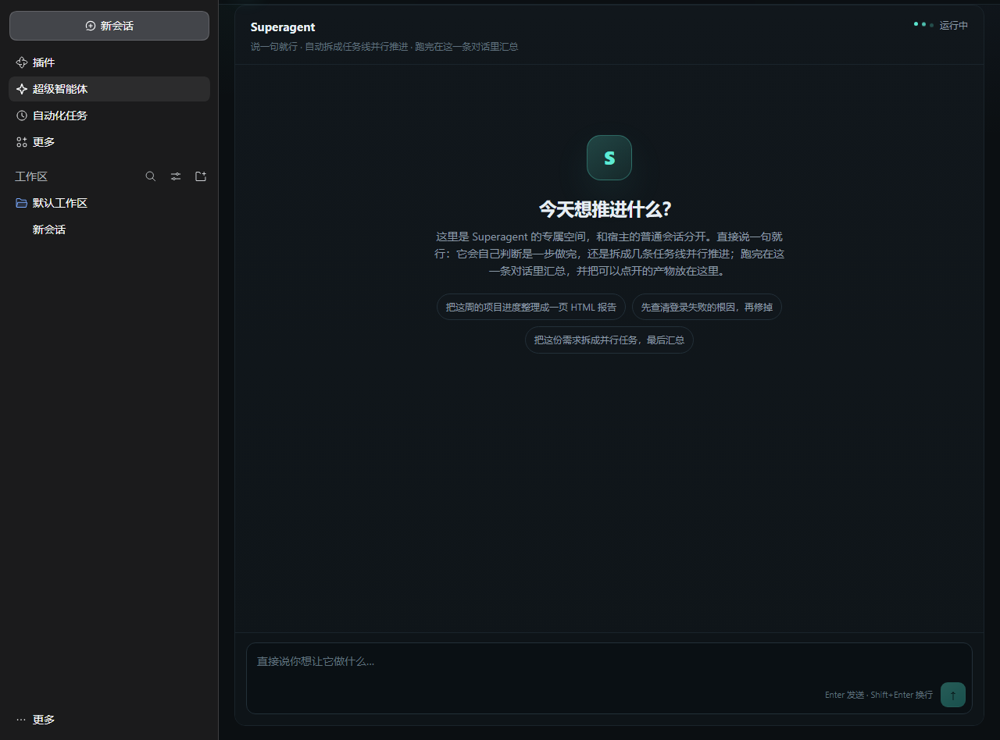
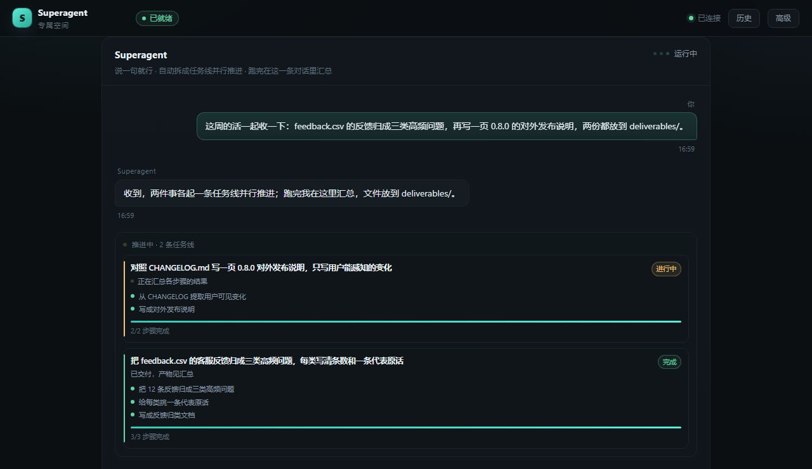
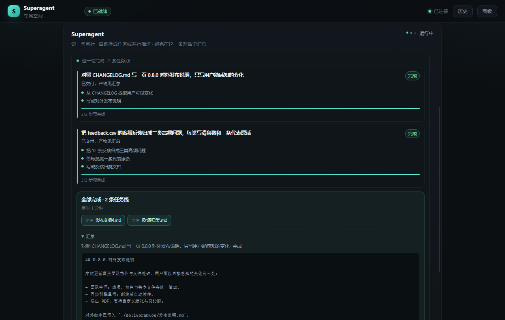
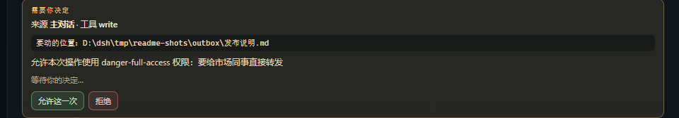
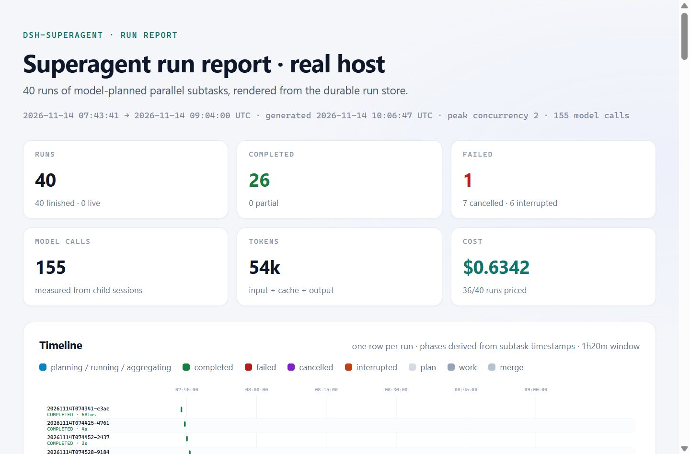

[中文](README.md) | English

# dsh-superagent

Give it one goal. It splits the work into parallel task lines, runs them, and reports back in a single conversation — interrupting you only for the decisions that matter.



## The problem you have now

When work from several areas lands at once, the hard part is rarely the work itself. It is managing the sessions: a launch note for product, a feedback triage for support, a numbers check for the data team. Three sessions, constant tab-switching, and you have to remember what each one is doing and what comes next. One stuck session pulls your attention away from the other two.

dsh-superagent takes that over. You state the goal once; it splits the work, runs it, keeps an eye on it, and gathers the result into one conversation.

## What it takes off your plate

- **Give orders.** Describe the outcome in one sentence. It plans parallel subtasks itself — four at a time by default — so you do not have to break the work down.
- **Wait for the handoff.** Progress and artifacts for every task line live in the same conversation; when everything finishes you get one summary, with artifacts you can open directly.
- **Only pulled in for real decisions.** Writing outside the workspace or asking for elevated permissions stops the run and raises a card with the source, tool, path, and reason. It continues only after you allow it; if you do not, the action is cancelled — never approved on your behalf.

### Task-line cards: several jobs at once



### All done: summary and artifacts



### A card appears only when you need to decide



## Quickstart

Three steps. The desktop app and the CLI install the same plugin; each step says where to click.

### 1. Install

Desktop: **Plugins** → **Add plugin** → enter `@xiangyixie/dsh-superagent@0.17.0` → install.

CLI:

```bash
dsh plugin --profile web add @xiangyixie/dsh-superagent@0.17.0
```

**Restart DSH** afterwards — plugins are loaded once at host startup. You can also add the [plugin index](https://raw.githubusercontent.com/LittleChenLiya/dsh-superagent/main/plugin-index.json) on the **Discover** page for one-click installs; upgrades are always remove-then-add.

### 2. Point it at a model

The default profile uses `deepseek-official` / `deepseek-flash`. Put its key in the environment that starts the host:

```bash
export DEEPSEEK_API_KEY=sk-...      # PowerShell: $env:DEEPSEEK_API_KEY="sk-..."
```

If your profile already holds a working conversation, you are done. For DashScope, a self-hosted gateway, or another route, see [Other routes](#other-routes).

### 3. Run it once

After the restart, open **Superagent** in the sidebar (CLI host: open the local console address it prints) and send:

> Wrap up this week: group the feedback in feedback.csv into three recurring themes, then write a one-page 0.8.0 release note. Put both in deliverables/.

Task lines start immediately; progress, the summary, and the artifacts all stay in that one conversation. Workers that need to run commands such as `npm test` need [per-worker command permissions](#per-worker-command-permissions) first.

## FAQ

**Why does it ask me questions?**

Only for actions that cross the workspace boundary or need elevated permissions. The card names the source (which task line, which subtask), the tool, the target path, and the reason. If nobody answers within 10 minutes, the action is cancelled — it is never approved automatically.

**Can I use it without the desktop app?**

Yes. The plugin runs on DeepSeek Harness; a local host started with `dsh --profile web` gives you the same console, task lines, and approval cards. The desktop app only adds the sidebar entry, so you do not have to remember the address.

**What does it cost?**

Every run pays for at least one planning call, several model calls per subtask, and one aggregation. The sample run in this document with two subtasks used 4 calls and about 4.6k input / 0.5k output tokens; longer work costs more. No prices are built in; configure `pricing` and each run prints its cost. Hard caps are `maxModelCallsPerRun` (default 80) and `maxTokensPerRun` (default 2,000,000).

## When not to use it

Work that one model call can answer, tasks that need sub-agents to delegate further (depth is capped at 1), and cases that need separate credentials or stronger isolation for children are not worth it. Every run also pays for one planning and one aggregation pass, so latency-sensitive single-step work is a poor fit.

## Requirements

- Node `>= 24.9.0`.
- DeepSeek Harness `>= 0.2.2-rc.1 < 0.3.0`, with the base bundle (`tools`, `agents`, `subagents`).
- A model route that can call tools, with its key in the environment.

## Configuration

Row config in `<profile>/cordis.patch.yml`:

```yaml
- id: superagent
  config:
    maxSubtasks: 8
    maxParallel: 4
    maxActiveRuns: 2
```

| Key | Default | Meaning |
| --- | --- | --- |
| `stateDir` | `$DSH_HOME/state/superagent` | Run state root. |
| `provider` | `spawn` | Subagent backend used for planner, workers, aggregator. |
| `childProvider` | parent's | Optional provider route override for child agents. |
| `childModel` | parent's | Optional model override for child agents. |
| `childPreset` | none | Agent preset for child agents. A preset owns the child's tool set; this host has no per-run tool filter. |
| `plannerPreset` | none | Agent preset for the planner child only. Use a tool-less preset: a planner only reads its prompt and returns JSON, and inherited tools invite a tool loop instead of a plan. Requires the host to compose an `agentPresets` registry. |
| `plannerProvider` | parent's | Optional provider route override for the planner child. |
| `plannerModel` | parent's | Optional model override for the planner child. Planning is a single JSON turn, so a stronger model here is usually cheaper than fixing plans after workers ran. |
| `plannerTimeoutSeconds` | `120` | Wall-clock bound per planner attempt. On expiry the attempt is stopped and recorded; no fallback worker is started. |
| `plannerMaxModelCalls` | `20` | Model calls the planning phase may spend across attempts; `0` disables. Once spent, the run fails as unplannable instead of draining the run budget. |
| `maxSubagentDepth` | `1` | How deep children may delegate. `1` forbids grandchildren; `provider-managed` leaves it to the backend. |
| `commandWorkerPermission` | `inherit` | Sandbox mode for workers whose plan entry declares a command capability (`shell`, `bash`, `pwsh`, …). `danger-full-access` lets those workers actually run commands on a `workspace-write` host; every other child keeps inheritance. See [Per-worker command permissions](#per-worker-command-permissions). |
| `maxSubtasks` | `8` | Cap on planned subtasks. A tool argument can only lower it, never raise it; hard max 16. |
| `maxParallel` | `4` | Subtasks executing at once. A tool argument can only lower it; hard max 8. |
| `maxActiveRuns` | `2` | Active runs per state directory, across profiles and hosts that share it. A further `superagent_start` is rejected unless it passes `queue: true`, in which case it waits for a slot instead. `superagent_resume` is not counted and works when the cap is full, because it only finishes work that already exists. |
| `maxQueuedRuns` | `5` | Runs allowed to wait for a free slot at once; hard max 32. `0` turns queueing off, so every start over `maxActiveRuns` is rejected again. |
| `queueTimeoutMinutes` | `30` | How long a queued run waits before it fails without ever starting; nothing is spent. |
| `queueOnFull` | `false` | Queue every start that exceeds `maxActiveRuns`, not only the ones that pass `queue: true`. |
| `attempts` | `2` | Attempts per subtask before it is marked failed. A failure that looks transient (quota, rate limit, timeout, 5xx) waits 2s, then 4s, then 8s before the next attempt. |
| `deadlineMinutes` | `120` | Wall-clock budget; on expiry the run ends `partial` or `failed`. |
| `maxModelCallsPerRun` | `80` | Hard cap on child model calls per run; `0` disables. |
| `maxTokensPerRun` | `2000000` | Hard cap on prompt + completion tokens per run; `0` disables. |
| `pricing` | empty | Per-1M-token prices, keyed exactly as the usage log names the model (`provider/model`). Nothing is priced out of the box. |
| `resultCapBytes` | `32768` | Bytes kept per subtask report. |
| `notifyOnComplete` | `true` | Master switch for proactive messages. Off means the plugin never wakes the session. |
| `maxNotificationsPerHour` | `3` | Proactive messages allowed per hour. Runs above the cap are folded into one summary; `0` disables the cap. |
| `notifyRetries` | `2` | Extra delivery attempts when the host refuses a wake-up; messages for one session are delivered in order. |
| `notifyRetryDelayMs` | `2000` | First delay between those attempts; it doubles per attempt, capped at 60s. |
| `autoResumeRounds` | `1` | Extra rounds that retry subtasks which failed in a way that looks transient, before the failure is reported; `0` disables. |
| `childModelFallback` | none | Model used on such a retry (quota, rate limit, timeout). Unset keeps the configured route. |
| `memory` | `true` | Cross-run notebook. See [Cross-run memory](#cross-run-memory). |
| `memoryScope` | `default` | Notebook file per scope, so unrelated projects can stay apart. Run notes are written here; `rules` and `profile` are read into every run. |
| `memoryMaxEntries` | `60` | Compaction threshold: a write that would exceed it compacts the notebook down to this many notes (400 lines / 128 KB are hard caps too). |
| `memoryMaxAgeDays` | `30` | Notes older than this are ignored, then compacted away. |
| `memoryDigestEntries` | `12` | Notes injected into a prompt. |
| `memoryDigestChars` | `1600` | Character budget for the note part of that prompt. |
| `memoryUserProfile` | `false` | Cross-task user profile (facts, preferences, decisions) under `<stateDir>/user-memory`. Off means nothing is constructed and no directory is created. See [User profile](#user-profile). |
| `keepRuns` | `0` | Delete terminal runs older than this many days at mount; `0` keeps everything. |
| `guard` | on | Worker path and command policy. See [Worker safety guard](#worker-safety-guard) for every default and the reason behind it. |
| `audit` | `true` | Append-only audit trail. It only observes; turning it off removes the trail, never the run behaviour. |
| `policyFile` | `<stateDir>/policy.json` when it exists | Permission policy. Unset and absent means no policy, i.e. the old behaviour. |
| `auditDir` | `<stateDir>/audit` | Where `audit.jsonl` and its exports live. |
| `controlPort` | off | Loopback port for the embedding surface; `0` picks a free one. See [docs/embedding.md](https://github.com/LittleChenLiya/dsh-superagent/blob/main/docs/embedding.md). |
| `workspaceIsolation` | `false` | Give every worker its own git worktree so parallel workers cannot overwrite each other. See [Per-worker workspace isolation](#per-worker-workspace-isolation). |
| `workspaceRoot` | session directory (see `workspaceBase`) | Repository the workers are isolated in when `workspaceIsolation` is on. Must be a git working tree with at least one commit. |
| `workspaceBase` | `session` | What isolation is based on. `session` uses the current session's directory (or the repository root git resolves from it) and honours `workspaceRoot` only when it names the same directory; `config` restores the old behaviour of always using `workspaceRoot`. A mismatch prints `workspace warning` in status and in the log instead of silently isolating in another project. |
| `workbenchPort` | off | Loopback port for the local workspace panel; `0` picks a free one. The panel reads and edits files itself, without a host API. |
| `workbenchRoot` | `process.cwd()` | Directory the panel may browse and edit. Every path outside it is refused. |
| `consolePort` | off | Loopback port for the conversation console; `0` picks a free one. Requires the host `sessionController` service. |
| `consoleRoot` | `workbenchRoot`, then host cwd | Directory the console's conversation session joins. |
| `consolePreset` | host default | Agent preset id the console session mounts. Tools follow this preset, not this plugin. |
| `boardPort` | off | Loopback port for the task board; `0` picks a free one. One page with subtask cards, the human inbox, and the built-in templates. See [Task board](#task-board). |
| `boardRoot` | `consoleRoot`, then `workbenchRoot` | Directory the board's own conversation session joins, and where template-started runs work. |
| `schedulerTickSeconds` | `30` | How often a live plan is checked for a due window, in seconds (1–3600). Nothing is armed until a plan exists, so this has no effect on an install with no schedules. |
| `schedulerHumanPriority` | `true` | Default for a plan's `human_priority`: a scheduled run may not take the last free concurrency slot. |
| `schedulerMaxConsecutiveFailures` | `3` | Consecutive failed executions before a plan pauses itself and says so once (1–20). |

### Switching models

Model choice is configuration, not code. By default child agents inherit the
session's model from the profile's `agent-default-model`. To pin children to a
specific route, set both keys and restart the host:

```yaml
- id: superagent
  config:
    childProvider: dashscope
    childModel: qwen-flash
```

Nothing about a model id is compiled into the plugin. API keys are read from
the environment variable named by the route; the plugin never stores a key. The
default profile's route is `deepseek-official` and reads `DEEPSEEK_API_KEY`.

### Other routes

The example above assumes a DashScope route is installed in the profile. It is
not part of the base bundle: the default profile has no `dashscope` provider and
`DASHSCOPE_API_KEY` alone will not create one. Add the route first (see the
harness docs for LLM plugins), then name it in `childProvider`.

### Child tools and recursion

`maxSubagentDepth: 1` is passed to the host as `maxDepth`, so a worker cannot
create its own children. This is enforced by the host, not by prompting, and a
provider that cannot enforce it makes `superagent_start` fail with an explicit
error instead of silently running unbounded.

There is **no** enforced tool allowlist on `dsh@0.2.2-rc.1`. The host's
subagent start request has no tool filter, and its own `subagent` tool rejects a
`toolFilter` config and points at agent presets. `childPreset` is therefore the
supported way to narrow a child's tools; without a dedicated preset, workers
inherit the session's tools. The `superagent_*` tools still exist in their tool
list, but the run tools (`superagent_start`, `superagent_resume`, `superagent_cancel`,
`superagent_followup`, `superagent_inject`, `superagent_answer`) refuse to run from a worker session;
only the top-level agent manages runs.

### Per-worker command permissions

A `workspace-write` host sandbox refuses a child process spawned with piped
stdio (`EPERM`). A worker that needs to run `npm test` therefore cannot do so
under the inherited policy, and this plugin will not turn the sandbox off for
the whole machine. `commandWorkerPermission` raises it only for the workers that
declare it:

```yaml
- id: superagent
  config:
    commandWorkerPermission: danger-full-access
```

With that setting, a worker whose plan entry has `requires` containing a command
capability (`shell`, `bash`, `sh`, `zsh`, `fish`, `terminal`, `pwsh`,
`powershell`, `cmd`, `run_command`, `exec_command`) gets full access. Planner,
aggregator, acceptance judges, and workers without such a capability keep the
inherited mode.

How it works, and why it is a delegation trick rather than a host feature:

- The host has no per-subagent permission field. What it does have is
  inheritance: `subagents.startActivation` captures the parent session's last
  `sandbox/mode` event **synchronously, before its first `await`**, and seeds
  that mode into the child.
- For one qualifying worker, the plugin appends `sandbox/mode:
  danger-full-access` to the parent session, calls `startActivation`, and
  appends the previous mode back in a `finally` — all in the same synchronous
  tick, with no `await` between those steps. A concurrent call can therefore
  never observe the temporary override, and the child still captures it.
- Both steps append one `sandbox/mode` event; the plugin never uses
  `permissionPresets.set()`, whose `custom` state cannot be restored by name.
- The approval policy is pinned to `never` for that child by the host's own
  delegation capture, not by this plugin.
- Each step is written to the audit trail as `worker.escalate` and
  `worker.restore` with `runId`, `subtaskId`, and the reason (the declared
  capability). When `audit` is off, no audit line is written; the escalation
  still behaves the same.

Limits: this only applies to in-process providers whose child is created from
the parent session in the same host process (`provider: spawn`). An upstream
change to when the override is captured — or to delegation inheritance itself —
makes this silently fall back to inheritance rather than fail the run. The
temporary event also pins the previous mode in the parent log when the parent
had no explicit override: it records the deployment default, which is
behaviourally identical until that default changes.

### Per-worker workspace isolation

Parallel workers are independent agents, but by default they share one working
directory: two subtasks that edit the same file overwrite each other, and the
last writer wins. `workspaceIsolation` fixes that by giving each worker its own
checkout.

```yaml
- id: superagent
  config:
    workspaceIsolation: true
    workspaceRoot: /home/me/projects/api      # or C:\work\api on Windows
```

**Why git worktrees rather than a directory copy.** The hard half of isolation
is merging the results back. A worktree gives that for free: a real three-way
merge with conflict detection, both sides preserved as refs, and one command the
user can run to finish by hand. A recursive copy would either need a diff3
engine (a dependency this package does not have) or overwrite the main checkout,
which is the bug the feature exists to prevent. A worktree also shares the object
database and ignore rules, so a worker sees the real repository without a full
copy of it. Worktrees live under `.superagent/worktrees/<runId>/w<n>` inside the
directory the host was started in — the repository itself when that is the
starting directory. The host's `workspace-write` sandbox takes its writable
boundary from the session cwd, so a checkout under the state directory, or
inside a repository the host was not started in, would be denied every write.
The pool carries its own `.gitignore`, so worker checkouts never leak into the
user's next commit or make the main checkout look dirty.

**What happens during a run.** Each worker is given
`superagent/<runId>-w<n>`, a branch created from the main checkout's `HEAD`. Its
prompt names the absolute path and forbids touching anything else, switching
branches, committing, merging, or pushing. When the worker finishes, the run
commits whatever it left in the checkout (so a model that forgot to commit still
loses nothing; git hooks are skipped so a pre-commit hook cannot block the merge)
and then merges the branches into the main checkout **one at a time**, after all
subtasks are done.

**What you see when a merge conflicts.** The merge is aborted, so the main
checkout is restored exactly as it was and no conflict markers are left in it.
The outcome is recorded on the run and printed by `superagent_status`:

```
workspace conflict: [2] src/routes.js, src/index.js — branch superagent/20261115T101500-ab12-w2
kept at <repository>/.superagent/worktrees/20261115T101500-ab12/w2; the main checkout was restored, so nothing
was lost. Resolve with: git -C "/home/me/projects/api" merge superagent/20261115T101500-ab12-w2
```

The wake-up message for the run says the same in one line. As soon as one branch
has not reached the main checkout — a conflict, or a dirty checkout at merge time
— the run is not reported as `completed`: it drops to `partial` and writes one
attention item naming the branch, where its worktree still is, why the merge was
refused, and the commands that finish it by hand. Nothing is discarded: the
branch and its checkout are kept until you merge or delete them. Two more cases
are reported the same way rather than silently dropped:

- the main checkout has uncommitted changes when the merge is due — every
  branch is left unmerged, since merging into a dirty tree would mix your edits
  with the workers' and make an abort restore the wrong state;
- the run was cancelled or hit its deadline before merging — the branches are
  kept and a resume reuses the same worktrees.

**What isolation is based on.** The default is the session's own directory
(`workspaceBase: "session"`) — the same directory the sandbox boundary, the
declared deliverables, and the merge target already use. `workspaceRoot` is
honoured only when it names that directory; when it does not,
`superagent_status` prints `workspace warning` and names the directory actually
used instead of isolating inside another project. `workspaceBase: "config"`
restores the old behaviour of always using `workspaceRoot`.

**When isolation is not possible.** If the base directory is not a git working tree,
git is not on `PATH`, or the repository has no commit yet, the run does not fail.
It falls back to the shared directory (the previous behaviour) and both
`superagent_status` and the notification say so:

```
workspace: isolation was requested but is unavailable — /tmp/notes is not a git working tree,
so a per-worker worktree cannot be created; workers shared /tmp/notes, so their edits can
overwrite each other
```

**Limits, stated plainly.** `dsh@0.2.2-rc.1` gives a child agent no `cwd` field,
so the plugin cannot hand a worker a directory at spawn time. Isolation is a
prompt contract plus a real branch: a worker that ignores the prompt can still
edit the main checkout, but that shows up in `git status` before any merge and
cannot damage a sibling's branch. With isolation off, behaviour is exactly what
it was before this option existed.

### Worker safety guard

Workers inherit the session's filesystem and credentials, so every tool call a
superagent child makes passes through a guard mounted on the host's
`tools/pre-execute` path (`ctx.tools.guard` when available). The guard only
policies children this plugin spawned; the parent session is untouched.

```yaml
- id: superagent
  config:
    guard:
      enabled: true
      allowWriteRoots: []        # extra writable roots, absolute or ~-relative
      denyPaths: []              # extra read+write denials
      denyCommands: []           # [{ id, pattern, reason }] extra regex denials
      allowCommands:             # explicit overrides; every use is recorded
        - id: clean-build
          pattern: '^rm -rf build$'
          reason: clean build output
      maxEvents: 50
```

Defaults, and why they are set that way:

| Rule | Default | Why |
| --- | --- | --- |
| Write roots | The child session's working directory plus the OS temp directory | A worker needs its own workspace and a scratch area. Everything else is outside the job, so it is refused. The state directory is deliberately **not** writable: a worker must not rewrite run records or reports. |
| Always denied (read and write) | `~/.ssh`, `~/.aws`, `~/.gnupg`, `~/.netrc`, `~/.npmrc`, `~/.yarnrc`, `~/.pypirc`, `~/.git-credentials`, `~/.docker/config.json`, `~/.kube/config`, `~/.config/gcloud`, `~/.config/gh/hosts.yml`, `~/.azure`, any `.git/config` and `.git/hooks` | These are credentials or code-execution vectors. A broader workspace never opens them. |
| System directories | Writable by nobody (`C:\Windows`, `C:\Program Files`, `C:\ProgramData`, `/etc`, `/usr`, `/bin`, `/boot`, `/dev`, `/System`, `/Library`, …), except the OS temp directory | Reading them is normal (`win.ini`, `/etc/hosts`); writing them is not a development task. The temp exception exists because `%TEMP%` can live under `C:\Windows\TEMP` for service accounts, and workers must still be able to write scratch files there. |
| `cmd/recursive-force-delete` | Denied when the target is `/`, a drive root, `~`, `.`, `..`, `*`, outside the write roots, or contains one | `rm -rf build` and `rm -rf node_modules` are normal; `rm -rf /` and `rm -rf .` are not. Blanket-blocking every `rm -rf` would make ordinary cleanup impossible, so the target decides. |
| `cmd/disk-format` | `mkfs`, `diskpart`, `wipefs`, `format X:`, `dd of=/dev/sd*` | Never a development action. |
| `cmd/system-scheduler` | `schtasks /create`, `Register-ScheduledTask`, `crontab -r`, `systemctl enable\|disable\|mask`, `launchctl load` | Persistence outside the workspace. |
| `cmd/system-registry` | `reg add/delete` on `HKLM`/`HKCR`, and any `\Run` key | Machine-wide or auto-start changes. |
| `cmd/system-write` | A redirection or write cmdlet whose target is a system directory, including `%SystemRoot%`/`$env:SystemRoot` | Catches writes that hide behind a variable. |
| `cmd/permission-nuke` | `chmod -R 777 /`, recursive `chown` of `/`, `icacls … /grant Everyone /t` | Destroys the access model of the machine. |
| `cmd/credential-access` | A shell command that names one of the credential locations above, `id_rsa`, `id_ed25519`, … | A worker reading a key is as harmful as writing one. |

A denial is a real tool error, not a silent failure: the worker receives
`[guard] blocked <tool>: rule <id> — <reason>. The call did not run.`, and the
event is added to the run. `superagent_status` prints
`guard: N tool call(s) blocked; M explicit allow(s) recorded (rule ×count)`
plus up to three blocked commands, and the finished report gains a
`## Safety guard` section listing every kept event. Counters cover all events
even when `maxEvents` stops the list.

`allowCommands` is the only override. It wins over a denial, but every match is
recorded as `decision: allowed` with the rule it overrode, so an override is
never invisible. Credential, `.git` control, and system-directory denials are
not overridable; to permit a legitimate build directory outside the workspace,
add it to `allowWriteRoots`. The guard is lexical and realpath based, so a
symlink inside the workspace that points at a denied path is still caught.

The guard is a policy layer over tool arguments, not an OS sandbox. A command
that delegates the write to a program (`node build.js`, a compiler) can still
write wherever that program runs; blocking that requires a host-level sandbox,
which `dsh@0.2.2-rc.1` does not expose. The guard stops direct `write`/`edit`/
`apply_patch` targets, shell redirections, and the destructive command classes
above, which covers the accidental `rm` and "write into `C:\Windows`" cases a
wandering worker actually produces.

### Spending limits and prices

Two hard budgets stop a pathological goal before it can spend quietly. Both are
checked before every child is spawned, so a retry loop cannot walk past them:

```yaml
- id: superagent
  config:
    maxModelCallsPerRun: 40
    maxTokensPerRun: 500000
    pricing:
      deepseek-official/deepseek-flash:
        input: 0.28          # price per 1M uncached prompt tokens (example)
        output: 0.42         # price per 1M completion tokens (example)
        cacheRead: 0.028     # optional; defaults to the input price
        currency: CNY
```

The pricing key is matched against the model id in the usage log, which is
`provider/model` — `superagent_status` prints it on the `usage:` line, so copy
the key from there. A key is matched exactly first, then by its bare model name,
so `qwen-flash` also prices `dashscope/qwen-flash` when there is no exact entry.
The plugin ships no price for any route, because a stale price is worse than a
missing one.

When a budget is hit, no new child starts and the abort controller stops the
child that is still running, so spend stops at the cap instead of draining one
more worker. Reports that already finished are still merged. The run ends
`partial` when at least one subtask completed and `failed` when none did (the
unfinished subtasks stay `pending`). `superagent_resume` rebuilds the limits
from the current config, keeps everything already spent, and continues from
there — that is how you raise a cap. On the real host, raising
`maxModelCallsPerRun` from 2 to 80 and resuming a run that stopped at 2/2
completed it without dropping the earlier spend.

A spawn counts as one model call even when the child's session log cannot be
read, so the call budget keeps working on a host whose log layout changed.
Token accounting still needs the log; when it is unavailable, the run prints a
`usage note:` saying the figures are a lower bound.

Costs are estimates from the table above, never from a built-in guess. A model
that is not listed is reported as `unpriced` and excluded from the total, so the
number you see is always a lower bound:

```
cost: at least ¥0.0041 (estimate; no price for haoduo/gpt-6.1-sol)
```

Amounts are kept per currency and never added across currencies. A run that
used both a CNY route and a USD route prints one subtotal per currency:

```
cost: ¥0.0952 + $0.0248 (estimate; all models priced)
```

The same rule holds for `superagent_list`'s ledger line, the live `watch`
footer, the exported `README.md`, and the HTML report — a mixed window gets one
figure per currency instead of a single number whose unit would be undefined.

## Runtime control

The plugin can drive a browser and, on Windows, the desktop. Both halves are
**off by default**: with `runtime.enabled` false not one of these tools is
registered, so an existing profile sees exactly the same tool list as before.
Nothing here needs an npm dependency — the browser is spoken to over the
DevTools protocol with Node's own `WebSocket`, and the desktop is reached
through `powershell.exe` and `user32.dll`.

```json
{
  "@xiangyixie/dsh-superagent": {
    "runtime": {
      "enabled": true,
      "browser": {
        "headless": true,
        "allowedHosts": ["localhost", "127.0.0.1"],
        "executablePath": null,
        "attachPort": null,
        "userDataDir": null
      },
      "desktop": { "enabled": false, "allowActivation": false }
    }
  }
}
```

`enabled` turns the layer on. `browser.enabled` and `desktop.enabled` decide
which halves register; desktop is separately gated because it can touch any
application on the machine. `allowedHosts` replaces the loopback default — a
leading `*.` matches any subdomain. `stopFile` and `shotDir` default to
`<stateDir>/runtime/STOP` and `<stateDir>/runtime/shots`.

`attachPort` and `userDataDir` are the two ways to reach a page that needs a
sign-in, and they trade differently:

- **`attachPort`** (for example `9222`) borrows the browser you started
  yourself with `--remote-debugging-port`. Element listing, clicks, typing, and
  screenshots all run on that connection, the tab keeps its own window size, and
  `browser_close` only detaches — it never terminates your browser. If the port
  is not listening the call fails with the port and a start command; it never
  falls back to a fresh profile behind your back. Because that profile is
  already signed in to whatever you use, every action inherits that access.
- **`userDataDir`** keeps one dedicated profile for a browser this plugin
  launches: sign in once (QR code, SMS, whatever the site asks), and later runs
  reuse the same cookie jar. The directory is a real credential store on disk —
  keep it somewhere you would keep a password file, and do not point it at your
  daily browser's profile. It is ignored while `attachPort` is set.

The default remains a fresh temporary profile under
`%TEMP%/dsh-runtime-profile-*`, so an ordinary run cannot see your daily
browser's cookies.

### What it registers

| Tool | What it does |
| --- | --- |
| `browser_open(url, headless?, width?, height?)` | Launches a browser with its own fresh or persistent profile, or attaches to yours when `attachPort` is set; opens the URL, returns URL, title, viewport, and a screenshot path. A sign-in, CAPTCHA, SMS, or QR page comes back as `[attention]`. |
| `browser_elements(text?, role?, limit?)` | Lists actionable elements with a stable index, accessible name, role, bounding box, and whether it is in the viewport. Matching is by visible text, ARIA name, or role — not only CSS. |
| `browser_click(index?, css?, text?, role?, confirm?, screenshot?)` | Scrolls the element into view, dispatches a real mouse press/release at its centre, and screenshots afterwards. |
| `browser_type(index?, css?, text?, value, submit?, screenshot?)` | Focuses the field, inserts text through the browser input pipeline, optionally presses Enter, and reports the value the page now holds (a password field is masked). |
| `browser_screenshot(path?, full_page?)` | PNG of the page, with path, pixel size, and byte size. |
| `browser_script(expression, await_promise?)` | Evaluates one expression and returns its JSON value; for reads, not for clicking. |
| `browser_wait(text?, css?, url_contains?, milliseconds?, timeout_ms?)` | Waits for a condition or a fixed delay. |
| `browser_await_human(timeout_ms?, poll_ms?, screenshot?)` | Waits for the person to clear a sign-in, CAPTCHA, SMS, two-factor, or QR check; returns ok when automation may continue, or `[attention]` if it is still pending. It never solves the check itself. |
| `browser_close()` | Closes a browser this plugin launched. On an attach connection it only detaches and leaves your browser running. |
| `desktop_screenshot(window?, path?)` | Whole desktop, or one window by title captured with `PrintWindow` (a covered window still yields its own pixels). |
| `desktop_windows(filter?, limit?)` | Visible top-level windows: handle, title, pid, screen rectangle. |
| `desktop_click(x, y, window?, activate?, right?, confirm?)` | Click at screen coordinates. Background by default; `activate` is required for a foreground click. |
| `desktop_type(text, window?, activate?)` | Types into a window, background `WM_CHAR` by default. |
| `desktop_keys(keys, window?, activate?)` | Presses named keys (`enter`, `tab`, `f5`, `a`, `1` …) in order. |
| `runtime_status()` | Stop state, registered halves, allowed hosts, browser executable, attach/launch mode, session. |

Every browser and desktop call writes one line to the existing audit trail
(`lib/audit.js`) with `source: "runtime"`, the action, the target, the decision,
the result, and the duration. A gate that refuses an action writes
`decision: "deny"` or `"confirm"` and `result: "blocked"`, so the log can never
claim that a refused click succeeded. Browser lines also carry `meta.session` —
`"attach"` when the action ran on the browser you started (with `meta.port` and
the tab it reused), `"launch"` when it ran on one this plugin started (with
`meta.profile` and `meta.persistentProfile`) — so the trail can never confuse
your session with a throwaway profile. A page that asks for a person writes
`kind: "attention"`, `decision: "attention"`, and `result: "needs-human"`.

### Gates

- **Emergency stop.** While the stop file exists — or `DSH_RUNTIME_STOP=1` is
  set — every action is refused and the refusal is audited. Create the file and
  the layer stops at the next call; delete it to re-enable.
- **Navigation.** Only `http:` and `https:` on the allowed hosts. `file://` is
  refused because a page that could read local files would walk around the
  workspace guard; `javascript:`, `data:`, and `chrome:` are refused too.
- **Uploads.** `browser_click` refuses an `<input type="file">`, because the
  native file picker that follows cannot be driven and would fall through to the
  user's own file system.
- **Irreversible actions.** A target whose label reads submit, delete, pay,
  publish, transfer, 提交, 删除, 支付 … needs `confirm: true`. Without it the
  click does not happen and the audit line records `decision: "confirm"`.
- **Human checks.** A page asking for a sign-in, CAPTCHA, SMS code, two-factor
  confirmation, or QR scan stops the action at that point and returns
  `[attention]` with what the page wants and how to hand over. The check is read
  from the page text, so an ordinary settings page with a password field but no
  sign-in wording is not flagged; nothing here solves or types the check. In a
  launched window or an attached tab the person finishes it in the browser, then
  `browser_await_human` polls until it is gone and the run continues. A pending
  check is a hand-off, not a failed run.
- **Focus.** A background click or keystroke never brings a window forward. A
  foreground action requires `activate: true` **and**
  `runtime.desktop.allowActivation: true`, and each activation is recorded in
  `meta.activated`.
- **Worker agents.** `browser_*` and `desktop_*` belong to the session that
  mounted the plugin. The guard blocks them for bound child agents with rule
  `guard/runtime-tool` unless `guard.allowRuntimeTools` is true.

### What it deliberately cannot do

- **Borrow your logins by accident.** A launched browser gets a fresh profile
  under `%TEMP%/dsh-runtime-profile-*`, so your cookies, saved passwords, and
  signed-in sessions are simply not there. Reaching an authenticated page is an
  explicit choice: attach to a browser you started with
  `--remote-debugging-port` and set `browser.attachPort`, or point
  `browser.userDataDir` at one dedicated profile and sign in there once. Both
  make that access available to every later action, and both are visible in
  `meta.session` in the audit log; a wrong attach port fails with instructions
  instead of silently starting a profile.
- **Solve human verification for you.** CAPTCHAs, SMS codes, "confirm you are
  human" interstitials, and QR logins stop the action and hand it back. It never
  types a code or scans a code for you; it waits for you to do it and then
  reports that the run may continue.
- **Evade bot detection.** A launched Chromium is detectable through CDP
  artefacts, and sites that block automation will block this. Nothing here
  patches `navigator.webdriver` or spoofs fingerprints.
- **Type into every application.** Background `WM_CHAR` reaches classic Win32
  controls; Chromium, Electron, Qt, and most games ignore posted messages. For
  those, either `activate: true` and accept the focus change, or drive the page
  through `browser_*` instead.
- **Guess coordinates.** `desktop_*` takes physical screen pixels. With mixed
  DPI scaling, take a `desktop_screenshot` first and read the rectangle from
  `desktop_windows` rather than computing it.
- **Control macOS or Linux desktops.** The desktop half is Windows-only. The
  browser half works anywhere a Chromium-family binary exists.

Two runnable proofs ship with the repository. `node scripts/runtime-demo.mjs`
starts a local page, clicks a button, reads the counter back out of the DOM,
types into a field, is refused on an irreversible button and on a file input,
flips the stop switch, and prints the audit lines and screenshot paths.
`node scripts/runtime-desktop-demo.mjs` opens a no-activate test window, posts a
click and text into it, verifies both from the target process's own state file,
and captures the window.

## Tools

When a goal has two or more independently deliverable artifacts, or a step that
must precede another, use `superagent_start` rather than hand-orchestrating the
host's own `subagent` tool: only a run keeps the plan, the parallel timing, and
one merged report. A top-level session gets a short reminder saying the same at
its first step; child sessions are not given it again. A single action — one
lookup, one edit, one command, one short piece of writing — does not need a run.

- `superagent_start(goal, mode?, queue?, max_subtasks?, max_parallel?, deadline_minutes?, allow_duplicate?, wait_seconds?)`
  starts a run and returns immediately with a run id. `mode: "direct"` runs the
  goal on one worker with no planner and no aggregator, and returns that worker's
  reply as the report unchanged — right for one self-contained lookup, edit,
  query, or short piece of writing, wrong for a goal with parts that can run in
  parallel. The default, `mode: "planned"`, does the full planner → workers →
  merged report pipeline. A planned subtask may declare `dependsOn` another
  subtask: the dependent waits for it and gets its report in its prompt, while
  independent subtasks still run in parallel. A dependency cycle rejects the
  plan before any work starts, and a dependency on a task the plan never
  declared is skipped with the reason. Both modes produce the same run record,
  quota, deadline, cancel, and usage accounting. `goal_mode: true` adds an
  acceptance step and re-plans a failed round; see [Goal mode](#goal-mode).
  `queue: true` makes a start wait for a free slot when `maxActiveRuns` is in use
  instead of failing: it returns `status: "queued"` with `queue.position` /
  `queue.of`, starts automatically when an active run finishes, and fails after
  `queueTimeoutMinutes` if no slot frees. At most `maxQueuedRuns` waits; a queued
  run does not count against `maxActiveRuns` while it waits, and cancelling it
  removes it from the line cleanly. Starting a goal that an
  active run in the same session already covers returns that run id marked
  `deduped: true` instead of paying for a second plan: the goal is compared after
  trimming, collapsing runs of whitespace, and ignoring case, and the check runs
  under a per-goal claim keyed in the state directory, so two processes that share
  it still start one run. The match is per session, because two sessions may
  legitimately ask for the same generic goal at once.
  `allow_duplicate: true` starts another one. A finished run never blocks the same
  goal from being started again. `wait_seconds` blocks for a terminal state and
  keeps the `deduped` marker in its result.
- `superagent_status(run_id, wait_seconds?)` returns status, milestones,
  per-subtask outcome, measured token usage, estimated cost, the report file
  path, and the final report.
- `superagent_list(limit?)` lists runs, newest first, plus the state directory's
  file count and size.
- `superagent_cancel(run_id)` stops the run, from any process; see below.
- `superagent_resume(run_id, wait_seconds?, force?)` continues an `interrupted`,
  `failed`, `partial`, or `cancelled` run; completed subtasks are kept. Workers
  are told what failed and to check what the earlier attempt already did. Only
  the session that started the run may resume it. A resume is not counted
  against `maxActiveRuns`, so it works when the cap is full; `force` is still
  accepted but no longer needed. A `completed` run stays completed unless it
  holds an answer that never reached a prompt — then resume reopens it, because
  otherwise that decision would be stranded.
- `superagent_followup(run_id, message)` adds an instruction to a run that is
  already executing, instead of starting a second run. This tool is explicitly
  next-prompt: the instruction is queued on the run and the next prompt built for
  it carries it — the next worker spawn or the aggregation, whichever comes
  first. Subtasks that are already running or finished keep their results and
  never see it. The reply names that boundary, and status shows the same thing;
  an instruction that arrives after the last boundary is recorded as
  `never took effect` rather than looking delivered. A paused run
  (`interrupted`, `failed`, `partial`, `cancelled`) keeps the instruction for
  the next round, which starts when it is resumed; a `completed` run refuses it.
  A run owned by another process is refused, because that owner's next save
  would overwrite it. Only the session that started the run may add to it. Use
  `superagent_inject` when the running workers must read the instruction now.
- `superagent_inject(run_id, message, subtask_index?, wait_seconds?)` delivers
  one instruction into the workers that are running right now. It uses the
  host's live steering channel (`subagents.sendMessage`, the same inbox the
  agent loop drains at its next pre-step), so the message is part of the child's
  next model request. It does not interrupt a model call already in flight: the
  delay is the remainder of the step that is running (that model response plus
  its tool batch). A live child that had already decided to stop runs one more
  turn to read it, so an uncancelled child consumes it. The reply reports the
  measured delay from acceptance to the child's next request, and marks a
  message as `missed` — never as delivered — when the child is cancelled,
  disposed, or finishes before another boundary. Worst case measured on a real
  `dsh@0.2.2-rc.1` host: **6978 ms** with an 8 s child step and **2986 ms** with
  a 4 s step, i.e. the bound tracks the step, not the plugin. With a host that
  exposes no live channel, the tool degrades to the followup queue and says so
  in the reply; it never calls that live.
- `superagent_answer(run_id, attention_id?, answer, wait_seconds?)` answers one
  structured attention item so that run continues with the decision. An active
  run applies the answer at its next boundary; a finished run is reopened and
  only its aggregation runs again, now with the answer in the prompt, so the
  report reflects the decision instead of the user starting a new run.
  `attention_id` is required when more than one question is open. An answer is
  matched to the id, not to the array position: an id that was never asked, a
  question already answered, and a question retired by a later resume are all
  refused, and an answer whose text is another question's option names that
  other id instead of guessing.
- `superagent_memory(action, key?, kind?, text?, scope?, query?, tags?, limit?)`
  lists, searches, adds, corrects, or forgets notebook notes. `set` with an
  existing key supersedes it; `forget` retracts it. `scope` addresses `rules`
  (project rules), `profile` (user preferences), or the run scope. `search`
  ranks notes against `query` (the current goal works well) and/or exact `tags`,
  so a relevant old note is found instead of only the newest ones; notes can
  carry `tags` when set. The tool is additive: the twelve other tools keep their
  arguments and output.
- `superagent_template(action, id?, params?, template?, limit?)` lists, shows,
  expands, saves, or deletes a workflow template: a fixed goal skeleton with
  required parameters, when it fits, and when it does not. `expand` returns one
  ordinary goal string, which `superagent_start` plans exactly like a typed goal;
  a missing or empty parameter is refused by name instead of defaulted. A
  template cannot set limits, budgets, a mode, or an override, so using one never
  widens what a run may do. Built-in ids are read-only; custom ones live under
  the template directory in the state directory, and a failure there is logged
  without disabling the run tools.
- `superagent_schedule(action, id?, name?, goal?, template_id?, params?, cron?,
  every_minutes?, timezone?, miss_policy?, goal_mode?, acceptance?, max_rounds?,
  max_wall_clock_minutes?, no_progress_rounds?, budget?, human_priority?)` creates,
  lists, pauses, resumes, deletes, or runs a scheduled plan now. A plan stores a
  goal (or an expanded template), a clock, and its own limits; it survives a host
  restart and starts runs nobody asked for. Nothing is armed until a plan exists.
  See [Scheduled runs](#scheduled-runs).
- `superagent_goal(action, goal_id?, goal?, phases?, cwd?, budget?, phase_budget?,
  max_parallel_phases?, max_attempts_per_phase?, auto_resume?, decision_id?, answer?,
  note?, limit?)` turns one natural-language goal into dependent phases, each phase
  an ordinary run, advancing up to `max_parallel_phases` at once and surviving a host
  restart. `create` decomposes with one direct run when `phases` is omitted;
  `status`/`list` report phase state, run ids, usage, and open decisions; `answer`
  settles phase-exhausted, verification-conflict, and stalled decisions;
  `pause`/`resume`/`cancel` govern the whole goal. A phase budget is clamped to what
  the goal has left, and the goal budget sums every phase, retry, and decompose run.
  It extends the run engine rather than replacing it: planner, dependency graph,
  budgets, attention, persistence, and resume are the same code. See
  [docs/LONG-GOAL.md](docs/LONG-GOAL.md).
- `superagent_audit(run_id?, subtask_id?, kind?, decision?, result?, target?,
  since?, until?, limit?, order?, format?, out_path?)` reads the audit trail, or
  exports the matching events as one JSONL or CSV file. See
  [Permissions and audit](#permissions-and-audit).


## Goal mode

A normal run finishes when its subtasks finish. That is not the same as the goal
being met, and a plan can report success over a broken build. Goal mode is an
opt-in (`goal_mode: true` on `superagent_start` or `superagent_schedule`) that
adds an independent acceptance step and keeps the run going until every
condition passes or a hard stop says a person has to decide.

- **Acceptance conditions.** `acceptance` is required and is a list of
  `{id?, text, check?}`. A `check` of `{"type":"command","command":"npm test"}`
  or `{"type":"file","path":"dist/app.js"}` is run by the plugin itself, so that
  verdict rests on a real exit code or a real file, never on a model's claim. A
  condition without a check is judged by a separate acceptance model, and
  `superagent_status` names the source of every verdict. At most 12 conditions
  are accepted; a longer list is a badly framed goal, not a checklist.
- **Rounds.** A failed round does not repeat the same work: the next round's
  plan receives what failed and why. `max_rounds` (default 5, max 20),
  `max_wall_clock_minutes` (default 60), and `no_progress_rounds` (default 2)
  bound it. When the acceptance has a machine check, a round that changed no
  file stops immediately instead of paying for another one.
- **Hard stops.** The loop stops with a reason instead of looping forever: the
  round cap, the wall clock, the run deadline, a budget stop, an open attention
  item, two identical failing rounds, or a round that cannot make progress.
  The stop report lists every condition with its last result and what was tried.
- **Notifications.** One notification when the goal is met or the loop stops —
  none between rounds. The run record, status line, and report all carry the
  round count and each condition's verdict.

Goal mode is off by default, adds no tool of its own, and changes nothing about
a run that does not pass `goal_mode: true`.

## Scheduled runs

`superagent_schedule` stores a plan — a goal plus a clock — and starts it
without anyone calling `superagent_start`. A scheduled run is an ordinary run:
same planner, same quota, same budgets, cancel, usage accounting, report, and
status. The scheduler is only a timer-shaped caller of the orchestrator, not a
second run engine.

```text
superagent_schedule(action: "create", name: "nightly audit",
  goal: "Audit yesterday's error logs and list anything new",
  cron: "0 3 * * *", timezone: "Asia/Shanghai",
  budget: { max_total_runs: 30, max_total_tokens: 5000000 })
```

Actions are `create`, `list`, `pause`, `resume`, `delete`, and `run-now`.
`run-now` starts one execution immediately without moving the next planned
window. A plan may name a `template_id` and `params` instead of a literal
`goal`; the template is expanded at create time, so editing the template later
does not silently change an existing plan.

A plan stores its clock (`cron` or `every_minutes`, plus `timezone`), the goal,
an optional `mode` / `goal_mode` with acceptance, its own `budget`, and its
`human_priority`. Plans persist to `schedules.json` in the state directory and
are reloaded at mount, so a host restart keeps them. The timer starts only when
at least one plan exists; the state file is not created by `init()` on an empty
state directory.

### Missed windows

A window that comes due while the host is down is **not** replayed in full. The
default policy, `miss_policy: "latest"`, runs only the newest missed window and
records every other due window as `missed` with its scheduled time and the
reason (the host was not running at that time); the plan then advances to its
next window on the normal grid. The run that executes that newest window is a
catch-up, and the plan says so: `totalRuns` counts it, `catchUpRuns` counts how
many runs were catch-ups, and the `started` history entry names the window and
the number of missed windows it stands in for. `miss_policy: "none"` skips all
due windows while the host was down, records the count, and resumes at the next
scheduled window. Catch-up work is bounded, so a laptop that was off for a month
does not queue thousands of runs.

The counters are separate on purpose: `missedRuns` is how many windows never
ran, `catchUpRuns` is how many ran late, and `skippedRuns` is how many were
passed over because the previous run was still active. `list` prints all three.

A plan also never overlaps itself: if the previous execution is still active
when a new window comes due, that window is not started and is recorded as
`skipped: previous run still active`. The next window is evaluated normally.

### Completion requires an artifact

A worker ending its turn with `completed` is not, by itself, a completed
subtask. When a subtask declares `deliverables` (file paths, relative to its
working directory), every listed file must exist, be a file, and be non-empty
before the subtask counts. With no file declared, the reply text is the
artifact, so an empty or whitespace-only reply is rejected with
`empty deliverable: ...` and the subtask is retried or failed like any other
incomplete attempt. A run whose report strips down to nothing is recorded as
`partial`, never `completed`, so a schedule cannot report success for an empty
result.

### Quota and manual priority

Scheduled runs share `maxActiveRuns` with manual runs. With
`human_priority: true` (the default, also configurable with
`schedulerHumanPriority`), a scheduled run may not occupy the last free slot:
when only one slot is free it waits for the next tick instead of blocking a
`superagent_start`. A scheduled run also never enters the queue, so a person's
`superagent_start(..., queue: true)` is never pushed back by a timer. When the
cap is reached, the due window stays due and is retried on a later tick,
without spending anything.

### Budget and failures

`budget.max_model_calls` / `max_tokens` cap one execution;
`budget.max_total_model_calls` / `max_total_tokens` / `max_total_runs` cap the
plan across executions. Reaching a plan total pauses the plan and records the
reason on the plan and in its run report; reaching a per-run cap ends that
execution the same way a manual run ends.

A failed execution does not notify on every retry. The first failure is
reported once, and `schedulerMaxConsecutiveFailures` (default 3) consecutive
failures pause the plan and report that once. A success resets the counter.
Notifications are otherwise limited to: the goal was achieved, the budget was
reached, or a run needs a decision. Milestones and ordinary progress stay in
`list` / `status` and never wake the session.

### Cron support

Cron parsing is built in and has no dependency. Supported: the standard five
fields (minute hour day-of-month month day-of-week), `*`, `*/n`, ranges
(`1-5`), lists (`1,15,30`), month and weekday names (`JAN`, `MON-FRI`), and `0`
or `7` for Sunday. Day-of-month and day-of-week together are OR-ed, as in
classic cron.

Not supported, and refused at create time with the offending field number:
seconds, a year field, `@daily`-style macros, and the `L`, `W`, `#`, and `?`
extensions. An expression with six fields is rejected as “field 1 is not a
minute” rather than being reinterpreted. Time zones use IANA names and are
evaluated in the zone the expression was written in, never the host's zone; a
time that does not exist at the spring DST jump is skipped, and an ambiguous
autumn time uses the earlier offset.

### What a plan needs from the host

Each plan is owned by the session that created it (or an explicit
`session_id`), and that owner is resolved **on every window**, not captured once.
If the session is live, it is used as is. After a host restart the plugin asks
the host to resume the persisted session (`agents.resume`, or the Host Session
API where that is the available surface); if the session was deleted, it creates
a replacement and the plan adopts the new id (recorded as `owner-recovered`). A
plan therefore survives a restart without depending on the original process or
conversation staying open.

When the host exposes no way to resume or create a session at all, that limit is
recorded at `create` time instead of being discovered as a pause. The response
carries a warning and the plan is marked `requires a resident session`; when a
window finds no live owner it is recorded as `blocked`, announced once, and the
plan stays enabled. It is not silently paused after three windows.

Nothing runs and nothing is written until the first `create`. An installation
with no plans behaves exactly as it did before this tool existed.

## Progress, decisions, and artifacts

- **Plan honesty.** Before a worker starts, the planner names what it cannot map
  to a concrete object: an ambiguous phrase goes into `ambiguities`, and a
  question only the user can answer goes into `needsInput`, so the run stops and
  asks instead of inventing a name that looks plausible. Each assumption the
  planner does make is recorded on that subtask (`assumptions`) and printed in
  status and in the report, so a guess is visible instead of silent. A plan
  whose questions arrive together is one decision point, not a drip of prompts.
- **Capability preflight.** A subtask may declare `requires` (`shell`,
  `net.http`, `browser`, `gui`, `desktop`, `git`, `gh`). The host compares that
  list with the tools this session actually has before any worker is spawned.
  A subtask whose capability is missing is `blocked`, with the capability and
  what would enable it named; it never starts and is never counted as success,
  and everything downstream of it is skipped for that reason. When the host
  cannot list its tools, preflight records `unavailable` and blocks nothing
  rather than guessing an inventory.
- **Milestones.** Every run records `plan_ready`, `running`, `aggregating`, and
  `settled` with a timestamp, shown in `superagent_status`. They never produce a
  proactive message; progress stays visible without becoming noisy.
- **Attention.** A worker or the aggregator may append one fenced `attention`
  block with a question that only the user can answer. It is stripped from the
  report, stored on the run as `attention.items`, shown as `needs your decision:`
  in status, and leads the notification when the run finishes. Every item gets a
  stable id (`q1`, `q2`, …) from a counter on the run, so a question means the
  same thing across saves and resumes. The question, options, and reason are
  collapsed to one line and capped at 500 / 200 / 300 characters, so the block
  cannot inject a forged status or notification line. A block that is not valid
  JSON or has no question is kept in the report, and status prints
  `attention: <reason>` instead of hiding the request.
- **Answering.** `superagent_answer` records the decision on that item and lets
  the run continue: an active run carries it into its next prompt, a terminal
  run is reopened so the aggregation runs again with the answer. The question is
  archived (not deleted) when a resume retires it, which is what lets a late
  answer be refused with `expired at <time>` instead of being attached to
  whatever is open now.
- **Instructions during a run.** Two boundaries, kept distinct.
  `superagent_followup` appends to the dialog log and is carried by the next
  prompt built for the run: each instruction records `appliedAt` /
  `appliedAtStage` when a prompt first carries it, or `missedAt` when the run
  settled first. `superagent_inject` instead steers a live child's inbox and is
  claimed at its next pre-step; its receipt records `latencyMs` measured from
  acceptance to that claim, or `missedReason` when the child left first. Status
  prints both, so a queued instruction and a live one are never confused.
- **Report file.** A terminal run writes its report to
  `<stateDir>/reports/<runId>.md` with an atomic rename, so the outcome has a
  path that can be opened or attached. The directory carries a `.gitignore` with
  `*`, and the path is recorded in `run.artifacts` and shown in status.
- **Dependencies between subtasks.** The planner may give a subtask an id and a
  `dependsOn` list; the dependent then waits (`waiting`) instead of starting,
  and its prompt carries the finished dependency's report. Independent subtasks
  still run in parallel. An unknown reference is `skipped` with the reason, a
  failure skips everything downstream rather than reporting it as done, and a
  cycle rejects the plan before any subtask starts. Status and the report show
  waiting separately from running.

## Permissions and audit

Two independent layers sit around a run. A **policy** decides whether an action
may happen; an **audit trail** records what was decided and what followed. The
trail is on by default because it only observes. A policy changes nothing until
one exists, and it can only tighten what the plugin does on its own.

### Policy

Copy [docs/policy.example.json](https://github.com/LittleChenLiya/dsh-superagent/blob/main/docs/policy.example.json) to
`<stateDir>/policy.json`, or name another file with `policyFile`. Rules are
matched in this order:

1. a `paths.deny` / `commands.deny` pattern -> `deny` (deny always wins);
2. an explicit `paths.allow` / `commands.allow` entry -> `allow`;
3. the action kind listed under `confirm.actions` -> `confirm`;
4. the run's `runs.<id>.level`, else `defaultLevel`.

An allow entry that beats a `confirm` or a per-run `deny` is recorded with
`meta.relaxedFrom`, so a person can always see where the policy was opened up.
Relative path patterns match at any directory boundary (`src/**` covers
`/anywhere/repo/src/a.js`) but not a sibling that merely ends the same way
(`xsrc/a.js`). A command entry without `*` is a prefix on whole tokens
(`git status` permits `git status --short`, not `git statusx`); a composite line
(`git status && curl ...`) can never be lifted above `confirm` by a prefix.

`policy.json` may contain `//`, `#`, and `/* */` comments. A schema problem is
reported with the file, line, and column:

```
policy.json: 1 problem in the permission policy
  policy.json:3:19 [defaultLevel] must be one of allow | confirm | deny
      "defaultLevel": "maybe",
                      ^
```

An unreadable or invalid policy **fails closed**: governed actions are denied and
`superagent_audit` prints the problem. A start or resume that is denied is
refused before any state changes; one held for `confirm` needs
`approve_policy: true` on the next call, and that approval is written as an
`approved` event naming the held event. An approval cannot release a `deny`.

### Audit

`<stateDir>/audit/audit.jsonl`, one JSON object per event:

```json
{"v":1,"id":"evt_...","at":"2026-11-15T10:04:11.238Z","runId":"20261115T100400-ab12cd34","subtaskId":"subtask-2","actor":"session:9f3c","kind":"path.write","action":"path.write","target":"C:/work/app/src/db.js","decision":"allow","result":"ok","durationMs":4,"rule":"paths.allow[0]","source":"policy","meta":{"relaxedFrom":"confirm","reason":"..."}}
```

Every event carries the run, the subtask, the actor, a timestamp, the decision,
the result, and how long the check took. Higher layers may add `tool.call` and
`command.exec` events. Triggered by the plugin itself: `run.start`, `run.resume`,
`run.cancel`, `run.finish`, `attention`, plus `blocked` when a policy denies and
`approved` when a person releases a held action.

Appends are serialized inside the process and guarded by a `wx` lock file across
processes, and each event is written with one append, so two workers finishing at
the same moment cannot splice a line. A trailing fragment left by a crash is
reported as `torn` and skipped; a damaged line is counted as `invalid` and does
not hide the rest.

`superagent_audit` reads by run, subtask, kind, decision, result, target text, and
time window. With `format: "jsonl"` or `format: "csv"` it writes one deliverable
file (default `<stateDir>/audit/audit-export-<time>.<ext>`) and returns its path.

A path/command guard can be attached without the audit layer knowing its rules:
`createAuditor({ dir, policyFile }).attachGuard(request => ({ decision, reason }))`.
The guard may only tighten the decision the policy produced; a guard that throws
is treated as a block. A guard that answers `{ blocked, rule, reason }` — the
shape a tool-call guard already produces — is understood as well.

## Cross-run memory

A run is isolated on purpose: planner and workers start empty. Without a
notebook, every run repeats work the last one already finished and rediscovers
the same traps. The plugin keeps two different things, and only one of them is
stored:

1. **What happened** is derived from the run store at planning time. The six
   most recent runs are rendered as one line each (date, status, completed
   subtasks, goal, run id). Nothing is copied, so it cannot drift from the run
   records.
2. **What was learned** is a small curated notebook: decisions, pitfalls, next
   steps, and which work was delegated. The aggregator returns it inside a
   fenced `memory` block that is removed from the report before the user sees it.
   A run that produces no block writes nothing; the plugin never invents a note.

**Storage.** `<stateDir>/memory/<scope>.jsonl`, one JSON object per line. A line
is `{v,id,ts,key,kind,text,runId,status}`; `key` is a short slug (`deploy-target`)
and `kind` is `decision`, `pitfall`, `next`, `dispatch`, or `note`. The directory
contains a `.gitignore` with `*`, so even a `stateDir` that points inside a
repository cannot commit the notebook. It is never listed in the package `files`
whitelist, so it never ships to npm.

**When it is written.** Once per run, at settle, only for a terminal run whose
report carried a block. A resume that settles the same run again is a no-op
because the store records the writing run id. A write failure is recorded on the
run (`memoryWrite.reason`) and never fails the run.

**When it is read.** Once at `superagent_start` (and again at `superagent_resume`,
since the aggregator will run again), before planning. The composed context is
stored on the run as `memory.digest`, injected into the planner and aggregator
prompts, and summarised in `superagent_status`.

**Layers.** Three scopes are read, in order: `rules` (project rules), `profile`
(user preferences), then `memoryScope` (what earlier runs learned). The first
two are curated with `superagent_memory` and are never written by a run, so a
rule cannot be overwritten by a model's observation. Each layer is labelled in
the prompt and bounded on its own; `memory.scopes` on the run lists what was
read.

**Size.** Each note is capped at 400 characters after redaction. A prompt sees at
most `memoryDigestEntries` notes inside `memoryDigestChars` characters, plus six
one-line run summaries, hard-capped at 2600 characters in total. The file is
compacted when a write would push it past `memoryMaxEntries` notes, 400 lines,
or 128 KB; compaction keeps the newest `memoryMaxEntries` notes.
Context cannot grow with the number of runs.

**Concurrency.** Within a process, writes to one scope are serialised. Across
processes, each batch is appended as one small `write` (no read-modify-write of
the whole file), compaction takes a lock file and replaces the file from a temp
file, and a truncated last line from a killed process is skipped. Two runs
finishing at once cannot overwrite each other's notes; a line may land in a
different order, and resolution is by timestamp, never by position.

**Search.** `superagent_memory` with `action: "search"` ranks notes by `query`
keywords and exact `tags` instead of returning the newest ones, and the planner
digest uses the same ranking against the run's goal. A relevant note from weeks
ago therefore still reaches the prompt when it matches, while unrelated notes do
not crowd out the budget. Notes can carry `tags` when set.

**Correction.** A newer note with the same key supersedes the old one. An
explicit `forget` writes a tombstone. Notes older than `memoryMaxAgeDays` stop
being injected and are dropped at the next compaction. Every note is shown with
its age and the digest tells the model the notes may be stale and must be
verified, so a wrong conclusion can be refuted by a later run instead of
becoming a permanent bias.

**Privacy.** Notes are written outside the repository by default
(`$DSH_HOME/state/superagent/memory`). Before storage, the plugin redacts API-key
shapes (`sk-…`, `Bearer …`, `ghp_…`, `AKIA…`), long hex/base64 blobs, email
addresses, and absolute home paths; it collapses a note to one line and caps it.
The aggregator is instructed not to record secrets, customer data, or the report
itself. A `stateDir` inside the installed package disables memory rather than
risk shipping it. If you point `stateDir` at a repository, the nested
`.gitignore` still keeps the files out of a default `git add`.

### User profile

The notebook above answers "what did the last run learn about this task". A
second, optional store answers a different question — "who is this person, what
do they want, and why did we choose that before" — and it has to outlive
unrelated tasks, so it is kept apart and read apart. It is off by default
(`memoryUserProfile: false`): nothing is constructed, no directory is created,
and the run notebook behaves exactly as before.

- **Three categories, three files.** `fact` (durable technical context such as
  the stack or the environment), `preference` (how the user wants work done),
  and `decision` (the choice, what was rejected, why, and how to undo it).
  A search opens one category file, so a fact can never come back as a
  preference just because the words match.
- **A decision needs its reason.** A decision without a rationale teaches the
  next run nothing, so the reason is part of the record and part of every digest
  line; a bare "chose X" is refused.
- **Reading and writing.** `superagent_memory` with `layer: "user"` and a
  `category` lists, searches, adds, corrects, or forgets profile records. The
  planner prompt gets a short digest of the matching records, labelled by
  category, under the same character budget as the notebook.
- **Forgetting is deletion.** The matching lines are removed under a lock and the
  file is replaced, with no tombstone that a later search could leak the value
  back through. A forget must name a key, a run id, or a time range, so a bare
  "forget everything" cannot wipe the profile by accident.
- **Privacy.** Every record is redacted before it is written: credentials,
  emails, phone numbers, and usernames inside home paths. The profile lives
  under `<stateDir>/user-memory` with the same nested `.gitignore` as the
  notebook, and is never in the package `files` whitelist.

## Watch and report



_Top of a report rendered from 40 real host runs. The full page — timeline,
swimlanes, call and cost curves, failure annotations, run table — is
[docs/report-sample.html](https://github.com/LittleChenLiya/dsh-superagent/blob/main/docs/report-sample.html)._

Five operator utilities ship with the package, need no session, and add no
runtime dependency. `watch`, `report`, `archive`, and `sync` read the same
durable run files as the tools; `doctor` inspects the install itself.

Run them from the installed copy inside the profile:

```bash
PKG="${DSH_HOME:-$HOME/.dsh}/profiles/web/node_modules/@xiangyixie/dsh-superagent"
node "$PKG/bin/watch.js"                          # live panel, Ctrl-C to stop
node "$PKG/bin/report.js" --out report.html       # self-contained HTML page
```

If the profile's linker created bin links (npm does), the same commands are
`node_modules/.bin/dsh-superagent-watch`, `node_modules/.bin/dsh-superagent-report`,
and `node_modules/.bin/dsh-superagent-doctor`.

`watch`, `report`, and `archive` all accept `--state-dir <path>`; it defaults to
`$DSH_HOME/state/superagent`. Pass it when the plugin config sets a custom
`stateDir`.

**`watch`** draws one line per run — id, status, calls used against the cap,
elapsed time, what it is doing right now, and the parent session — in the
alternate screen, and restores the cursor on Ctrl-C, SIGTERM, or a closed pipe.
A status change repaints immediately; an idle panel reads one small file per
second. Runs alive at the same moment share a numbered gutter, so parallel work
is visible as a group instead of unrelated rows. A waiting row leads with the
run holding its slot, then the queue position, because a narrow cell clips from
the right and the holder is the actionable part. `--once` prints a single plain
frame, which is what
[docs/e2e/transcripts/watch-panel.log](https://github.com/LittleChenLiya/dsh-superagent/blob/main/docs/e2e/transcripts/watch-panel.log)
captures from 40 real runs.

**`report`** renders recorded runs into one HTML file: inline CSS, inline SVG,
no script, no font, no image, no network. It has a timeline with each run's
start, end, and derived planning/work/merge phases; a swimlane chart whose lane
count is the peak concurrency; cumulative model-call and cost curves; explicit
failure, cancellation, and interruption annotations; and a run table. Each
worker's retry chain and its share of the run's wall clock are listed next to
its outcome, so an expensive flaky subtask is visible instead of only its final
failure.
[docs/report-sample.html](https://github.com/LittleChenLiya/dsh-superagent/blob/main/docs/report-sample.html)
is the 40-run report from the host e2e — open it directly, nothing is fetched —
and
[docs/e2e/transcripts/report-cli.log](https://github.com/LittleChenLiya/dsh-superagent/blob/main/docs/e2e/transcripts/report-cli.log)
records the command plus a zero-external-reference audit.

**`doctor`** answers "it installed, why does nothing work?" before the host
does. It reads only: no install, no mount, no edit to the profile. One block per
check — imported files against the `files` whitelist, declared files against
what is on disk, the installed copy against the published tarball for its
version, the profile's bundle registration, and the fourteen registered tools — each
failure followed by the command that fixes it.

```bash
PKG="${DSH_HOME:-$HOME/.dsh}/profiles/web/node_modules/@xiangyixie/dsh-superagent"
node "$PKG/bin/doctor.js" --profile web
node "$PKG/bin/doctor.js" --profile web --offline   # skip the registry hash check
```

Exit code is `0` when no check fails, `1` when one does, so it can gate a
deploy. `npm test` runs the same pack guard as
[`scripts/check-pack.mjs`](scripts/check-pack.mjs): every file reachable from
the entry points must appear in `npm pack --dry-run`, which is the check the
0.9.x release lacked.

None of these utilities is the install path: the plugin is installed with
`dsh plugin add`, never with `npm i -g`.

**`archive`** is the fourth utility. It prunes terminal runs and exports or
imports one run as a self-contained archive; see [Retention](#retention) and
[Archives](#archives).
## Syncing one state directory across machines

There is no server and no account. The state directory is a directory of files,
so a git remote can carry it: `dsh-superagent-sync` makes that directory a
repository, keeps the machine-local files out, and gives you `pull`, `push`, and
`status`. `git` is the only requirement — the command has no dependency of its
own.

```bash
PKG="${DSH_HOME:-$HOME/.dsh}/profiles/web/node_modules/@xiangyixie/dsh-superagent"
node "$PKG/bin/sync.js" init git@github.com:me/superagent-state.git   # once per machine
node "$PKG/bin/sync.js" push                                          # after runs finish
node "$PKG/bin/sync.js" pull                                          # before starting work
node "$PKG/bin/sync.js" status
```

Or `node_modules/.bin/dsh-superagent-sync`. All four accept `--state-dir
<path>` (default `$DSH_HOME/state/superagent`), and `--json` prints the raw
result.

**`init <remote>`** creates the repository, writes a managed block into
`.gitignore`, sets `origin`, and makes the first commit. Re-running it refreshes
the remote URL and that block without touching entries you added yourself. A
machine with no `~/.gitconfig` gets a repository-local commit identity, so the
first commit cannot fail on that alone.

**`pull`** fetches `origin`, then merges. Uncommitted local changes are stashed
first (`stash@{0}`, subject `dsh-sync auto-stash …`) and reapplied after the
merge, so a pull never silently overwrites an edit. A conflict stops the merge
with both sides still in the files: the paths are printed, nothing is chosen,
and the stash is left unapplied with a line saying so.

**`push`** commits everything and pushes the current branch, setting its
upstream on the first push. A rejected push is reported, not forced and not
auto-merged: run `pull`, resolve what it reports, then push again.

**`status`** prints ahead/behind counts, uncommitted files, stashes, and the
conflicted paths waiting for a decision.

### What never leaves the machine

`.owner`, `control.json` (a bearer token), `notifications.json`, `*.lock`,
`*.cancel`, `*.corrupt-*`, `*.tmp`, `*.log`, and `.env` / key material. The
notebook is the one exception worth knowing: `memory/.gitignore` normally holds
a bare `*`, which would keep every note local, so `init` rewrites that one
default to allow `<scope>.jsonl`. A file you customized is left alone.

### When it conflicts

Run records are one file per run (`runs/<runId>.json`), so ordinary concurrent
work on two machines — different runs — never touches the same path. A conflict
needs one of these:

- the same run id written on both machines: a resume or cancel on the second
  machine before pulling the first machine's state;
- the same memory scope appended to on both machines (`memory/<scope>.jsonl` is
  append-only, and two different tails collide);
- the same `reports/<runId>.md` regenerated with different content;
- `.gitignore` edited by hand on both machines.

While a run file still contains conflict markers it is not valid JSON, and the
plugin quarantines it at mount as `<runId>.json.corrupt-<ts>`. Resolve it before
starting the host: keep the side you want, `git add` it, `git commit`.

### Why this is approximate

- Two machines writing at the same moment can conflict. The merge stops and you
  decide; nothing is merged behind your back.
- There is no live sync and no cross-machine lock. A machine sees another
  machine's run only after `pull`, and `push` does not know what the other
  machine is doing right now. Run one host per state directory at a time.
- Keys are not distributed: each machine still needs its own model credential.
- `keepRuns` pruning deletes files, and a deletion reaches the other machine
  only on the next `pull`.

## Embedding over local HTTP

The tools require a session. If another UI or script must start and watch runs
without importing this package, set `controlPort`:

```yaml
- id: superagent
  config:
    controlPort: 0     # off by default; 0 = OS picks a free loopback port
```

The plugin then writes `<stateDir>/control.json` with the bound URL and a
per-process bearer token (mode `0600`) and serves `GET /`, `GET /health`,
`GET /runs`, `GET /runs/:id`, `POST /runs`, `POST /runs/:id/cancel`, and
`POST /runs/:id/resume` on `127.0.0.1` only. Every reply carries the same text
the tool would print (the route index and `/health` are the two exceptions:
they describe the socket, not a run). Every run goes through the same quota,
budgets, locks, and recovery as a tool-started run. `POST /runs` requires
`session_id` of a session that is live in that host — a run needs a real parent
agent for its children.

```bash
STATE="${DSH_HOME:-$HOME/.dsh}/state/superagent"
URL=$(node -e "console.log(require('$STATE/control.json').url)")
TOKEN=$(node -e "console.log(require('$STATE/control.json').token)")
curl -s -H "Authorization: Bearer $TOKEN" "$URL/runs"
```

The full contract — routes, error ids, security model, lifecycle, client
examples — is [docs/embedding.md](https://github.com/LittleChenLiya/dsh-superagent/blob/main/docs/embedding.md). It is opt-in, loopback
only, and there is no remote or unauthenticated mode.

## Conversation console

`consolePort` adds a local page where you talk to a **real Host Session**, not a
mock chat and not a re-skinned `superagent_start(goal)` form:

```yaml
- id: superagent
  config:
    consolePort: 0            # off by default; 0 = OS picks a free loopback port
    consoleRoot: /path/to/project
```

The plugin creates the session with the host's `sessionController.create()`,
sends each message with `prompt({ mode: 'queue' | 'steer' })`, and forwards
`follow({ assistantStream: true })` plus `observeState()` to the page. Follow-up
messages therefore continue the same conversation; they are not a new session.
The right-hand column lists the runs whose `parentSessionId` is that session, so
the page shows exactly the subtasks the conversation derived. An attention card
answers through `orchestrator.answer`, the same path as the
`superagent_answer` tool, with the conversation agent as the run owner.

The bound URL and a fresh per-process token are written to
`<stateDir>/console.json` (mode `0600`). Open
`http://127.0.0.1:<port>/?token=<token>` once; the page stores the token in
`sessionStorage` and removes it from the address bar. Every route, including
the event stream, answers `401` without it, and every request with a non-loopback
`Host` header answers `403`.

On a fresh install the page opens with 首次使用向导 (first-use wizard): an
environment check, an API key verified against the real endpoint before anything
is written, a preview and save of the profile patch, and one real trial run in a
temporary directory. Every save leaves a restorable backup (the last 10), the key
goes only to the host's credential store while the patch keeps its reference, and
the editor touches just the two entries it owns (`llm-pi-ai`,
`agent-default-model`). A host without the wizard hooks answers
`501 wizard-unavailable`, so the button says that rather than opening a form that
cannot work.

If the host does not mount `sessionController` (for example a headless profile
without the web session API), the page says so and refuses to create a session.
It does **not** pretend to be a chat. The console also keeps one active
conversation per process; "新对话" creates a new Host Session and leaves the old
one intact. Approval prompts that appear as host `pendingInput` are surfaced in
the status line but are not answered by this page; only run attention questions
are.

### Tools the conversation gets

The console session is created with no tool list of its own: it mounts whatever
the host's agent preset mounts, which is the same set the Web app's own
sessions get. The plugin registers no conversation tools and filters none; the
only filter it can apply is the opt-in `guard` for child agent calls. To see the
real list, the page asks the host for `ctx.tools.definitions(agent)` and shows
it under "这个会话挂载的工具"; when the host cannot enumerate, the page says so
instead of printing a fixed list. `consolePreset` passes `agentPreset` to
`sessionController.create()` when you want a preset other than the profile
default.

Browser and desktop control are not implemented here. They come from
`feat/runtime-control`, which registers host-scope `browser_*` and `desktop_*`
tools; those are visible to the console session like any other host tool. On a
build without that branch the page reports them as "未挂载". Neither branch ships a 3D tool; when
the preset includes `bash` or `pwsh`, a headless Blender can be driven through
it (`blender --background --python`), which is the scriptable path the console
can already reach.

## Workspace panel

`workbenchPort` adds a local, IDE-shaped panel over one directory. It has its
own file tree, editor, diff preview, and run change view; nothing is proxied
through the host.

```bash
npx dsh-superagent-workbench --root /path/to/project --port 8787
```

The same server can run inside the host, with its Runs view wired to the plugin
state directory:

```yaml
- id: superagent
  config:
    workbenchPort: 0          # off by default; 0 = OS picks a free loopback port
    workbenchRoot: /path/to/project
```

The standalone command serves the same page and defaults its run state to
`<root>/.dsh-workbench`; pass `--state-dir <plugin state directory>` to read
existing runs. Neither form opens a socket unless you ask for it.

The bound URL and a fresh per-process token are written to
`<stateDir>/workbench.json` (mode `0600`). Open `http://127.0.0.1:<port>/?token=<token>`
once; the page keeps the token in `sessionStorage` and strips it from the
address bar. Without the token every route answers `401`.

The panel can list, read, and edit regular text files under `workbenchRoot`. It
refuses absolute paths, `..` traversal, symlinks that leave the root, the plugin
state directory, binary files, and files above 512 KB. Saving sends the hash and
mtime the editor read; if either changed on disk, the save is refused with
`external-change` instead of overwriting another process's work. Before a save
is confirmed the page shows a unified diff.

When `workbenchPort` is on, the plugin records the files each run changed into
that run's JSON record (`run.changes`), so the Runs view can show those files and
their diff against `git HEAD` later.

## Task board

`boardPort` adds the page to open when you do not want to read a run record.
It is written for someone who has never seen the plugin: every subtask is a
card, everything that waits for a person is in one inbox, and the four built-in
templates start with a form instead of a prompt.

```yaml
- id: superagent
  config:
    boardPort: 0              # off by default; 0 = OS picks a free loopback port
    boardRoot: /path/to/project
```

Open the URL in `<stateDir>/board.json` (mode `0600`), or use
`http://127.0.0.1:<port>/?token=<token>`; the token is stored in the browser and
removed from the address bar. Every route and the event stream answer `401`
without it, and a non-loopback `Host` answers `403`. The stream opens with a
full snapshot, so a reconnect or a page refresh restores the board from durable
run records instead of a blank page.

**Board.** One card per subtask with its status, attempts, elapsed time, tokens,
cost, dependencies, and — when it did not run — the dependency that stopped it.
Each card can be cancelled on its own or rerun on its own. `cancelSubtask`
aborts only that child; the rest of the run keeps going, and dependents are
skipped with `not started because w2 was cancelled`. `rerunSubtask` resets that
one subtask (plus dependents that were skipped only because of it) and resumes
the run; completed siblings are not touched. A run whose entire remaining work
was cancelled reports `cancelled`, not `failed`.

**Inbox.** Planner `needsInput` questions, deliverable reviews (`unverified`),
missing capabilities, policy confirmations, browser checks that need a person,
and interrupted runs. Each item says what happened, why a person is needed, the
options, and what answering will do. Answers go through the same
`orchestrator.answer` path as `superagent_answer`, with the run's owning session
as the actor, and the audit trail records who answered what. When nothing is
waiting, the page says "当前没有需要你处理的事" instead of showing an empty
column.

**Templates.** `bugfix-verify`, `review-fix`, `docs-examples`, and
`research-report` are forms: purpose, parameters, and the expected subtask
count. Submitting expands the template, starts one run from the board's own
persisted Host Session, and jumps to its board.

**Plain-language failures.** Capability preflight blocks, unparsable plans,
missing or wrong-type deliverables, sandbox write denial, `spawn EPERM`,
unavailable models/endpoints, budget or deadline exhaustion, and a dead
scheduler owner session each map to one Chinese sentence plus one action
(retry, rerun, open configuration, or copy diagnostics). The raw stack stays
folded under "原始错误（给技术同学看）".

The board never owns a run. It resolves the run's `parentSessionId` through the
host and calls the same orchestrator methods the tools call. Without
`sessionController` it still shows every run and explains, in Chinese, why the
action buttons are unavailable; it does not fake a chat or an agent.

## State and recovery

One file per run: `$DSH_HOME/state/superagent/runs/<runId>.json`, written with a
temp file plus rename, so a kill during a save cannot leave a half-written run.
Statuses: `queued`, `planning`, `running`, `aggregating`, `completed`,
`partial`, `failed`, `cancelled`, `interrupted`. A run that is waiting for a free
slot also has `queued` as its status but carries `queue.waiting: true` with its
position in line; it is not active and does not count against `maxActiveRuns`.

At mount the plugin marks a run as `interrupted` **only when it has no live
owner** (see below) and resets its in-flight subtasks to `pending`.
`superagent_resume` then re-runs only what did not finish. The planner's plan is
reused, so a resumed run does not pay for planning twice.

A state directory can be shared by two profiles or two machines. Recovery
therefore never decides from this process's memory alone: a run whose owner is
still alive — fresh heartbeat, live local pid, or a live process holding its
lock — is left untouched, cancel marker included. Two processes rewriting one
run would make the surviving child keep spending while the file says
`interrupted`, and a resume would then run the same subtasks twice.

Resuming is exclusive for the same reason. `superagent_resume` takes the same
serial gate as `superagent_start`, claims `<runId>.lock` (created atomically),
refuses a run that still has a live owner, and refuses a caller that is not the
session in `parentSessionId`. It does not count against `maxActiveRuns`: a
resume finishes work that already exists, so a full cap never blocks it. `force`
(tool) or `force` / `override_quota` (HTTP) is still accepted for compatibility
and changes nothing.

Three side files live next to the run:

| File | Meaning |
| --- | --- |
| `<runId>.cancel` | A cancel was requested by some process. The owner polls it once per second and stops its children. Removed when the run ends. |
| `<runId>.lock` | The process that is allowed to schedule this run. Created with `wx`, so exactly one process wins. A lock left by a dead local pid is broken immediately; a live local pid keeps it however long it has held it; a lock from another machine is broken once it is older than 10 minutes, since its pid cannot be checked. |
| `<runId>.json.corrupt-<ts>` | The state file was not valid JSON and was moved aside, not deleted. The run is skipped by `superagent_list` and reported by id with this path. |
| `<anchor>/.superagent/worktrees/<runId>/w<n>/` | A worker's git worktree when `workspaceIsolation` is on. Anchored inside the host's session directory (the repository when that is where the host started) so the sandbox allows writes, and ignored so it never shows up in `git status`. Removed once its branch is merged or it produced no change; kept when a conflict left it for the user to merge. |

If a run's file is damaged, nothing else breaks: other runs list normally, and
starting a new run works. Inspect the `.corrupt-` file, then delete it. A file
that cannot be read at all (permission, too many open files, disk full) is
reported as such instead of being shown as an unknown run.

### Orphaned runs and the active-run quota

A run counts against `maxActiveRuns` while its status is active. If the process
owning it disappears without a restart, the run would otherwise hold that slot
forever. Before every quota check the plugin looks for such runs and reclaims
them, with two different rules:

- **The state directory belongs to this machine** (`.owner` holds our hostname):
  a dead local pid is enough on its own — that is direct evidence the process is
  gone, so the next mount reclaims immediately regardless of the heartbeat. A
  live pid vetoes reclamation even with a stale heartbeat, because a wedged
  process may still resume.
- **The directory is shared, or its owner is unknown**: the pid may belong to
  another machine, so it is ignored and only the heartbeat decides; a run is
  reclaimed once its heartbeat is older than 90 seconds. This is the case for a
  state directory on a network share or a synced folder.

In both cases a lock held by a live local process also vetoes reclamation, and
mount-time recovery uses exactly the same rules — a run is never rewritten
while anybody can still be working on it.

Reclamation is never silent: the run becomes `interrupted`, its `reclaimed`
field records the exact basis (`pid 1234 is not running and its heartbeat
stopped at ...`, or `the state directory is shared with <host> ...`), the reason
is printed by `superagent_status`, and one line goes to the host log. The subtasks
that were mid-flight become `pending`, so `superagent_resume` continues the run.

The heartbeat is refreshed every 30 seconds by the owning process, so a healthy
run is never mistaken for an orphan.

### Talking to the user

The plugin is quiet unless the user must hear something. This is a rule in code,
not only in this document:

- **Allowed to interrupt:** a run finished and delivered a result, a run failed,
  or a run stopped half-way (`partial`, `interrupted`). A run the user cancelled
  is never announced — the caller already knows.
- **Never pushed:** progress, subtask start/finish, retries, and memory writes.
  They live in the run record, `superagent_status`, the watch panel, and the
  report page; the user can look, but nothing pops up.
- **Self-heal first:** each subtask gets `attempts` tries, and a failure that
  looks transient (quota, rate limit, timeout, 5xx) gets `autoResumeRounds`
  more rounds, optionally on `childModelFallback`. Only what still fails is
  reported, and the message says what was tried.
- **Bounded noise:** at most `maxNotificationsPerHour` proactive messages per
  hour. Runs above the cap are buffered and folded into the next message as one
  summary; `superagent_list` shows how many are waiting. If the message carrying
  a folded batch cannot be delivered, the batch stays buffered and rides the
  next one; it is dropped only after three failed deliveries.
- **Do not ask what is known:** the planner and aggregator receive the notebook
  and are told to use it instead of asking the user for facts it already holds.

`notifyOnComplete` is the master switch. Two cases already report instead of
notifying:

- a caller in the same host process was inside `superagent_status` and receives
  the terminal report itself (no message, to avoid duplicate noise). A poller in
  a *different* process does not suppress the message: it can time out just
  before the run ends, and then the only notification would be lost;
- the owning session is gone (headless users who closed it): the run records
  `notify.delivered = false` with the reason, `superagent_status` prints
  `notify: not delivered — ...`, and `superagent_list` marks the row
  `(result not delivered to the session)`. The report is always readable with
  `superagent_status`.

Waking the session is bounded (15 s), and the heartbeat keeps running until the
terminal state is written, so a slow wake-up cannot make another process treat a
live run as orphaned.

### Retention

Nothing is deleted by default. Set `keepRuns` to a number of days to delete
terminal runs older than that at mount; active runs are never touched, the
removed ids are logged, and the matching `reports/<runId>.md` artifact is
removed with its run. `superagent_list` prints the current file count and size,
so growth is visible before it becomes a problem.

To clean up on demand, `dsh-superagent-archive prune` plans first and deletes
second:

```bash
node "$PKG/bin/archive.js" prune --older-than 30                  # dry run
node "$PKG/bin/archive.js" prune --older-than 30 --status failed  # dry run, one status
node "$PKG/bin/archive.js" prune --older-than 30 --confirm        # delete
```

The plan prints each run id, status, finish time, and the bytes it holds; the
summary gives the run, file, and byte totals. Without `--confirm` nothing is
deleted. Only terminal runs (`completed`, `partial`, `failed`, `cancelled`,
`interrupted`) are ever candidates: a run that is still active, or whose
`.lock` is held by another process, is listed as skipped and left alone. A run
inside the window, a run with no parsable timestamp, and a quarantined
`*.corrupt-*` file are kept as well.

## Archives

`archive export` turns one run into evidence another person can open offline —
no host, no plugin, no network:

```bash
node "$PKG/bin/archive.js" export <run-id> --out ./run-archive              # directory
node "$PKG/bin/archive.js" export <run-id> --out ./run.html --format html   # one page
node "$PKG/bin/archive.js" export <run-id> --out ./run.json --format bundle
```

The directory contains `README.md` (summary, the merged report, a subtask
table, and a file index), `report.md` (the report as markdown), `run.json` (the
full durable record), `subtasks/` (one markdown page and one JSON file per
subtask), `guards.json` / `guards.md` (every decision a worker or the
aggregator stopped on), `usage.json` (token totals per child plus the cost the
operator prices produce), and `manifest.json` (archive metadata, sizes, and a
SHA-256 per file). `--format html` writes the same content as one self-contained
page with the bundle embedded; `--format bundle` writes only that JSON.

`archive import <path>` reads any of the three back into the local store for
review, restoring the run record and its report artifact. It never overwrites:
when a local run has the same id, the command fails before writing anything and
says so. An imported run is terminal, so it is listed and readable but never
resumed.

## Cancelling from another process

`superagent_cancel` works even when the run was started by a different host
process (web and headless running side by side, or a second terminal). The
crossing point is the `.cancel` marker file, not shared memory:

1. the caller writes `<runId>.cancel`;
2. the owning process notices within a second, aborts its children' signal,
   disposes their activations, and writes `cancelled`;
3. the caller waits up to 5 seconds for that, then reports what happened.

If the owner does not answer in time, the reply says
`cancel requested ... not confirmed` instead of `cancelled`. That means the
owning process is gone or wedged; the marker stays on disk, and the next mount
converts the run to `cancelled` during recovery. No socket, pipe, or Windows
named pipe is involved, so this works the same on every platform and across a
shared state directory.

Measured on the real host: with two workers sleeping inside a model call that
ignores abort, `superagent_cancel` returned `cancelled` in **1.99 s** and the
state file stopped accepting new spawns at that instant. The *host process*
still took 22.8 s to exit, because it waits for its own child sessions; that
wait is the host's teardown, outside the plugin's control. In an interactive
session you never notice it; in a one-shot headless turn it is why cancel
appears to "hang" until the ignored-abort child returns.

## Troubleshooting

| What you see | What it means | What to do |
| --- | --- | --- |
| `superagent_*` tools do not exist | The bundle row is not mounted, or the host refused to load the plugin. | Run `--dump-config` and check for the `@xiangyixie/dsh-superagent` block; reinstall with `dsh plugin --profile <p> add @xiangyixie/dsh-superagent@0.17.0` and read the host log for `[dsh-superagent]` lines. |
| `Cannot find module .../lib/control.js` (or `watch.js` / `report.js` / `wizard.js`), or `[dsh-superagent] dsh-superagent failed to load because a file it imports is missing: ...` in the host log | The copy in that profile is incomplete — an `add` that was interrupted leaves a partial extraction. From 0.14.3 the entry point names the missing file itself. The published package is not the cause: every version ships all thirty-four `lib/` files. | Delete the plugin's directory under the profile's `node_modules` (scoped `@xiangyixie/dsh-superagent`, or unscoped `dsh-superagent` from an older tarball install) and run the same `add` command again, with the version number. Do not copy files in by hand. |
| `[error] the model provider rejected the API key` | The key env var is missing in the process that started the host. | Export `DEEPSEEK_API_KEY` (the default route) or the variable your route names, then restart `dsh`. |
| `MISSING_CREDENTIAL ... no API key for provider route "..."` | The profile's route has no credential in the environment. | Set the env var named for that route and restart. The error line names the route, so use that, not this page. |
| `[error] the subagent service is unavailable` | The profile has no `subagents` service, so the plugin has nothing to spawn. | Use a profile built on the base bundle (`web` or `headless` from the stock image), or add the subagent plugin to the profile. |
| `error: subagent provider "..." cannot enforce maxSubagentDepth` | The route's subagent backend cannot cap delegation. | Keep `provider: spawn`, or set `maxSubagentDepth: provider-managed` if you accept the backend's own limit. |
| `error: the Windows file sandbox could not start a child process` | Host sandbox launcher failure (`windows-acl-run: ...`), not your goal or key. The subtask is retried once. | Retry the run; if it repeats, restart the host, or disable the Windows ACL sandbox in the profile, then run the `diagnose-windows-sandbox-acl` skill. |
| `error: the run was not started because the active-run limit is already in use` | `maxActiveRuns` is full, including runs from another profile that shares the state directory, and the start did not ask to queue (or the queue itself is full). | Retry with `queue: true`, wait, cancel one, or raise `maxActiveRuns` / `maxQueuedRuns`. |
| `error: the run stopped because it reached its spending cap` | `maxModelCallsPerRun` or `maxTokensPerRun` was hit. | Read the partial report; raise the cap in the config, then `superagent_resume` continues with the new limits. |
| `usage: not recorded` | The run finished and no child session log could be read (moved `sessions` directory, or a run created before accounting). | Nothing to fix on old runs; new runs record usage. While a run is still active the line says accounting is pending instead. |
| `usage note: N child session log(s) could not be read` | Part of the usage was unreadable; the token figures are a lower bound. The call budget still counted those children. | Check that `$DSH_HOME/sessions` exists and is readable by the host process. |
| `cost: not computed — no price configured for X` | The model is not in the `pricing` table. | Add its per-1M prices under `pricing["provider/model"]`, copying the id from the `usage:` line. |
| `cost: at least ... (no price for X)` | Some children used an unpriced model. | Same as above; the figure covers only the priced part. |
| `[error] a saved run file is damaged` | A state file was truncated or invalid JSON. | The bytes were kept at `<runId>.json.corrupt-<ts>`; inspect, then delete. |
| `cancel requested ... not confirmed` | The owning process did not acknowledge within 5 s. | Check `superagent_status`; if the owner is gone, restart the host so recovery marks the run `cancelled`, then `superagent_resume` if you want it to continue. |
| `[error] ... still owned by a live process` | Another profile is running this run, so resuming here would duplicate the work. | Let it finish, or `superagent_cancel` it first. |
| `missing or wrong bearer token` (HTTP 401) | The embedder used a token from an earlier host start, or the wrong state directory's discovery file. | Read `token` from `<stateDir>/control.json` again; it is regenerated on every start. Read the file as UTF-8. |
| `the request did not name a live session` (HTTP 409) | `POST /runs` or `/resume` was called without a `session_id`, or the session closed. | Pass the id of a session open in that host process; run the start from the session that should own it. |
| `[dsh-superagent] control plane is not listening` in the host log | `controlPort` is already taken, the value is invalid, or the state directory is not writable. | Use `controlPort: 0`, free the port, fix the state directory, or remove the key; the tools keep working either way. |

A tool call that fails itself returns three lines: `[error]` a sentence, `hint:`
one next step, and `detail:` the untouched host message, so nothing is hidden.
A run that fails *after* it was accepted keeps its report and shows `error:`
(plus a `hint:` line when it is `failed`) in the run block instead.

## Known limits

- Children are not isolated by this plugin: they run with the host's
  credentials and filesystem, under whatever sandbox policy the host itself
  applies.
- A run lives inside the host process. Killing the process stops its children;
  the run becomes `interrupted` on the next mount.
- Cancelling from another process is cooperative: it relies on the owning
  process still running. A wedged process is only cleaned up at the next mount
  or when its heartbeat goes stale and the quota is reclaimed.
- Planning is one model call. If the reply has no parsable
  `{"subtasks":[...]}` object, the run degrades to a single subtask and is
  marked `plan.mode = "degraded"`.
- Aggregation is skipped for a single successful subtask (the report is that
  subtask's text under the goal heading) and falls back to a deterministic merge
  when the aggregator fails or the budget is exhausted.
- Retention is opt-in (`keepRuns`); by default state accumulates, at up to
  32 KB per subtask plus the report per run. `archive prune` removes terminal
  runs on demand, as a dry run unless `--confirm` is given.
- The HTTP embedding surface is loopback-only, opt-in, and token-authenticated;
  it cannot be exposed remotely, and there is no MCP server. A local process
  running as the same user can read the token, which is the same trust boundary
  as writing run files.
- Cross-machine sync is a git repository, not a service: it is offline-first,
  conflict-stop rather than conflict-free, has no realtime channel, and does
  not move credentials between machines. Two hosts actively writing one state
  directory on two machines still need a `pull` between them.

## Naming

The package is published as `@xiangyixie/dsh-superagent` — npm already has a
`dsh-super-agent` that is too close to the unscoped name, so the scope keeps
the name instead of renaming the project. The tools are unchanged:
`superagent_*` (with `superagent_memory` added in 0.10, additively). The earlier working name was `dsh-longhaul` with `longhaul_*`
tools; nothing was ever published, so the old names do not exist anywhere and
there is no alias layer. If you find an old snippet that calls `longhaul_start`,
replace the prefix — the arguments are unchanged.

## Development

```bash
npm test        # node:test, fake store and fake child spawner, no network
npm pack        # inspect what would ship
```

What "ready to publish" means is written down as checkable rows in
[docs/DONE.md](https://github.com/LittleChenLiya/dsh-superagent/blob/main/docs/DONE.md); the real-host run that most of them point at is
[docs/e2e-2026-11-14.md](https://github.com/LittleChenLiya/dsh-superagent/blob/main/docs/e2e-2026-11-14.md).

Layout: `lib/index.js` (plugin, tool schemas, run formatting),
`lib/orchestrator.js` (ordering, retries, budgets, cancel, resume),
`lib/store.js` (atomic run files, cancel markers, quarantine),
`lib/errors.js` (readable error text), `lib/usage.js` (session log parsing),
`lib/control.js` (optional loopback HTTP surface).

## License

MIT. Copyright (c) 2026 Admire (LittleChenLiya); see [LICENSE](LICENSE).

The npm scope `@xiangyixie` and the GitHub account `LittleChenLiya` are the same
author.
