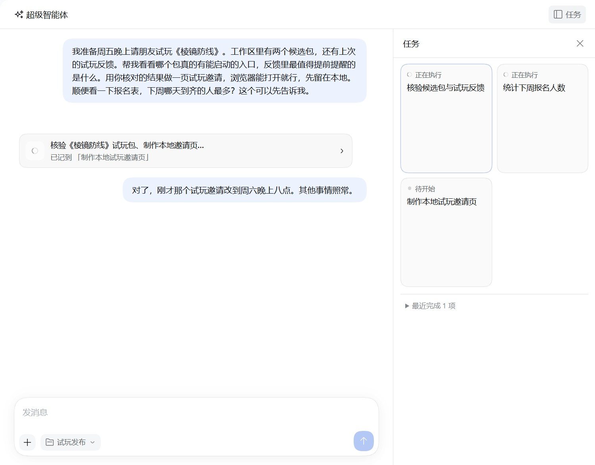

[English](README.en.md)

# dsh-superagent

这是 DeepSeek Harness 的多任务插件。把几件事交给左侧的「超级智能体」，它会安排哪些可以一起做、哪些得等前一步。进度、补充要求和交付文件都在同一个对话里。

## 桌面实录

这次是给《棱镜防线》准备一场试玩。右侧两条任务正在跑，一条核对候选包和试玩反馈，一条统计报名。邀请页要等核包的结果。中途把时间改到周六晚上八点，对话里能看到这条补充要求记到了邀请页。



*截图来自 Windows 桌面端开发版的实际运行。*

## 安装

在 DeepSeek Harness 桌面端打开「插件」，点 **Add plugin**，输入 `@xiangyixie/dsh-superagent@0.24.0`。安装后重启 DSH，再从侧边栏进入「超级智能体」。

用 Web profile 的话，在命令行安装，然后重启宿主。

```bash
dsh plugin --profile web add @xiangyixie/dsh-superagent@0.24.0
```

插件需要 DeepSeek Harness `>= 0.2.2-rc.1 < 0.3.0` 和一个支持工具调用的模型。部署命令行宿主时需要 Node.js `>= 24.9.0`。模型和 API Key 的配置见[中文手册](README.zh.md#配置)。

## 发一条任务试试

选中工作区，在输入框里发一条消息。

> 把 `feedback.csv` 里最常见的三个问题找出来，再根据 `CHANGELOG.md` 写一页发布说明。两份都放到 `deliverables/`。

开着「任务」可以看每一项的状态。想改其中一件事，直接在原对话补一句，说明要改哪一项。碰到需要你授权或决定的动作，先看卡片写了什么，再决定要不要继续。

单独问个问题可以直接用 DSH 聊天。一次多任务执行会额外用模型做规划和汇总。

## 文档

- [完整中文手册](README.zh.md)
- [配置示例和故障排查](README.zh.md#故障排查)
- [宿主兼容性](docs/host-compat.md)
- [更新记录](CHANGELOG.md)

[MIT License](LICENSE)
