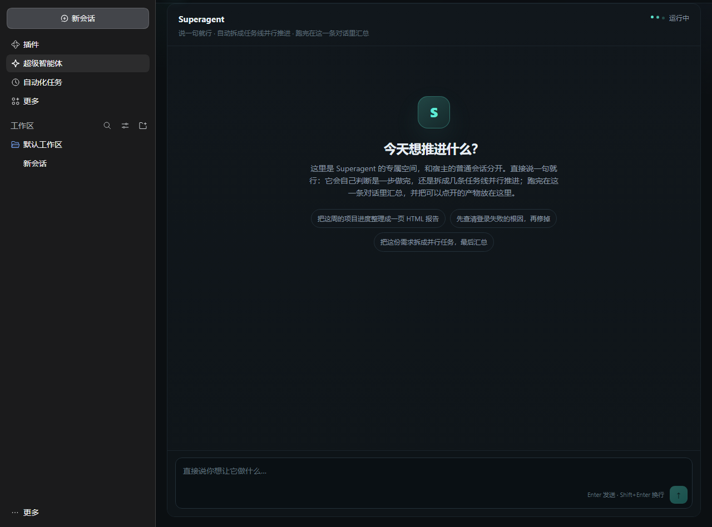
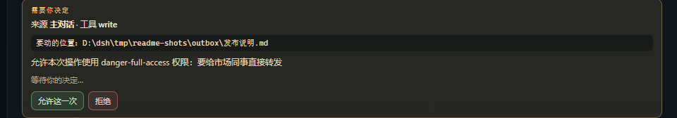

中文 | [English](README.en.md)

# dsh-superagent

把一句目标交给它，它自己拆成几条并行的任务线，跑完在一条对话里汇总；你只在关键判断时被叫一次。



## 你现在的麻烦

手上的活一起来的时候，最累的往往不是干活，而是管会话：产品那边要一页发布说明，客服那边要一份反馈归类，数据那边还等着你核对。开三个会话，来回切，每个都得记住跑到哪了、下一步是什么；一个会话卡住，另外两个也跟着分心。

dsh-superagent 把这件事接过去：你说一句目标，它负责拆、负责跑、负责盯，最后把结果收拢到一条对话里。

## 它替你管什么

- **下命令。** 一句话说清要什么，它自己规划成可并行的子任务，默认同时跑四条，不用你拆步骤。
- **等验收。** 每条任务线的进度和产物都落在同一条对话里；全部完成后给一份汇总，产物可以直接点开。
- **只在关键判断时被打断。** 写工作区外的文件、需要提权这类动作，它会停下来放一张卡，写清来源、工具、路径和理由；你点头才继续，不点头就取消，不会替你做主。

### 任务线卡：几条活一起跑


### 全部完成：汇总与产物


### 需要你点头时，才出现一张卡



## 快速开始

三步。桌面端和命令行走的是同一套插件，下面每一步都写清在哪里点。

### 1. 装

桌面端：侧边栏 **插件** → **Add plugin** → 输入 `@xiangyixie/dsh-superagent@0.14.7` → 安装。

命令行：

```bash
dsh plugin --profile web add @xiangyixie/dsh-superagent@0.14.7
```

装完**重启 DSH**（插件只在宿主启动时加载一次）。也可以从「发现」页添加[插件索引](https://raw.githubusercontent.com/LittleChenLiya/dsh-superagent/main/plugin-index.json)一键安装；升级一律先 `remove` 再 `add`。

### 2. 配一个模型

默认 profile 用 `deepseek-official` / `deepseek-flash`，把 key 放进启动宿主的那个环境：

```bash
export DEEPSEEK_API_KEY=sk-...      # PowerShell: $env:DEEPSEEK_API_KEY="sk-..."
```

已经能正常对话的 profile 不用改。想换 DashScope、自建网关等其他路由，见[其他路由](#其他路由)。

### 3. 第一次跑起来

重启后点侧边栏 **超级智能体**（命令行宿主：打开它打印的本地控制台地址），在输入框里发一句：

> 这周的活一起收一下：把 feedback.csv 的反馈归成三类高频问题，再写一页 0.8.0 的发布说明，两份都放到 deliverables/。

任务线会立刻开始跑，进度、汇总和产物都在这一条对话里。需要跑 `npm test` 这类命令的 worker，要先打开[按 worker 设置命令权限](#按-worker-设置命令权限)。

## 常见问题

**为什么它会问我？**

只有越过工作区边界、需要提权一类的动作才会问。卡片会写明来源（哪条任务线、哪个子任务）、工具名、目标路径和理由；不回答超过 10 分钟就按取消处理，不会自动批准。

**能不能不装桌面端？**

能。插件挂在 DeepSeek Harness 上，`dsh --profile web` 起的本地宿主同样有控制台、任务线和审批卡；桌面端只是多了侧边栏入口，省去记地址。

**开销大概多少？**

一次 run 至少包含一次规划、每个子任务若干次模型调用，以及一次汇总。文档里那条两个子任务的样例是 4 次调用、约 4.6k 输入 / 0.5k 输出 token；活越长，调用越多。默认不内置价格，在 `pricing` 里配好之后每个 run 会打印金额；另有 `maxModelCallsPerRun`（默认 80）和 `maxTokensPerRun`（默认 2,000,000）两道硬上限。

## 什么时候不要用它

一次模型调用就能答完的活、需要子 agent 继续往下委派的任务（深度上限为 1）、需要给子 agent 单独凭据或更强隔离的场景，都不划算。它对每个 run 额外收一次规划和汇总的费用，对延迟极敏感的单步任务也不合适。

## 环境要求

- Node `>= 24.9.0`。
- DeepSeek Harness `>= 0.2.2-rc.1 < 0.3.0`，并带 base bundle（`tools`、`agents`、`subagents`）。
- 一条能调用工具的模型路由，且 key 已放进环境。

## 配置

在 `<profile>/cordis.patch.yml` 里写行配置：

```yaml
- id: superagent
  config:
    maxSubtasks: 8
    maxParallel: 4
    maxActiveRuns: 2
```

| 配置项 | 默认值 | 含义 |
| --- | --- | --- |
| `stateDir` | `$DSH_HOME/state/superagent` | run 状态根目录。 |
| `provider` | `spawn` | planner、worker、aggregator 使用的子 agent 后端。 |
| `childProvider` | 跟随父级 | 可选的子 agent provider 路由覆盖。 |
| `childModel` | 跟随父级 | 可选的子 agent 模型覆盖。 |
| `childPreset` | 无 | 子 agent 使用的 agent preset。preset 决定子 agent 的工具集；这个宿主没有按 run 过滤工具的能力。 |
| `plannerPreset` | 无 | 只给 planner 子 agent 用的 preset。请用无工具的 preset：planner 只读自己的 prompt 并返回 JSON，继承来的工具反而会引出一整轮工具调用而不是计划。需要宿主组合出 `agentPresets` 注册表。 |
| `plannerProvider` | 跟随父级 | 可选，planner 子 agent 的 provider 路由覆盖。 |
| `plannerModel` | 跟随父级 | 可选，planner 子 agent 的模型覆盖。规划只是一次 JSON 回合，所以这里换个更强的模型，通常比 worker 跑完之后再修计划便宜。 |
| `plannerTimeoutSeconds` | `120` | 单次规划尝试的墙钟上限。超时后这次尝试被停止并记录；不会转而启动一个兜底 worker。 |
| `plannerMaxModelCalls` | `20` | 规划阶段跨多次尝试可以花的模型调用数；`0` 表示不限制。花完就以"无法规划"失败，而不是把整个 run 的预算抽干。 |
| `maxSubagentDepth` | `1` | 子 agent 还能往下委派几层。`1` 禁止孙代理；`provider-managed` 交给后端。 |
| `commandWorkerPermission` | `inherit` | 给"计划条目里声明了命令能力"的 worker（`shell`、`bash`、`pwsh`、…）使用的沙箱模式。`danger-full-access` 让这些 worker 在 `workspace-write` 宿主上真正执行命令；其他子 agent 保持继承。见[按 worker 设置命令权限](#按-worker-设置命令权限)。 |
| `maxSubtasks` | `8` | 计划中子任务数量的上限。工具参数只能调低，不能调高；硬上限 16。 |
| `maxParallel` | `4` | 同时执行的子任务数。工具参数只能调低；硬上限 8。 |
| `maxActiveRuns` | `2` | 每个状态目录的活跃 run 数，跨共享该目录的 profile 和宿主计算。超出后再 `superagent_start` 会被拒，除非带上 `queue: true`，那样会等一个空位。`superagent_resume` 不计入配额，配额满了也能用，因为它只是把已经存在的活儿干完。 |
| `maxQueuedRuns` | `5` | 同时允许排队等空位的 run 数；硬上限 32。`0` 关闭排队，超过 `maxActiveRuns` 的启动重新一律被拒。 |
| `queueTimeoutMinutes` | `30` | 排队的 run 等多久还没开始就失败；期间不花任何钱。 |
| `queueOnFull` | `false` | 让每个超过 `maxActiveRuns` 的启动都排队，而不只是显式传 `queue: true` 的那些。 |
| `attempts` | `2` | 每个子任务的尝试次数，用完即标记失败。看起来是暂时性的失败（配额、限流、超时、5xx）会依次等 2s、4s、8s 再试。 |
| `deadlineMinutes` | `120` | 墙钟预算；到期后 run 以 `partial` 或 `failed` 结束。 |
| `maxModelCallsPerRun` | `80` | 每个 run 子 agent 模型调用次数的硬上限；`0` 关闭。 |
| `maxTokensPerRun` | `2000000` | 每个 run 的 prompt + completion token 硬上限；`0` 关闭。 |
| `pricing` | 空 | 每百万 token 的价格，键必须与用量日志里模型的名字完全一致（`provider/model`）。开箱状态下没有任何价格。 |
| `resultCapBytes` | `32768` | 每个子任务报告保留的字节数。 |
| `notifyOnComplete` | `true` | 主动消息的总开关。关掉之后插件永远不会叫醒会话。 |
| `maxNotificationsPerHour` | `3` | 每小时允许的主动消息数。超出上限的 run 会被折叠成一条摘要；`0` 取消上限。 |
| `notifyRetries` | `2` | 宿主拒绝唤醒时的额外投递次数；同一个会话的消息按顺序投递。 |
| `notifyRetryDelayMs` | `2000` | 上述重试的首次间隔，每次翻倍，上限 60s。 |
| `autoResumeRounds` | `1` | 在报告失败之前，针对"看起来是暂时性"的失败再重试子任务的轮数；`0` 关闭。 |
| `childModelFallback` | 无 | 这类重试（配额、限流、超时）时使用的模型。不设则沿用配置的路由。 |
| `memory` | `true` | 跨 run 的笔记本。见[跨运行记忆](#跨运行记忆)。 |
| `memoryScope` | `default` | 按 scope 分文件，让不相关的项目彼此分开。run 的笔记写在这里；`rules` 和 `profile` 会被读进每一个 run。 |
| `memoryMaxEntries` | `60` | 压缩阈值：一次会超过它的写入会把笔记本压缩到这个条数（400 行 / 128 KB 也是硬上限）。 |
| `memoryMaxAgeDays` | `30` | 比这更旧的笔记被忽略，并在压缩时清掉。 |
| `memoryDigestEntries` | `12` | 注入 prompt 的笔记条数。 |
| `memoryDigestChars` | `1600` | 该 prompt 中笔记部分的字符预算。 |
| `memoryUserProfile` | `false` | 跨任务的用户画像（事实、偏好、决策），位于 `<stateDir>/user-memory`。关掉时不构建任何东西，也不创建目录。见[用户画像](#用户画像)。 |
| `keepRuns` | `0` | 挂载时删除早于这么多天的终态 run；`0` 全部保留。 |
| `guard` | 开 | worker 的路径与命令策略。每一项默认值和背后的理由见[worker 安全护栏](#worker-安全护栏)。 |
| `audit` | `true` | 只追加的审计轨迹。它只观察；关掉只会去掉轨迹，不会改变 run 的行为。 |
| `policyFile` | 存在时为 `<stateDir>/policy.json` | 权限策略文件。不设置且文件不存在就表示没有策略，即旧行为。 |
| `auditDir` | `<stateDir>/audit` | `audit.jsonl` 及其导出文件所在目录。 |
| `controlPort` | 关 | 嵌入接口的回环端口；`0` 让系统挑一个空闲端口。见 [docs/embedding.md](https://github.com/LittleChenLiya/dsh-superagent/blob/main/docs/embedding.md)。 |
| `workspaceIsolation` | `false` | 给每个 worker 一个自己的 git worktree，避免并行 worker 互相覆盖。见[按 worker 隔离工作区](#按-worker-隔离工作区)。 |
| `workspaceRoot` | 会话目录（见 `workspaceBase`） | `workspaceIsolation` 打开时，worker 在其中被隔离的仓库。必须是至少有一次提交的 git 工作树。 |
| `workspaceBase` | `session` | 隔离的基准目录。`session` 用当前会话的目录（或 git 从它解析出的仓库根），`workspaceRoot` 只有指向同一目录时才生效；`config` 恢复旧行为，始终使用 `workspaceRoot`。两者不一致时 status 打印 `workspace warning`，并在日志里说明，不会静默改用另一个项目。 |
| `workbenchPort` | 关 | 本地工作区面板的回环端口；`0` 让系统挑一个空闲端口。面板自己读写文件，不经过宿主 API。 |
| `workbenchRoot` | `process.cwd()` | 面板可以浏览和编辑的目录。它之外的任何路径都会被拒绝。 |
| `consolePort` | 关 | 对话控制台的回环端口；`0` 让系统挑一个空闲端口。需要宿主的 `sessionController` 服务。 |
| `consoleRoot` | 先取 `workbenchRoot`，再取宿主 cwd | 控制台的对话会话所加入的目录。 |
| `consolePreset` | 宿主默认 | 控制台会话挂载的 agent preset id。工具跟着这个 preset 走，不跟本插件走。 |
| `boardPort` | 关 | 任务看板的回环端口；`0` 让系统挑一个空闲端口。一个页面里放子任务卡片、待办收件箱和内置模板。见[任务看板](#任务看板)。 |
| `boardRoot` | 先取 `consoleRoot`，再取 `workbenchRoot` | 看板自己的对话会话所加入的目录，也是从模板启动的 run 的工作目录。 |
| `schedulerTickSeconds` | `30` | 检查活跃计划是否到点的频率，单位秒（1–3600）。没有计划之前不会武装任何东西，所以对没有定时任务的安装没有影响。 |
| `schedulerHumanPriority` | `true` | 计划 `human_priority` 的默认值：定时 run 不能占掉最后一个空闲并发位。 |
| `schedulerMaxConsecutiveFailures` | `3` | 连续失败多少次后计划自动暂停并只通知一次（1–20）。 |

### 切换模型

模型选择是配置，不是代码。默认情况下子 agent 继承会话的模型，即 profile 的 `agent-default-model`。要把子 agent 钉在特定路由上，两个键都设，然后重启宿主：

```yaml
- id: superagent
  config:
    childProvider: dashscope
    childModel: qwen-flash
```

插件里没有编译进任何模型 id。API key 只从路由指定的环境变量读取；插件从不保存 key。默认 profile 的路由是 `deepseek-official`，读取 `DEEPSEEK_API_KEY`。

### 其他路由

上面的例子假设 profile 里已经装了 DashScope 路由。它不属于 base bundle：默认 profile 没有 `dashscope` provider，光有 `DASHSCOPE_API_KEY` 也不会变出一个来。先装好那条路由（见 harness 关于 LLM 插件的文档），再在 `childProvider` 里写它的名字。

### 子 agent 的工具与递归

`maxSubagentDepth: 1` 会作为 `maxDepth` 传给宿主，所以 worker 无法再创建自己的子 agent。这条限制由宿主强制执行，而不是靠 prompt 劝说；如果某个 provider 做不到，`superagent_start` 会直接报错失败，而不是悄悄无限制地跑下去。

在 `dsh@0.2.2-rc.1` 上**没有**强制的工具白名单。宿主的 subagent 启动请求里没有工具过滤字段，它自己的 `subagent` 工具也拒绝 `toolFilter` 配置，并指向 agent preset。因此 `childPreset` 才是收窄子 agent 工具集的受支持方式；没有专用 preset 时，worker 继承会话的工具。`superagent_*` 工具仍在它们的工具列表里，但管理 run 的那几个（`superagent_start`、`superagent_resume`、`superagent_cancel`、
`superagent_followup`、`superagent_inject`、`superagent_answer`）会拒绝从 worker 会话中运行；只有顶层 agent 能管理 run。

### 按 worker 设置命令权限

`workspace-write` 的宿主沙箱会拒绝以管道 stdio 启动子进程（`EPERM`）。所以需要跑 `npm test` 的 worker 在继承策略下做不到，而这个插件也不会为整台机器关掉沙箱。`commandWorkerPermission` 只对声明了该能力的 worker 抬高权限：

```yaml
- id: superagent
  config:
    commandWorkerPermission: danger-full-access
```

这样设置之后，计划条目中 `requires` 带命令能力（`shell`、`bash`、`sh`、`zsh`、`fish`、`terminal`、`pwsh`、
`powershell`、`cmd`、`run_command`、`exec_command`）的 worker 获得完全访问权。planner、aggregator、验收判定，以及没有这类能力的 worker，仍然保持继承模式。

它的工作原理，以及为什么这是一种"委派技巧"而不是宿主特性：

- 宿主没有按子 agent 设置权限的字段。它有的是继承机制：`subagents.startActivation` 会**在第一次 `await` 之前同步地**捕获父会话最后的
  `sandbox/mode` 事件，并把该模式播种给子会话。
- 对一个符合条件的 worker，插件先向父会话追加 `sandbox/mode:
  danger-full-access`，调用 `startActivation`，再在 `finally` 里把先前的模式追加回去——整个过程在同一个同步 tick 内完成，中间没有 `await`。因此并发调用永远看不到这个临时覆盖，而子会话仍然捕获到了它。
- 两个步骤各追加一条 `sandbox/mode` 事件；插件从不用
  `permissionPresets.set()`，因为它的 `custom` 状态无法按名字恢复。
- 该子会话的审批策略被钉为 `never`，这是宿主自己的委派捕获行为，不是本插件做的。
- 每一步都会以 `worker.escalate` 和 `worker.restore` 写进审计轨迹，带上 `runId`、`subtaskId` 和原因（所声明的能力）。`audit` 关闭时不写审计行，但升级行为本身不变。

限制：这只适用于进程内、子会话由同一宿主进程中的父会话创建的那种 provider（`provider: spawn`）。如果上游改变了捕获时机，或者改变了委派继承本身，这里会静默退回继承模式，而不是让 run 失败。另外，当父会话没有显式覆盖时，这个临时事件也会把"部署默认模式"钉进父日志：它记录的是部署默认值，在该默认值变化之前行为完全一致。

### 按 worker 隔离工作区

并行 worker 是相互独立的 agent，但默认共用一个工作目录：两个子任务改同一个文件就会互相覆盖，最后写的赢。`workspaceIsolation` 通过给每个 worker 一份自己的 checkout 来解决这个问题。

```yaml
- id: superagent
  config:
    workspaceIsolation: true
    workspaceRoot: /home/me/projects/api      # or C:\work\api on Windows
```

**为什么用 git worktree 而不是复制目录。** 隔离难的那一半是把结果合回去。worktree 免费提供了这件事：真正的三方合并、带冲突检测、两侧都保留为 ref，还留一条命令让用户手工收尾。递归复制要么需要 diff3 引擎（本包没有这个依赖），要么直接覆盖主 checkout——而那正是这个特性要防的 bug。worktree 还共享对象库和忽略规则，所以 worker 看到的是真实仓库，而不是它的一份完整拷贝。worktree 放在宿主启动目录下的 `.superagent/worktrees/<runId>/w<n>`——如果宿主就是在仓库里启动的，那就是仓库本身。宿主的 `workspace-write` 沙箱以会话 cwd 为可写边界，所以放在状态目录下、或者放在宿主并非在其中启动的仓库里，checkout 的每次写入都会被拒。这个 worktree 池自带 `.gitignore`，因此 worker 的 checkout 不会漏进用户的下一次提交，也不会让主 checkout 看起来是脏的。

**run 期间发生什么。** 每个 worker 拿到一个从主 checkout 的 `HEAD` 创建的
`superagent/<runId>-w<n>` 分支。它的 prompt 里写明绝对路径，并禁止碰其他任何东西、切分支、commit、merge 或 push。worker 结束时，run 会把它在 checkout 里留下的东西提交掉（所以忘了 commit 的模型也不会丢东西；git hook 被跳过，免得 pre-commit 钩子挡住合并），然后在所有子任务结束之后，**逐个**把分支合并回主 checkout。

**合并冲突时你会看到什么。** 合并被中止，主 checkout 精确恢复到原样，里面不会留下冲突标记。结果记录在 run 上，并由 `superagent_status` 打印：

```
workspace conflict: [2] src/routes.js, src/index.js — branch superagent/20261115T101500-ab12-w2
kept at <repository>/.superagent/worktrees/20261115T101500-ab12/w2; the main checkout was restored, so nothing
was lost. Resolve with: git -C "/home/me/projects/api" merge superagent/20261115T101500-ab12-w2
```

该 run 的唤醒消息会用一行说出同样的事。只要有一条分支没合回主 checkout（冲突，或者合并时主 checkout 是脏的），run 就不会报 `completed`：它降级为 `partial`，并往收件箱写一条 attention，写明分支、worktree 还在哪、为什么没合，以及手工收尾要跑的命令。什么都不会被丢弃：分支和它的 checkout 会一直保留，直到你合并或删除它们。另外两种情况也照样报告，而不是悄悄丢掉：

- 该合并时主 checkout 还有未提交的改动——所有分支都不合并，因为往脏树上合并会把你的改动和 worker 的混在一起，中止时还会恢复成错误的状态；
- 合并之前 run 被取消或撞上了 deadline——分支保留，resume 会复用同一批 worktree。

**基准目录。** 隔离默认以当前会话所在目录为准（`workspaceBase: "session"`），也就是沙箱边界、声明的交付物和合并目标都指向的那个目录；`workspaceRoot` 只有在指向同一目录时才生效，不一致时 `superagent_status` 会打印 `workspace warning` 并说明用了哪个目录，而不是默默在另一个项目里隔离。`workspaceBase: "config"` 恢复旧行为，始终使用 `workspaceRoot`。

**无法隔离时。** 如果基准目录不是 git 工作树、`PATH` 里没有 git，或者仓库还没有任何提交，run 不会失败。它退回共享目录（也就是旧行为），并且 `superagent_status` 和通知都会说明：

```
workspace: isolation was requested but is unavailable — /tmp/notes is not a git working tree,
so a per-worker worktree cannot be created; workers shared /tmp/notes, so their edits can
overwrite each other
```

**直说限制。** `dsh@0.2.2-rc.1` 不给子 agent 提供 `cwd` 字段，所以插件无法在 spawn 时交给 worker 一个目录。隔离是一份 prompt 约定加一个真实分支：无视 prompt 的 worker 仍然能改主 checkout，但这种改动会在任何合并之前出现在 `git status` 里，也破坏不了兄弟分支。关掉隔离时，行为与这个选项存在之前完全一致。

### worker 安全护栏

worker 继承会话的文件系统和凭据，所以 superagent 子 agent 的每次工具调用都会经过挂在宿主
`tools/pre-execute` 路径上的护栏（有 `ctx.tools.guard` 时走它）。护栏只约束本插件 spawn 的子 agent；父会话不受影响。

```yaml
- id: superagent
  config:
    guard:
      enabled: true
      allowWriteRoots: []        # extra writable roots, absolute or ~-relative
      denyPaths: []              # extra read+write denials
      denyCommands: []           # [{ id, pattern, reason }] extra regex denials
      allowCommands:             # explicit overrides; every use is recorded
        - id: clean-build
          pattern: '^rm -rf build$'
          reason: clean build output
      maxEvents: 50
```

默认值，以及为什么这么设：

| 规则 | 默认值 | 理由 |
| --- | --- | --- |
| 可写根目录 | 子会话的工作目录加上操作系统临时目录 | worker 需要自己的工作区和一处草稿区。其他一切都与任务无关，因此拒绝。状态目录**故意**不可写：worker 不能改写 run 记录或报告。 |
| 始终拒绝（读和写） | `~/.ssh`、`~/.aws`、`~/.gnupg`、`~/.netrc`、`~/.npmrc`、`~/.yarnrc`、`~/.pypirc`、`~/.git-credentials`、`~/.docker/config.json`、`~/.kube/config`、`~/.config/gcloud`、`~/.config/gh/hosts.yml`、`~/.azure`、任何 `.git/config` 与 `.git/hooks` | 这些是凭据或代码执行入口。工作区再大也不会开放它们。 |
| 系统目录 | 一律不可写（`C:\Windows`、`C:\Program Files`、`C:\ProgramData`、`/etc`、`/usr`、`/bin`、`/boot`、`/dev`、`/System`、`/Library`、…），操作系统临时目录除外 | 读它们是正常的（`win.ini`、`/etc/hosts`）；写它们不是开发任务。临时目录之所以例外，是因为服务账号的 `%TEMP%` 可能落在 `C:\Windows\TEMP` 下，而 worker 仍必须能在那里写草稿文件。 |
| `cmd/recursive-force-delete` | 当目标是 `/`、盘符根、`~`、`.`、`..`、`*`、可写根之外，或包含其中之一时拒绝 | `rm -rf build` 和 `rm -rf node_modules` 是正常的；`rm -rf /` 和 `rm -rf .` 不是。一刀切地封掉所有 `rm -rf` 会让日常清理没法做，所以由目标决定。 |
| `cmd/disk-format` | `mkfs`、`diskpart`、`wipefs`、`format X:`、`dd of=/dev/sd*` | 从来不是开发动作。 |
| `cmd/system-scheduler` | `schtasks /create`、`Register-ScheduledTask`、`crontab -r`、`systemctl enable\|disable\|mask`、`launchctl load` | 在工作区之外建立持久化。 |
| `cmd/system-registry` | 针对 `HKLM`/`HKCR` 的 `reg add/delete`，以及任何 `\Run` 键 | 全机范围或开机自启的改动。 |
| `cmd/system-write` | 目标为系统目录的重定向或写 cmdlet，包括 `%SystemRoot%`/`$env:SystemRoot` | 抓住藏在变量后面的写入。 |
| `cmd/permission-nuke` | `chmod -R 777 /`、递归 `chown /`、`icacls … /grant Everyone /t` | 摧毁机器的访问模型。 |
| `cmd/credential-access` | 点名上述凭据位置、`id_rsa`、`id_ed25519`、… 的 shell 命令 | worker 读 key 和写 key 一样有害。 |

拒绝是真实的工具错误，不是静默失败：worker 会收到
`[guard] blocked <tool>: rule <id> — <reason>. The call did not run.`，事件也会加到 run 上。`superagent_status` 打印
`guard: N tool call(s) blocked; M explicit allow(s) recorded (rule ×count)`
以及最多三条被拦下的命令，最终报告会多出一节 `## Safety guard`，列出每一个保留的事件。即使 `maxEvents` 截断了列表，计数器也统计全部事件。

`allowCommands` 是唯一的越权通道。它胜过拒绝，但每一次命中都会以 `decision: allowed` 记录下来，并注明它覆盖了哪条规则，所以覆盖行为永远不会隐身。凭据、`.git` 控制项和系统目录的拒绝不可覆盖；要放行工作区之外的合法构建目录，请加进 `allowWriteRoots`。护栏基于词法和 realpath，所以工作区内指向被拒路径的符号链接照样会被抓住。

护栏是加在工具参数上的一层策略，不是操作系统沙箱。把写入委托给某个程序的命令（`node build.js`、一个编译器）仍然能写到那个程序能写的任何地方；要挡住它需要宿主级沙箱，而 `dsh@0.2.2-rc.1` 没有暴露。护栏拦住的是直接的 `write`/`edit`/
`apply_patch` 目标、shell 重定向，以及上面那些破坏性命令类型——这恰好覆盖了一个乱走的 worker 真正会造成的"误删 `rm`"和"写进 `C:\Windows`"。

### 花费上限与价格

两道硬预算，能在病态目标开始悄悄烧钱之前把它停住。两者都在每次 spawn 子 agent 之前检查，所以重试循环也绕不过去：

```yaml
- id: superagent
  config:
    maxModelCallsPerRun: 40
    maxTokensPerRun: 500000
    pricing:
      deepseek-official/deepseek-flash:
        input: 0.28          # price per 1M uncached prompt tokens (example)
        output: 0.42         # price per 1M completion tokens (example)
        cacheRead: 0.028     # optional; defaults to the input price
        currency: CNY
```

价格键会与用量日志里的模型 id 匹配，那个 id 就是
`provider/model`——`superagent_status` 会在 `usage:` 行打印它，从那里复制键即可。先精确匹配，再不济按裸模型名匹配，所以没有精确条目时 `qwen-flash` 也能给 `dashscope/qwen-flash` 定价。插件不为任何路由内置价格，因为过期价格比没有价格更糟。

预算触顶时不再启动新的子 agent，并让 abort controller 停掉还在跑的那个，于是花费停在帽子上，而不是再抽干一个 worker。已经完成的报告仍然会被合并。至少有一个子任务完成时 run 以 `partial` 结束，一个都没完成时以 `failed` 结束（没做完的子任务留在 `pending`）。`superagent_resume` 会用当前配置重建限额，保留已经花掉的部分。从那里继续——这也是提高上限的方式。在真实宿主上，把
`maxModelCallsPerRun` 从 2 提到 80 再 resume 一个停在 2/2 的 run，它跑完了，且没有丢掉先前的花费。

即使子会话日志读不到，一次 spawn 也算一次模型调用，所以调用预算在日志布局变了的宿主上仍然有效。token 记账仍然依赖日志；读不到时 run 会打印一行
`usage note:`，说明这些数字只是下界。

花费是根据上表估算的，绝不来自内置猜测。没列出的模型报为 `unpriced` 并排除在合计之外，所以你看到的数永远是下界：

```
cost: at least ¥0.0041 (estimate; no price for haoduo/gpt-6.1-sol)
```

金额按币种分别记账，绝不跨币种相加。同时用了 CNY 和 USD 路由的 run 会每种币种打一个小计：

```
cost: ¥0.0952 + $0.0248 (estimate; all models priced)
```

同样的规则适用于 `superagent_list` 的账目行、实时 `watch` 的页脚、导出的 `README.md` 以及 HTML 报告——混合窗口会得到每种币种一个数字，而不是一个单位不明的单一数字。

## 运行时控制

插件可以驱动浏览器，在 Windows 上还可以驱动桌面。两部分**默认都关**：`runtime.enabled` 为 false 时，这些工具一个都不注册，已有的 profile 看到的工具列表与之前完全一样。这里不需要任何 npm 依赖——浏览器通过 DevTools 协议、用 Node 自带的 `WebSocket` 对话，桌面则通过 `powershell.exe` 和 `user32.dll` 触达。

```json
{
  "@xiangyixie/dsh-superagent": {
    "runtime": {
      "enabled": true,
      "browser": {
        "headless": true,
        "allowedHosts": ["localhost", "127.0.0.1"],
        "executablePath": null,
        "attachPort": null,
        "userDataDir": null
      },
      "desktop": { "enabled": false, "allowActivation": false }
    }
  }
}
```

`enabled` 打开这一层。`browser.enabled` 和 `desktop.enabled` 决定哪一半注册；桌面单独设闸，因为它能碰机器上的任何应用。`allowedHosts` 替代回环默认值——开头的 `*.` 匹配任意子域。`stopFile` 和 `shotDir` 默认是
`<stateDir>/runtime/STOP` 和 `<stateDir>/runtime/shots`。

`attachPort` 和 `userDataDir` 是两种触达"需要登录的页面"的方式，代价各不相同：

- **`attachPort`**（例如 `9222`）借用你自己用 `--remote-debugging-port` 启动的浏览器。元素列举、点击、输入、截图全都走那条连接，标签页保持自己的窗口尺寸，而
  `browser_close` 只是断开——它从不终止你的浏览器。如果端口没在监听，调用会失败并给出端口和启动命令；它绝不会背着你退回一个全新的 profile。因为那个 profile 已经登录了你用的东西，每个动作都会继承那份权限。
- **`userDataDir`** 为本插件启动的浏览器保留一个专用 profile：登录一次（二维码、短信，站点要什么就什么），之后的 run 复用同一个 cookie jar。这个目录是磁盘上一份真实的凭据存储——请放在你愿意放密码文件的地方，不要指向日常浏览器的 profile。设置 `attachPort` 时它会被忽略。

默认仍然是 `%TEMP%/dsh-runtime-profile-*` 下的临时 profile，所以普通 run 看不到你日常浏览器的 cookie。

### 注册的工具

| 工具 | 作用 |
| --- | --- |
| `browser_open(url, headless?, width?, height?)` | 用全新的或持久化的 profile 启动浏览器，或者在你设置了 `attachPort` 时附着到你的浏览器；打开 URL，返回 URL、标题、视口和一张截图路径。登录、CAPTCHA、短信或二维码页面会以 `[attention]` 返回。 |
| `browser_elements(text?, role?, limit?)` | 列出可操作元素，带稳定索引、无障碍名、角色、包围盒以及是否在视口内。匹配依据是可见文本、ARIA 名或角色——不只靠 CSS。 |
| `browser_click(index?, css?, text?, role?, confirm?, screenshot?)` | 把元素滚进视口，在它的中心派发真实的鼠标按下/抬起，然后截图。 |
| `browser_type(index?, css?, text?, value, submit?, screenshot?)` | 聚焦输入框，通过浏览器输入管线插入文本，可选按回车，并报告页面现在的值（密码框会被遮蔽）。 |
| `browser_screenshot(path?, full_page?)` | 页面 PNG，带路径、像素尺寸和字节大小。 |
| `browser_script(expression, await_promise?)` | 求值一个表达式并返回其 JSON 值；用于读取，不用于点击。 |
| `browser_wait(text?, css?, url_contains?, milliseconds?, timeout_ms?)` | 等待某个条件或固定时长。 |
| `browser_await_human(timeout_ms?, poll_ms?, screenshot?)` | 等待人去完成登录、CAPTCHA、短信、双因素或二维码检查；可以继续自动化时返回 ok，仍在等待时返回 `[attention]`。它从不自己解这个检查。 |
| `browser_close()` | 关闭本插件启动的浏览器。在 attach 连接上它只断开，你的浏览器继续运行。 |
| `desktop_screenshot(window?, path?)` | 整个桌面，或用 `PrintWindow` 抓取某个标题的窗口（被遮挡的窗口也能拿到自己的像素）。 |
| `desktop_windows(filter?, limit?)` | 可见的顶层窗口：句柄、标题、pid、屏幕矩形。 |
| `desktop_click(x, y, window?, activate?, right?, confirm?)` | 按屏幕坐标点击。默认后台；前台点击必须 `activate`。 |
| `desktop_type(text, window?, activate?)` | 向窗口输入文本，默认后台 `WM_CHAR`。 |
| `desktop_keys(keys, window?, activate?)` | 按顺序按下具名键（`enter`、`tab`、`f5`、`a`、`1` …）。 |
| `runtime_status()` | 停止状态、已注册的部分、允许的 host、浏览器可执行文件、attach/启动模式、会话。 |

每次浏览器和桌面调用都会往既有审计轨迹（`lib/audit.js`）写一行，带 `source: "runtime"`、动作、目标、判定、
结果和耗时。被闸门拒绝的动作写
`decision: "deny"` 或 `"confirm"` 以及 `result: "blocked"`，所以日志永远不会声称一次被拒的点击成功了。浏览器那几行还带 `meta.session`——
动作跑在你启动的浏览器上时是 `"attach"`（带 `meta.port` 和它复用的标签页），跑在本插件启动的浏览器上时是 `"launch"`（带
`meta.profile` 和 `meta.persistentProfile`）——因此轨迹永远不会把你的会话和一次性 profile 搞混。需要人介入的页面会写
`kind: "attention"`、`decision: "attention"` 和 `result: "needs-human"`。

### 闸门

- **紧急停止。** 停止文件存在期间——或者设置了 `DSH_RUNTIME_STOP=1`——每个动作都被拒绝，且拒绝行为会被审计。创建该文件，这一层在下次调用时停下；删掉它即恢复。
- **导航。** 只允许 `http:` 和 `https:`，且 host 在白名单内。`file://` 被拒，因为能读本地文件的页面会绕过工作区护栏；`javascript:`、`data:` 和 `chrome:` 同样被拒。
- **上传。** `browser_click` 拒绝 `<input type="file">`，因为随之而来的原生文件选择器无法被驱动，会一路落到用户自己的文件系统上。
- **不可逆动作。** 标签里出现 submit、delete、pay、publish、transfer、提交、删除、支付 … 的目标需要 `confirm: true`。没有它点击不会发生，审计行记录 `decision: "confirm"`。
- **人工检查。** 要求登录、CAPTCHA、短信验证码、双因素确认或扫码的页面会在那一点停下动作，返回
  `[attention]`，说明页面要什么以及如何交接。检查内容是从页面文本里读的，所以一个带密码框但没有登录字样的普通设置页不会被误判；这里不会去解或去输入那个检查。在启动的窗口或 attach 的标签页里，人就在浏览器里完成，然后
  `browser_await_human` 轮询到它消失，run 继续。等待中的检查是一次交接，不是失败的 run。
- **焦点。** 后台点击或按键从不把窗口拉到前面。前台动作需要 `activate: true` **并且**
  `runtime.desktop.allowActivation: true`，每次激活都记录在
  `meta.activated` 里。
- **worker agent。** `browser_*` 和 `desktop_*` 属于挂载插件的那个会话。护栏会以规则
  `guard/runtime-tool` 拦下受绑定的子 agent 的调用，除非 `guard.allowRuntimeTools` 为 true。

### 它刻意做不到的事

- **顺手借用你的登录态。** 启动的浏览器拿的是
  `%TEMP%/dsh-runtime-profile-*` 下的全新 profile，所以你的 cookie、保存的密码和已登录会话根本不在那里。触达需要认证的页面是一个明确选择：attach 到你自己用
  `--remote-debugging-port` 启动的浏览器并设置 `browser.attachPort`，或者把
  `browser.userDataDir` 指向一个专用 profile 并在那里登录一次。两者都会让那份权限对之后每个动作可用，也都会出现在审计日志的
  `meta.session` 里；attach 端口写错会失败并给出说明，而不是悄悄启动一个新 profile。
- **替你通过人机验证。** CAPTCHA、短信验证码、"确认你是真人"的中间页、扫码登录都会停下动作交还给人。它从不替你输码或扫码；它等你做完，然后报告 run 可以继续。
- **规避 bot 检测。** 启动的 Chromium 能通过 CDP 特征被检测出来，封自动化站点的站会连它一起封。这里没有修补 `navigator.webdriver`，也没有伪装指纹。
- **往任何应用里输入。** 后台 `WM_CHAR` 能触达经典 Win32 控件；Chromium、Electron、Qt 和大多数游戏会忽略投递的消息。对它们，要么 `activate: true` 并接受焦点变化，要么改用 `browser_*` 驱动页面。
- **猜坐标。** `desktop_*` 用的是物理屏幕像素。DPI 缩放混杂时，先 `desktop_screenshot`，再从
  `desktop_windows` 读矩形，而不是自己算。
- **控制 macOS 或 Linux 桌面。** 桌面这一半只支持 Windows。浏览器那一半在任何有 Chromium 系二进制的地方都能用。

仓库里带了两份可直接跑的验证。`node scripts/runtime-demo.mjs`
启动一个本地页面，点一个按钮，从 DOM 读回计数器，往输入框里打字，在不可逆按钮和文件输入上被拒，翻转停止开关，并打印审计行和截图路径。
`node scripts/runtime-desktop-demo.mjs` 打开一个不激活的测试窗口，向它投递点击和文本，用目标进程自己的状态文件验证两者，
并抓取该窗口。

## 工具

如果目标有两个及以上可独立交付的产物，或含“先做 A 才能做 B”的前置依赖，就用 `superagent_start`，不要用宿主自带的 `subagent` 自己编排：只有 run 会留下计划、并行时序和一份合并报告。每个会话开始时只会收到一次同样意思的简短提示（不再每个 turn 重复），子会话不会收到。单一动作（一次查询、一次编辑、一条命令、一段短文本）不必起 run，直接做。

默认只声明 8 个常用工具（`superagent_start` / `status` / `list` / `cancel` / `resume` / `followup` / `answer` / `help`），这样每次请求固定带的工具说明很小。长期目标、定时任务、实时插话、跨 run 笔记、模板、审计这 6 个工具按需展开：先调用一次 `superagent_help`，它们会在下一步自动出现在工具列表里，本会话之后一直可用。

- `superagent_help()` 列出另外 6 个按需工具以及各自适用的场景，并为本会话展开它们。需要定时、长期目标、记忆、模板、审计或实时插话时先调用它。
- `superagent_start(goal, mode?, queue?, max_subtasks?, max_parallel?, deadline_minutes?, allow_duplicate?, wait_seconds?)`
  启动一次 run 并立刻返回 run id。`mode: "direct"` 让一个 worker 直接跑这个 goal，不要 planner 也不要 aggregator，并把该 worker 的回复原样作为报告返回——适合一次自成一体的查询、修改、检索或短写作，不适合可以并行拆开的目标。默认的 `mode: "planned"` 走完整的 planner → worker → 合并报告流程。计划中的子任务可以声明 `dependsOn` 另一个子任务：依赖方会等它，并在自己的 prompt 里拿到它的报告，而彼此独立的子任务仍然并行。依赖成环会在任何工作开始前否掉整个计划，依赖一个计划从未声明的任务则以原因跳过。两种模式产出相同的 run 记录、配额、deadline、取消和用量记账。`goal_mode: true` 增加一步验收，并在失败的轮次重新规划；见 [Goal 模式](#goal-模式)。
  `queue: true` 让 `maxActiveRuns` 占满时的启动改为等空位而不是失败：它返回 `status: "queued"` 以及
  `queue.position` / `queue.of`，某个活跃 run 结束时自动开始，等不到空位则在
  `queueTimeoutMinutes` 之后失败。最多 `maxQueuedRuns` 个在等；排队的 run 在等待期间不计入 `maxActiveRuns`，取消它会干净地把它从队列里移除。启动一个同会话中活跃 run 已经覆盖的 goal，会返回那个 run id 并标上
  `deduped: true`，而不是为第二个计划付钱：比较前会去掉首尾空白、折叠连续空白并忽略大小写，检查在一个按 goal 命名的 claim 锁下进行，并落在状态目录里，所以共享该目录的两个进程也只会启动一个 run。匹配是按会话的，因为两个会话同时要同一个泛化的 goal 是合理的。
  `allow_duplicate: true` 可以再起一个。已结束的 run 从不阻止同一个 goal 再次启动。`wait_seconds` 会阻塞到终态，并在结果里保留 `deduped` 标记。
- `superagent_status(run_id, wait_seconds?)` 返回状态、里程碑、
  每个子任务的结果、实测 token 用量、估算花费、报告文件路径，以及最终报告。
- `superagent_list(limit?)` 列出 run，最新的在前，并给出状态目录的文件数与大小。
- `superagent_cancel(run_id)` 停止 run，可从任何进程调用；见下文。
- `superagent_resume(run_id, wait_seconds?, force?)` 继续一个 `interrupted`、
  `failed`、`partial` 或 `cancelled` 的 run；已完成的子任务保留。worker 会被告知什么失败了，并被要求检查之前那次尝试已经做了什么。只有启动该 run 的会话才能 resume 它。resume 不计入
  `maxActiveRuns`，所以配额满了也能用；`force` 仍然被接受，但已不再需要。`completed` 的 run 保持 completed，除非它持有一个从未进入任何 prompt 的答案——那时 resume 会重新打开它，否则那个决定就会被搁浅。
- `superagent_followup(run_id, message)` 往已经在执行的 run 里加一条指令，而不是另起一个 run。这个工具明确是"下一个 prompt 生效"：指令排在 run 上，下一次为它构建的 prompt 会带上它——下一个 worker 的 spawn 或聚合，哪个先到算哪个。已经在跑或已完成的子任务保留自己的结果，永远看不到它。回复会点名这个边界，status 也显示同样的东西；在最后一个边界之后到达的指令记录为
  `never took effect`，而不是看起来已投递。暂停的 run
  （`interrupted`、`failed`、`partial`、`cancelled`）会保留这条指令给下一轮，resume 时开始；`completed` 的 run 会拒绝它。属于另一个进程的 run 会被拒绝，因为那个 owner 的下一次保存会覆盖它。只有启动该 run 的会话才能往里加。如果正在跑的 worker 必须立刻读到指令，用
  `superagent_inject`。
- `superagent_inject(run_id, message, subtask_index?, wait_seconds?)` 把一条指令送进此刻正在运行的 worker。它使用宿主的实时引导通道（`subagents.sendMessage`，即 agent 循环在下一个 pre-step 排空的同一个收件箱），所以消息会成为子 agent 下一次模型请求的一部分。它不会打断已经在飞的模型调用：延迟就是当前那一步剩下的部分（那次模型响应加上它的工具批次）。一个已经决定收尾的活着的子 agent 会再跑一轮来读它，所以未被取消的子 agent 会消费掉它。回复报告从接受到子 agent 下一次请求的实测延迟，并在子 agent 被取消、
  释放或在另一边界之前结束时，把消息标成 `missed`——而不是 delivered。在真实
  `dsh@0.2.2-rc.1` 宿主上实测最坏情况：子 agent 步长 8 s 时 **6978 ms**，步长 4 s 时 **2986 ms**，也就是说上界跟着步长走，不是跟着插件走。宿主没有暴露实时通道时，工具退化为 followup 队列并在回复里说明；它从不把那种情况称作实时。
- `superagent_answer(run_id, attention_id?, answer, wait_seconds?)` 回答一条结构化的 attention 项，让 run 带着这个决定继续。活跃 run 在下一个边界应用答案；已结束的 run 会被重新打开，只重跑它的聚合，这次 prompt 里带着答案，所以报告反映该决定，而不是让用户另起一个 run。
  同时有多个问题时 `attention_id` 必填。答案按 id 匹配，不按数组位置匹配：从未问过的 id、已经回答过的问题、以及被后续 resume 退役的问题都会被拒绝，而如果答案文本正好是另一个问题的选项，会指出那个 id 而不是猜。
- `superagent_memory(action, key?, kind?, text?, scope?, query?, tags?, limit?)`
  列出、搜索、添加、更正或遗忘笔记本里的笔记。`set` 一个已存在的 key 会取代旧的；`forget` 撤回它。`scope` 指向 `rules`
  （项目规则）、`profile`（用户偏好），或 run scope。`search`
  按 `query`（当前 goal 效果不错）和/或精确 `tags` 给笔记排序，于是相关的老笔记能被找到，而不只是最新的几条；笔记在设置时可以携带 `tags`。这个工具是增量的：另外十二个工具的参数和输出都不变。
- `superagent_template(action, id?, params?, template?, limit?)` 列出、展示、展开、保存或删除一个工作流模板：一个固定的 goal 骨架，带必需参数、适用场景和不适用场景。`expand` 返回一个普通 goal 字符串，`superagent_start` 会像对待手打的 goal 一样规划它；缺失或为空的参数会按名字被拒绝，而不是取默认值。模板不能设置限额、预算、模式或覆盖项，所以用模板永远不会扩大 run 的权限。内置 id 只读；自定义模板放在状态目录的模板目录下，那里的失败会被记录，但不会让 run 工具失效。
- `superagent_schedule(action, id?, name?, goal?, template_id?, params?, cron?,
  every_minutes?, timezone?, miss_policy?, goal_mode?, acceptance?, max_rounds?,
  max_wall_clock_minutes?, no_progress_rounds?, budget?, human_priority?)` 创建、列出、暂停、恢复、删除或立即运行一个定时计划。计划保存一个 goal（或展开后的模板）、一个时钟和它自己的限额；它能跨宿主重启存活，并启动没人手动发起的 run。没有计划之前不会武装任何东西。见[定时运行](#定时运行)。
- `superagent_goal(action, goal_id?, goal?, phases?, cwd?, budget?, phase_budget?,
  max_parallel_phases?, max_attempts_per_phase?, auto_resume?, decision_id?, answer?,
  note?, limit?)` 把一个自然语言目标拆成有依赖关系的阶段，每个阶段是一个普通 run，按
  `max_parallel_phases` 并行推进，跨宿主重启不丢。`create` 在没给 `phases` 时先用一次
  direct run 拆阶段；`status`/`list` 给出阶段状态、run id、用量和待决策项；`answer` 结算
  阶段耗尽、验收证据冲突和停滞决策；`pause`/`resume`/`cancel` 管住整个目标。阶段预算收紧到
  目标剩余额度，目标预算合计所有阶段、重试和拆阶段 run。它扩展而不是替换 run：
  planner、子任务依赖图、预算、attention、持久化和 resume 还是同一套，见
  [docs/LONG-GOAL.md](docs/LONG-GOAL.md)。
- `superagent_audit(run_id?, subtask_id?, kind?, decision?, result?, target?,
  since?, until?, limit?, order?, format?, out_path?)` 读审计轨迹，或把匹配的事件导出成一个 JSONL 或 CSV 文件。见
  [权限与审计](#权限与审计)。


## Goal 模式

普通 run 在子任务结束时结束。这和"目标达成了"不是一回事，一个计划完全可能在构建已经坏掉的情况下报告成功。Goal 模式是可选开启的（在 `superagent_start` 或 `superagent_schedule` 上设 `goal_mode: true`），它增加一步独立的验收，并让 run 一直跑到每个条件都通过、或者某个硬停点说明必须由人来决定为止。

- **验收条件。** `acceptance` 必填，是 `{id?, text, check?}` 的列表。
  `{"type":"command","command":"npm test"}` 或 `{"type":"file","path":"dist/app.js"}` 这样的 `check` 由插件自己执行，所以那个判定落在真实的退出码或真实存在的文件上，绝不落在模型的声称上。没有 check 的条件由另一个验收模型判定，`superagent_status` 会注明每个判定的来源。最多接受 12 个条件；更长的列表说明目标本身没框好，那不是清单。
- **轮次。** 失败的轮次不会重复同样的工作：下一轮的计划会拿到什么失败了、为什么。
  `max_rounds`（默认 5，最大 20）、
  `max_wall_clock_minutes`（默认 60）和 `no_progress_rounds`（默认 2）给它设界。当验收带有机器检查时，一个没有改动任何文件的轮次会立刻停下，而不是再付一轮钱。
- **硬停。** 循环带着原因停下，而不是永远转下去：轮次上限、墙钟、run 的 deadline、预算停、有一个未决的 attention 项、两轮完全相同的失败，或者某一轮无法取得进展。停止报告列出每个条件及其最后结果，以及试过什么。
- **通知。** 只有 goal 达成或循环停止时通知一次——轮次之间不通知。run 记录、状态行和报告都带轮次计数和每个条件的判定。

Goal 模式默认关闭，不新增自己的工具，也不会改变任何不带 `goal_mode: true` 的 run。

## 定时运行

`superagent_schedule` 保存一个计划——一个 goal 加一个时钟——并在没人调用 `superagent_start` 的情况下启动它。定时 run 是普通的 run：同样的 planner、同样的配额、同样的预算、取消、用量记账、报告和状态。调度器只是编排器的一个定时形状的调用方，不是第二套 run 引擎。

```text
superagent_schedule(action: "create", name: "nightly audit",
  goal: "Audit yesterday's error logs and list anything new",
  cron: "0 3 * * *", timezone: "Asia/Shanghai",
  budget: { max_total_runs: 30, max_total_tokens: 5000000 })
```

动作有 `create`、`list`、`pause`、`resume`、`delete` 和 `run-now`。
`run-now` 立刻开始一次执行，但不移动下一个计划窗口。计划可以用 `template_id` 和 `params` 代替字面 `goal`；模板在创建时展开，所以之后编辑模板不会悄悄改变已有计划。

计划保存它的时钟（`cron` 或 `every_minutes`，外加 `timezone`）、goal、
可选的 `mode` / `goal_mode` 与 acceptance、它自己的 `budget`，以及
`human_priority`。计划持久化到状态目录下的 `schedules.json`，并在挂载时重新加载，所以宿主重启不会丢。只有至少存在一个计划时定时器才启动；空状态目录下 `init()` 不会创建那个状态文件。

### 错过的窗口

宿主停机期间到点的窗口**不会**全部重放。默认策略 `miss_policy: "latest"` 只跑最新一个错过的窗口，把其他每个到点窗口记录为 `missed`，并带上计划时间和原因（那时宿主没在运行）；随后计划在正常网格上推进到下一个窗口。执行那个最新窗口的 run 是一次追赶，计划会说明这一点：`totalRuns` 计入它，`catchUpRuns` 记录有多少次是追赶，`started` 历史条目会写明是哪个窗口、它代表了多少个错过的窗口。`miss_policy: "none"` 跳过宿主停机期间所有到点窗口，记录数量，并在下一个计划窗口恢复。追赶工作是有界的，所以一台关了一个月的笔记本不会排出几千个 run。

这些计数器故意分开：`missedRuns` 是从未运行的窗口数，`catchUpRuns` 是晚运行的次数，`skippedRuns` 是因为上一次 run 还活跃而被跳过的次数。`list` 会把三者都打印出来。

计划也永远不会和自己重叠：新窗口到点时如果上一次执行还活跃，该窗口不会启动，并记录为
`skipped: previous run still active`。下一个窗口正常评估。

### 完成必须有产物

worker 以 `completed` 结束自己的回合，本身并不等于子任务完成。当子任务声明了 `deliverables`（文件路径，相对于它的工作目录）时，列出的每个文件都必须存在、是文件、且非空，子任务才算数。没有声明文件时，回复文本就是产物，所以空回复或只有空白的回复会以
`empty deliverable: ...` 被拒绝，子任务像其他未完成的尝试一样重试或失败。报告被剥到什么都不剩的 run 会记录为
`partial`，永远不会是 `completed`，所以定时任务无法为空结果报告成功。

### 配额与人工优先

定时 run 与手动 run 共享 `maxActiveRuns`。设了
`human_priority: true`（默认值，也可用
`schedulerHumanPriority` 配置）时，定时 run 不能占用最后一个空闲位：只剩一个空位时它会等下一个 tick，而不是堵住一次
`superagent_start`。定时 run 也永远不进队列，所以人的
`superagent_start(..., queue: true)` 永远不会被定时器推后。配额满时，到点的窗口保持到点状态，在之后的 tick 重试，
期间不花任何东西。

### 预算与失败

`budget.max_model_calls` / `max_tokens` 限制单次执行；
`budget.max_total_model_calls` / `max_total_tokens` / `max_total_runs` 限制计划跨多次执行的总量。达到计划总量会暂停计划，并把原因记在计划和它的 run 报告里；达到单次 run 的上限则以手动 run 相同的方式结束那次执行。

失败的执行不会在每次重试时都通知。第一次失败只报告一次，
`schedulerMaxConsecutiveFailures`（默认 3）次连续失败会暂停计划并只报告这一次。成功会重置计数。除此之外，通知仅限于：目标达成、预算到顶、或者某个 run 需要决策。里程碑和普通进展留在
`list` / `status` 里，永远不会叫醒会话。

### Cron 支持

Cron 解析是内置的，没有依赖。支持：标准五个字段（分 时 日 月 星期）、`*`、`*/n`、范围
（`1-5`）、列表（`1,15,30`）、月份与星期名（`JAN`、`MON-FRI`），以及星期日写成 `0`
或 `7`。日与星期同时出现时按经典 cron 的方式做 OR。

不支持，并在创建时以出错的字段序号拒绝：秒、年份字段、`@daily` 之类的宏，以及 `L`、`W`、`#`、`?`
扩展。六个字段的表达式会以"field 1 is not a minute"被拒，而不是被重新解释。时区用 IANA 名字，始终按表达式书写时所在的时区求值，绝不按宿主时区；春季 DST 跳变时不存在的时间被跳过，秋季二义的时间使用较早的那个偏移。

### 计划对宿主的要求

每个计划都属于创建它的会话（或显式的
`session_id`），而这个 owner 是**在每个窗口**解析的，不是只捕获一次。会话还活着就直接用。宿主重启后，插件请求宿主恢复持久化的会话（`agents.resume`，或在只有那个接口时用 Host Session API）；如果会话被删除，它会创建一个替代者，计划采用新 id（记录为 `owner-recovered`）。因此计划能跨重启存活，而不依赖原进程或原对话保持打开。

当宿主完全没有提供恢复或创建会话的途径时，这个限制在 `create` 时就记录下来，而不是事后以一次暂停的形式被发现。响应里带一条警告，计划标记为
`requires a resident session`；窗口发现没有活着的 owner 时记为 `blocked`，只通告一次，计划保持启用。它不会在三个窗口之后被悄悄暂停。

在第一次 `create` 之前，不跑任何东西，也不写任何东西。没有任何计划的安装，行为与这个工具存在之前完全一样。

## 进度、决策与产物

- **计划的诚实性。** worker 开始之前，planner 会点出它无法映射到具体对象的东西：含糊的措辞进 `ambiguities`，只有用户能回答的问题进 `needsInput`，于是 run 停下来问，而不是编一个看起来合理的名字。planner 确实做出的每个假设都记录在那个子任务上（`assumptions`）并打印在 status 和报告里，所以猜测是可见的而不是静默的。问题一起到达的计划是一个决策点，而不是一连串滴灌式的提示。
- **能力预检。** 子任务可以声明 `requires`（`shell`、
  `net.http`、`browser`、`gui`、`desktop`、`git`、`gh`）。宿主会在 spawn 任何 worker 之前，把该列表与本会话实际拥有的工具比对。能力缺失的子任务是 `blocked`，会写明缺哪项能力、什么能启用它；它从不开始，也从不被算作成功，它下游的一切都因这个原因跳过。宿主无法列出自己的工具时，预检记录 `unavailable` 并不阻挡任何东西，而不是猜一份清单。
- **里程碑。** 每个 run 记录 `plan_ready`、`running`、`aggregating` 和
  `settled` 及时间戳，显示在 `superagent_status` 里。它们从不产生主动消息；进展保持可见但不会变成噪音。
- **Attention。** worker 或 aggregator 可以追加一个围栏 `attention`
  块，提出一个只有用户能回答的问题。它从报告里剥掉，作为 `attention.items` 存在 run 上，在 status 里显示为 `needs your decision:`，并在 run 结束时领衔通知。每一项都从 run 上的计数器获得稳定 id（`q1`、`q2`、…），所以同一个问题在多次保存和 resume 之间含义不变。问题、选项和原因会折叠成一行，并分别限制在 500 / 200 / 300 字符，所以这个块无法注入伪造的状态行或通知行。不是合法 JSON 或没有问题的块会留在报告里，status 打印
  `attention: <reason>` 而不是把请求藏起来。
- **回答。** `superagent_answer` 把决定记录在该项上，让 run 继续：活跃 run 把它带进下一个 prompt，终态 run 被重新打开以便带着答案重跑聚合。resume 让问题退役时，它是被归档而不是删除——这正是让迟到的答案能以 `expired at <time>` 被拒、而不是被挂到当前随便哪个问题上。
- **run 期间的指令。** 两个边界，保持区分。
  `superagent_followup` 追加到对话日志，由下一个为 run 构建的 prompt 携带：每条指令在某个 prompt 第一次携带它时记录 `appliedAt` /
  `appliedAtStage`，run 先落定时记录 `missedAt`。`superagent_inject` 则引导活着的子 agent 的收件箱，并在它的下一个 pre-step 被认领；回执记录从接受到那次认领的 `latencyMs`，或者在子 agent 先离开时记录 `missedReason`。Status 两者都打印，所以排队的指令和实时的指令永远不会混淆。
- **报告文件。** 终态 run 把报告写到
  `<stateDir>/reports/<runId>.md`，用原子重命名，所以结果有一个可以打开或附加的路径。该目录带一个内容为 `*` 的 `.gitignore`，路径记录在 `run.artifacts` 里并显示在 status 中。
- **子任务之间的依赖。** planner 可以给子任务一个 id 和
  `dependsOn` 列表；依赖方于是等待（`waiting`）而不是开始，它的 prompt 带上已完成的依赖方的报告。彼此独立的子任务仍然并行。未知引用是 `skipped` 并带原因，失败会跳过下游的一切而不是把它报成完成，成环则在任何子任务开始之前否掉计划。Status 和报告把等待与运行分开显示。

## 权限与审计

run 周围有两层互相独立的东西。**策略**决定某个动作能否发生；**审计轨迹**记录决定了什么、随后发生了什么。轨迹默认开启，因为它只观察。策略在存在之前不改变任何东西，而且它只能把插件自发的行为收得更紧。

### 策略

把 [docs/policy.example.json](https://github.com/LittleChenLiya/dsh-superagent/blob/main/docs/policy.example.json) 复制到
`<stateDir>/policy.json`，或用 `policyFile` 指定另一个文件。规则按这个顺序匹配：

1. `paths.deny` / `commands.deny` 模式 -> `deny`（deny 永远优先）；
2. 显式的 `paths.allow` / `commands.allow` 条目 -> `allow`；
3. `confirm.actions` 里列出的动作类型 -> `confirm`；
4. run 的 `runs.<id>.level`，否则 `defaultLevel`。

压过 `confirm` 或按 run 的 `deny` 的 allow 条目会带
`meta.relaxedFrom` 记录，所以人总能看出策略在哪里被放宽了。相对路径模式在任意目录边界匹配（`src/**` 覆盖
`/anywhere/repo/src/a.js`），但不匹配只是结尾相同的兄弟路径（`xsrc/a.js`）。不带 `*` 的命令条目是按整 token 的前缀
（`git status` 允许 `git status --short`，不允许 `git statusx`）；复合行
（`git status && curl ...`）永远不能被前缀提升到 `confirm` 之上。

`policy.json` 可以包含 `//`、`#` 和 `/* */` 注释。模式问题会带着文件、行、列报告：

```
policy.json: 1 problem in the permission policy
  policy.json:3:19 [defaultLevel] must be one of allow | confirm | deny
      "defaultLevel": "maybe",
                      ^
```

不可读或无效的策略**失败关闭**：受管辖的动作被拒绝，`superagent_audit` 打印问题。被拒绝的 start 或 resume 在任何状态改变之前就被拒；被 `confirm` 拦下的那个需要在下一次调用时带
`approve_policy: true`，该批准会写成一条
`approved` 事件，点名被拦下的事件。批准不能解除 `deny`。

### 审计

`<stateDir>/audit/audit.jsonl`，每个事件一个 JSON 对象：

```json
{"v":1,"id":"evt_...","at":"2026-11-15T10:04:11.238Z","runId":"20261115T100400-ab12cd34","subtaskId":"subtask-2","actor":"session:9f3c","kind":"path.write","action":"path.write","target":"C:/work/app/src/db.js","decision":"allow","result":"ok","durationMs":4,"rule":"paths.allow[0]","source":"policy","meta":{"relaxedFrom":"confirm","reason":"..."}}
```

每个事件都带 run、子任务、actor、时间戳、判定、
结果，以及检查耗时。更高层可能再加 `tool.call` 和
`command.exec` 事件。由插件自己触发的是：`run.start`、`run.resume`、
`run.cancel`、`run.finish`、`attention`，以及策略拒绝时的 `blocked`、人释放被拦动作时的
`approved`。

进程内的追加是串行的，跨进程由一个 `wx` 锁文件守护，每个事件一次追加写完，所以两个同时结束的 worker 不会把行拼在一起。崩溃留下的尾部碎片会报为
`torn` 并跳过；损坏的行计为 `invalid`，不会掩盖其余部分。

`superagent_audit` 可按 run、子任务、kind、decision、result、目标文本和时间窗读取。用 `format: "jsonl"` 或 `format: "csv"` 时，它写出一个可交付文件（默认
`<stateDir>/audit/audit-export-<time>.<ext>`）并返回路径。

路径/命令护栏可以挂上去，而不需要审计层知道它的规则：
`createAuditor({ dir, policyFile }).attachGuard(request => ({ decision, reason }))`。
护栏只能把策略产生的判定收得更紧；抛异常的护栏被视为阻断。返回 `{ blocked, rule, reason }`——也就是工具调用护栏本来就产出的形状——的护栏同样能被理解。

## 跨运行记忆

run 是故意隔离的：planner 和 worker 都从空白开始。没有笔记本，每个 run 都会重复上一个已经做完的工作，并重新踩一遍同样的坑。插件保存两类不同的东西，而其中只有一类被存下来：

1. **发生过什么** 在规划时从 run 存储推导。最近六次 run 各渲染成一行（日期、状态、完成的
   子任务数、goal、run id）。没有任何东西被复制，所以它不可能和 run
   记录漂移。
2. **学到了什么** 是一个小的、经过整理的笔记本：决策、坑、下一步，以及哪些工作被委派出去了。aggregator 把它放在一个围栏 `memory` 块里返回，这个块在用户看到之前就从报告里移除。没有产出块的 run 什么都不写；插件从不凭空造笔记。

**存储。** `<stateDir>/memory/<scope>.jsonl`，一行一个 JSON 对象。一行的结构是
`{v,id,ts,key,kind,text,runId,status}`；`key` 是一个短 slug（`deploy-target`），
`kind` 是 `decision`、`pitfall`、`next`、`dispatch` 或 `note`。该目录包含一个内容为 `*` 的 `.gitignore`，所以即便 `stateDir` 指向仓库内部，笔记本也不会被提交。它也从不进入包的 `files`
白名单，所以永远不会发布到 npm。

**什么时候写。** 每个 run 一次，在落定时，且只对报告里带块的终态 run。把同一个 run 再次落定的 resume 是一次 no-op，
因为存储记录了写入的 run id。写入失败记录在 run 上（`memoryWrite.reason`），从不让 run 失败。

**什么时候读。** 在规划之前，`superagent_start` 时读一次（`superagent_resume` 时再读一次，因为 aggregator 会再跑）。组合出的上下文作为 `memory.digest` 存在 run 上，注入 planner 和 aggregator
的 prompt，并在 `superagent_status` 里摘要显示。

**分层。** 按顺序读三个 scope：`rules`（项目规则）、`profile`
（用户偏好），然后 `memoryScope`（更早的 run 学到的东西）。前两个用
`superagent_memory` 整理，永远不由 run 写入，所以一条规则不会被模型的观察覆盖。每一层在 prompt 里都有标注，并各自设界；run 上的 `memory.scopes` 列出读了哪些。

**体量。** 每条笔记在脱敏之后上限 400 字符。一个 prompt 最多看到
`memoryDigestEntries` 条笔记、总计 `memoryDigestChars` 字符以内，再加六条
一行的 run 摘要，整体硬上限 2600 字符。当一次写入会把文件推过 `memoryMaxEntries` 条笔记、400 行
或 128 KB 时，文件被压缩；压缩保留最新的 `memoryMaxEntries` 条笔记。
上下文不会随 run 数量增长。

**并发。** 进程内，对同一 scope 的写入是串行的。跨进程，每一批作为一次小 `write` 追加（不对整个文件做读-改-写），压缩拿锁文件并从临时文件替换，被杀死进程留下的截断末行会被跳过。两个同时结束的 run 不会覆盖彼此的笔记；行的顺序可能不同，但合并依据时间戳，绝不依据位置。

**搜索。** `superagent_memory` 的 `action: "search"` 按 `query`
关键词和精确 `tags` 给笔记排序，而不是只返回最新的那些；planner 的摘要也用同一套排序针对 run 的 goal。所以几周前一条相关的笔记在匹配时仍能进入 prompt，而不相关的笔记不会挤占预算。笔记在设置时可以携带 `tags`。

**更正。** 同一 key 的更新笔记取代旧的。显式 `forget` 写一条墓碑。早于 `memoryMaxAgeDays` 的笔记不再被注入，并在下一次压缩时丢弃。每条笔记都显示年龄，摘要也会告诉模型这些笔记可能过期、必须核实，所以一个错误结论可以被后续的 run 推翻，而不是变成永久的偏见。

**隐私。** 默认情况下笔记写在仓库之外
（`$DSH_HOME/state/superagent/memory`）。存储之前，插件会脱敏 API key 形状（`sk-…`、`Bearer …`、`ghp_…`、`AKIA…`）、长的 hex/base64 串、邮箱
地址，以及绝对家目录路径；它把笔记压成一行并设上限。
aggregator 被指示不要记录密钥、客户数据或报告本身。`stateDir` 落在已安装包内时会禁用记忆，而不是冒把它发布出去的风险。如果你把 `stateDir` 指向仓库，嵌套的
`.gitignore` 仍然会让这些文件躲开默认的 `git add`。

### 用户画像

上面的笔记本回答的是"上一个 run 对这个任务学到了什么"。第二个可选的存储回答另一个问题——"这个人是谁、他想要什么、我们之前为什么那样选"——而且它必须比不相关的任务活得更久，所以它单独存放、单独读取。默认关闭
（`memoryUserProfile: false`）：不构建任何东西、不创建目录，
run 笔记本的行为与之前完全一致。

- **三类，三个文件。** `fact`（持久的技术背景，例如技术栈或环境）、`preference`（用户希望工作怎么做）、
  以及 `decision`（选了什么、否决了什么、为什么、以及怎么撤销）。
  一次搜索只打开一个类别的文件，所以一条事实不会仅仅因为词对得上就被当成偏好返回。
- **决策必须带理由。** 没有理由的决策教不会下一个 run 任何东西，所以理由既是记录的一部分，也是每条摘要
  行的一部分；光秃秃的"选了 X"会被拒绝。
- **读写。** 带 `layer: "user"` 和
  `category` 的 `superagent_memory` 可以列出、搜索、添加、更正或遗忘画像记录。planner 的 prompt 会拿到匹配记录的短摘要，按
  类别标注，字符预算与笔记本相同。
- **遗忘就是删除。** 匹配的行在锁下被移除，文件被替换，不留墓碑，所以后续搜索不可能把值泄漏回来。遗忘必须点名 key、run id 或时间范围，所以光秃秃的"全部忘掉"不会误清整个画像。
- **隐私。** 每条记录在写入前都会脱敏：凭据、
  邮箱、电话号码，以及家目录路径里的用户名。画像位于
  `<stateDir>/user-memory`，带与笔记本相同的嵌套 `.gitignore`，
  并且永远不在包的 `files` 白名单里。

## 观察与报告


_一份由 40 次真实宿主 run 渲染出来的报告顶部。完整页面——时间线、
泳道图、调用与花费曲线、失败标注、run 表——在
[docs/report-sample.html](https://github.com/LittleChenLiya/dsh-superagent/blob/main/docs/report-sample.html)。_

包里带五个运维工具，不需要会话，也不增加运行时依赖。`watch`、`report`、`archive` 和 `sync`
读的是与工具相同的持久 run 文件；`doctor` 检查安装本身。

从 profile 里已安装的那份副本运行：

```bash
PKG="${DSH_HOME:-$HOME/.dsh}/profiles/web/node_modules/@xiangyixie/dsh-superagent"
node "$PKG/bin/watch.js"                          # live panel, Ctrl-C to stop
node "$PKG/bin/report.js" --out report.html       # self-contained HTML page
```

如果 profile 的链接器创建了 bin 链接（npm 会），同样的命令是
`node_modules/.bin/dsh-superagent-watch`、`node_modules/.bin/dsh-superagent-report`、
以及 `node_modules/.bin/dsh-superagent-doctor`。

`watch`、`report` 和 `archive` 都接受 `--state-dir <path>`；默认是
`$DSH_HOME/state/superagent`。当插件配置设置了自定义
`stateDir` 时要传它。

**`watch`** 在备用屏幕上为每个 run 画一行——id、状态、已用调用数对上限、已耗时、此刻在做什么，以及父会话——并在 Ctrl-C、SIGTERM 或管道关闭时恢复光标。状态变化立即重绘；空闲面板每秒只读一个小文件。同一时刻活着的 run 共享编号边栏，所以并行工作看起来是一组，而不是互不相关的行。等待中的行先显示占着空位的那个 run，再显示队列位置，因为窄单元格从右边截断，而占位者才是可操作的信息。`--once` 打印单帧纯文本，
[docs/e2e/transcripts/watch-panel.log](https://github.com/LittleChenLiya/dsh-superagent/blob/main/docs/e2e/transcripts/watch-panel.log) 捕获的就是这个，来自 40 次真实 run。

**`report`** 把记录下来的 run 渲染成一个 HTML 文件：内联 CSS、内联 SVG、
不含脚本、字体、图片，也不联网。它有时间线（每个 run 的开始、结束，以及推导出的规划/执行/合并阶段）；泳道图，泳道数等于峰值并发；累计模型调用与花费曲线；明确的失败、取消、中断标注；以及一张 run 表。每个
worker 的重试链和它占 run 墙钟的比例列在结果旁边，所以一个昂贵而飘忽的子任务能被看见，而不只是它最终的失败。
[docs/report-sample.html](https://github.com/LittleChenLiya/dsh-superagent/blob/main/docs/report-sample.html)
是宿主 e2e 的 40-run 报告——直接打开即可，不请求任何东西——
而
[docs/e2e/transcripts/report-cli.log](https://github.com/LittleChenLiya/dsh-superagent/blob/main/docs/e2e/transcripts/report-cli.log)
记录了命令本身，以及一次零外部引用的审计。

**`doctor`** 在宿主之前回答"装是装上了，为什么什么都不工作？"。它只读：不安装、不挂载、不修改 profile。每项检查一个块——导入的文件对 `files` 白名单、声明的文件对磁盘实况、已安装副本对同版本已发布的 tarball、profile 的 bundle 注册，以及注册的十三个工具——每个失败后面跟着能修好它的命令。

```bash
PKG="${DSH_HOME:-$HOME/.dsh}/profiles/web/node_modules/@xiangyixie/dsh-superagent"
node "$PKG/bin/doctor.js" --profile web
node "$PKG/bin/doctor.js" --profile web --offline   # skip the registry hash check
```

没有检查失败时退出码是 `0`，有一项失败是 `1`，所以它能用来给部署设闸。`npm test` 跑的打包防护与
[`scripts/check-pack.mjs`](scripts/check-pack.mjs) 相同：从入口点可达的每个文件都必须出现在 `npm pack --dry-run` 里，而这正是 0.9.x 版本缺的那项检查。

这些工具都不是安装路径：插件用 `dsh plugin add` 安装，绝不用 `npm i -g`。

**`archive`** 是第四个工具。它清理终态 run，并把一个 run 导出或导入成一个自包含的归档；见[保留策略](#保留策略)和
[归档](#归档)。
## 在多台机器间同步同一个状态目录

没有服务器，也没有账号。状态目录就是一堆文件，所以一个 git remote 就能承载它：`dsh-superagent-sync` 把那个目录变成仓库，把机器本地文件排除在外，并提供 `pull`、`push` 和
`status`。唯一的要求是 `git`——这个命令本身没有依赖。

```bash
PKG="${DSH_HOME:-$HOME/.dsh}/profiles/web/node_modules/@xiangyixie/dsh-superagent"
node "$PKG/bin/sync.js" init git@github.com:me/superagent-state.git   # once per machine
node "$PKG/bin/sync.js" push                                          # after runs finish
node "$PKG/bin/sync.js" pull                                          # before starting work
node "$PKG/bin/sync.js" status
```

或者用 `node_modules/.bin/dsh-superagent-sync`。四个子命令都接受 `--state-dir
<path>`（默认 `$DSH_HOME/state/superagent`），`--json` 打印原始结果。

**`init <remote>`** 创建仓库，往
`.gitignore` 写入一个受管块，设置 `origin`，并做第一次提交。重复执行会刷新远端 URL 和那个块，不会碰你自己加的条目。没有 `~/.gitconfig` 的机器会得到一个仓库本地的提交身份，所以第一次提交不会仅因为这个失败。

**`pull`** 获取 `origin`，然后合并。未提交的本地改动会先被 stash
（`stash@{0}`，主题 `dsh-sync auto-stash …`）并在合并后重新应用，所以 pull 绝不会悄悄覆盖一次编辑。冲突会让合并停下，两侧内容都还在文件里：路径被打印出来，不做任何取舍，stash 保持未应用并有一行说明。

**`push`** 提交所有东西并推送当前分支，首次推送时设置 upstream。被拒的 push 会被报告，不强制、也不自动合并：先 `pull`，解决它报告的问题，再 push。

**`status`** 打印 ahead/behind 计数、未提交文件、stash，以及等待决定的冲突路径。

### 什么东西不会离开本机

`.owner`、`control.json`（一个 bearer token）、`notifications.json`、`*.lock`、
`*.cancel`、`*.corrupt-*`、`*.tmp`、`*.log`，以及 `.env` / key 材料。笔记本是唯一值得知道的例外：`memory/.gitignore` 通常是一个光秃秃的 `*`，那会让每条笔记都留在本地，所以 `init` 会把这一处默认值改写成允许 `<scope>.jsonl`。你自定义过的文件不会被改动。

### 发生冲突时

run 记录是一个 run 一个文件（`runs/<runId>.json`），所以两台机器上普通的并发工作——不同的 run——永远不会碰到同一个路径。冲突需要以下之一：

- 同一个 run id 在两台机器上都被写：在 pull 第一台机器的状态之前，就在第二台上 resume 或 cancel 了它；
- 同一个记忆 scope 在两台机器上都被追加（`memory/<scope>.jsonl` 是
  只追加的，两条不同的尾部会碰撞）；
- 同一个 `reports/<runId>.md` 被用不同内容重新生成；
- `.gitignore` 在两台机器上都被手工改过。

run 文件里只要还有冲突标记就不是合法 JSON，插件会在挂载时把它隔离为 `<runId>.json.corrupt-<ts>`。启动宿主之前先解决它：留下你要的那一侧，`git add`，`git commit`。

### 为什么说这是近似的

- 两台机器在同一时刻写入会冲突。合并停下，由你决定；不会有任何东西在你背后被合并。
- 没有实时同步，也没有跨机器锁。一台机器只有 `pull` 之后才看到另一台机器的 run，而 `push` 不知道另一台此刻在做什么。同一时间只让一个宿主使用一个状态目录。
- key 不分发：每台机器仍然需要自己的模型凭据。
- `keepRuns` 清理会删文件，而删除要等到下一次 `pull` 才到达另一台机器。

## 通过本地 HTTP 嵌入

工具需要一个会话。如果另一个 UI 或脚本要在不导入本包的情况下启动并观察 run，就设置 `controlPort`：

```yaml
- id: superagent
  config:
    controlPort: 0     # off by default; 0 = OS picks a free loopback port
```

插件随后写出 `<stateDir>/control.json`，含绑定的 URL 和每进程一个的 bearer token（权限 `0600`），并只在 `127.0.0.1` 上提供 `GET /`、`GET /health`、
`GET /runs`、`GET /runs/:id`、`POST /runs`、`POST /runs/:id/cancel` 和
`POST /runs/:id/resume`。每个回复都带与该工具会打印的相同文本
（路由索引和 `/health` 是两个例外：
它们描述的是 socket，不是 run）。每个 run 都走与工具启动的 run 相同的配额、
预算、锁和恢复流程。`POST /runs` 要求 `session_id` 是该宿主中活着的会话——run 需要一个真实的父
agent 来带它的子 agent。

```bash
STATE="${DSH_HOME:-$HOME/.dsh}/state/superagent"
URL=$(node -e "console.log(require('$STATE/control.json').url)")
TOKEN=$(node -e "console.log(require('$STATE/control.json').token)")
curl -s -H "Authorization: Bearer $TOKEN" "$URL/runs"
```

完整契约——路由、错误 id、安全模型、生命周期、客户端
示例——在 [docs/embedding.md](https://github.com/LittleChenLiya/dsh-superagent/blob/main/docs/embedding.md)。它是可选开启的、只走回环，
没有远程模式，也没有免认证模式。

## 对话控制台

`consolePort` 增加一个本地页面，让你和**真实的 Host Session** 对话，而不是一个假聊天，也不是一个换了皮的 `superagent_start(goal)` 表单：

```yaml
- id: superagent
  config:
    consolePort: 0            # off by default; 0 = OS picks a free loopback port
    consoleRoot: /path/to/project
```

插件用宿主的 `sessionController.create()` 创建会话，用 `prompt({ mode: 'queue' | 'steer' })` 发送每条消息，并把
`follow({ assistantStream: true })` 加 `observeState()` 转发给页面。所以后续消息是在继续同一个对话；它们不是新会话。
右栏列出 `parentSessionId` 为该会话的 run，所以页面显示的就是这个对话派生出的那些子任务。attention 卡片
通过 `orchestrator.answer` 作答，与
`superagent_answer` 工具走同一条路径，run owner 就是对话 agent。

绑定的 URL 和每进程新生成的 token 写到
`<stateDir>/console.json`（权限 `0600`）。打开
`http://127.0.0.1:<port>/?token=<token>` 一次；页面把 token 存进
`sessionStorage` 并从地址栏移除。没有它，每个路由（包括
事件流）都返回 `401`，而每个带非回环
`Host` 头的请求返回 `403`。

第一次使用时，页面上的「首次使用向导」按顺序走：检查环境 → 验证 API key（真的请求端点，通过了才写任何东西）→ 预览并保存 profile patch → 在一个临时目录里跑一次真实的 trial run。每次保存前会留一份可回滚的 patch 备份（保留最近 10 次），密钥只交给宿主的凭据存储，patch 里只留引用；向导只改它自己那两个条目（`llm-pi-ai`、`agent-default-model`），其余行和注释原样不动。宿主没有提供向导接口时，按钮会说明本宿主不支持，而不是弹一个填了也没用的表单。

如果宿主没有挂载 `sessionController`（例如没有 web session API 的无头 profile），页面会说明这一点并拒绝创建会话。它**不会**假装成一个聊天。控制台在一个进程里也只保留一个活跃
对话；"新对话"会创建一个新的 Host Session，旧的保持原样。以宿主 `pendingInput` 形式出现的审批提示会显示在
状态行里，但不会由这个页面回答；只有 run 的 attention 问题会被回答。

### 这个对话能用的工具

控制台会话创建时没有自己的工具列表：它挂载宿主 agent preset 挂载的那些，与 Web 应用自己的
会话拿到的是同一组。插件不注册对话工具，也不过滤；它唯一能施加的过滤是给子 agent 调用的可选 `guard`。要看真实的列表，页面向宿主请求 `ctx.tools.definitions(agent)`，并显示在"这个会话挂载的工具"下；宿主无法枚举时，页面会说明，而不是打印一个固定列表。想要 profile
默认之外的 preset 时，`consolePreset` 会把 `agentPreset` 传给
`sessionController.create()`。

浏览器与桌面控制不在这里实现。它们来自
`feat/runtime-control`，那个分支注册宿主级的 `browser_*` 和 `desktop_*`
工具；这些工具像其他宿主工具一样对控制台会话可见。在没有那个分支的构建上，页面把它们报成"未挂载"。两个分支都不带 3D 工具；当
preset 里有 `bash` 或 `pwsh` 时，无头 Blender 可以通过它驱动
（`blender --background --python`），这是控制台本来就能触达的脚本化路径。

## 工作区面板

`workbenchPort` 在一个目录上增加一个本地的、IDE 形状的面板。它有自己的文件树、编辑器、diff 预览和 run 改动视图；任何东西都不经过宿主代理。

```bash
npx dsh-superagent-workbench --root /path/to/project --port 8787
```

同一个服务器也可以跑在宿主内部，Runs 视图接到插件的
状态目录：

```yaml
- id: superagent
  config:
    workbenchPort: 0          # off by default; 0 = OS picks a free loopback port
    workbenchRoot: /path/to/project
```

独立命令提供同一个页面，其 run 状态默认是
`<root>/.dsh-workbench`；传 `--state-dir <plugin state directory>` 可以读已有的 run。两种形式都不会在你要求之前打开 socket。

绑定的 URL 和每进程新生成的 token 写到
`<stateDir>/workbench.json`（权限 `0600`）。打开 `http://127.0.0.1:<port>/?token=<token>`
一次；页面把 token 存进 `sessionStorage` 并从
地址栏去掉。没有 token 时每个路由都返回 `401`。

面板可以列出、读取和编辑 `workbenchRoot` 下的普通文本文件。它
拒绝绝对路径、`..` 穿越、指向根之外的符号链接、插件
状态目录、二进制文件，以及大于 512 KB 的文件。保存时发送编辑器读到的哈希和
mtime；如果磁盘上任一已变，保存会以
`external-change` 被拒，而不是覆盖另一个进程的工作。保存确认之前，页面显示统一 diff。

`workbenchPort` 打开时，插件把每次 run 改动的文件记录进
该 run 的 JSON 记录（`run.changes`），这样 Runs 视图之后可以显示这些文件及其
针对 `git HEAD` 的 diff。

## 任务看板

`boardPort` 增加一个页面，给不想读 run 记录的人用：每条子任务是一张卡，
所有需要人介入的事收在一个收件箱里，四个内置模板填表就能起。

```yaml
- id: superagent
  config:
    boardPort: 0              # 默认关闭；0 表示让系统挑一个空闲的回环端口
    boardRoot: /path/to/project
```

打开 `<stateDir>/board.json` 里的 URL（权限 `0600`），或者用
`http://127.0.0.1:<port>/?token=<token>`；页面会把 token 存在浏览器里，再从
地址栏去掉。没有 token 时每个路由和事件流都返回 `401`，`Host` 不是回环地址时
返回 `403`。事件流第一帧是完整快照，所以刷新页面或断线重连会从磁盘上的 run
记录恢复看板，而不是留下一片空白。

**看板。** 每条子任务一张卡：状态、尝试次数、耗时、tokens、花费、依赖关系，
以及没跑起来时究竟是被哪条依赖卡住的。每张卡都能单独取消或单独重跑。
`cancelSubtask` 只中止那一个子 agent，run 的其余部分照常继续，依赖它的子任务
会以 `not started because w2 was cancelled` 跳过。`rerunSubtask` 只重置那一条
子任务（以及仅因为它被跳过的下游），然后恢复 run；已完成的兄弟任务不受影响。
如果剩下的活儿全被取消了，run 以 `cancelled` 结束，而不是 `failed`。

**收件箱。** planner 的 `needsInput` 提问、交付物待验收（`unverified`）、
能力缺失、权限确认、需要人看的浏览器检查、被中断的 run，都在这里。每条都会
说明发生了什么、为什么需要你、有哪些选项、回答之后会怎样。作答走的是和
`superagent_answer` 同一条 `orchestrator.answer` 路径，actor 是 run 的归属
会话，审计里会记下谁答了什么。没有待办时，页面显示"当前没有需要你处理的事"，
而不是留一列空白。

**模板。** `bugfix-verify`、`review-fix`、`docs-examples`、`research-report`
四个模板是表单：用途、要填的参数、预计会起几个子任务。提交后展开模板，用看板
自己持久化的 Host Session 起一个 run，并跳到它的看板。

**报错说人话。** 能力预检被拦、计划不可解析、交付物缺失或类型不符、沙箱拒绝
写入、`spawn EPERM`、模型或端点不可用、预算或超时耗尽、定时计划的 owner 会话
已不在，各自对应一句中文说明加一个动作（重试、重跑、打开配置、复制诊断信息）。
原始堆栈折叠在"原始错误（给技术同学看）"下面。

看板从不占有 run。它通过宿主解析 run 的 `parentSessionId`，然后调用工具调用的
同一批 orchestrator 方法。没有 `sessionController` 时，它照样列出所有 run，
并用中文说明为什么按钮不可用；它不会伪造一段对话或一个 agent。

## 状态与恢复

一个 run 一个文件：`$DSH_HOME/state/superagent/runs/<runId>.json`，用
临时文件加重命名写出，所以保存过程中被 kill 也不会留下半写的 run。
状态有：`queued`、`planning`、`running`、`aggregating`、`completed`、
`partial`、`failed`、`cancelled`、`interrupted`。正在等空位的 run 状态也是 `queued`，但带 `queue.waiting: true` 和它在队列里的
位置；它不是活跃的，不计入 `maxActiveRuns`。

挂载时，插件**只在 run 没有活着的 owner**（见下文）时把它标成 `interrupted`，并把在飞的子任务重置为 `pending`。
`superagent_resume` 随后只重跑没完成的部分。planner 的计划被复用，所以 resume 的 run 不会为规划付两次钱。

一个状态目录可以被两个 profile 或两台机器共享。因此恢复从不只凭本进程的内存做决定：owner 还活着的 run——心跳新鲜、本地 pid 活着、或有活进程持有它的
锁——保持不动，cancel 标记也一样。两个进程重写同一个
run 会让还活着的子 agent 继续花钱，而文件却说
`interrupted`，之后一次 resume 会把同样的子任务跑两遍。

resume 的独占性也是同一个原因。`superagent_resume` 拿与 `superagent_start` 相同的
串行闸，占用 `<runId>.lock`（原子创建），
拒绝还有活着 owner 的 run，也拒绝不是
`parentSessionId` 中那个会话的调用者。它不计入 `maxActiveRuns`：resume 是在把已经存在的活儿干完，所以配额满了也永远不会挡住它。`force`
（工具）或 `force` / `override_quota`（HTTP）仍然为兼容而接受，
但不改变任何东西。

run 旁边还有三个附属文件：

| 文件 | 含义 |
| --- | --- |
| `<runId>.cancel` | 某个进程请求了取消。owner 每秒轮询一次并停掉它的子 agent。run 结束时移除。 |
| `<runId>.lock` | 允许调度这个 run 的进程。用 `wx` 创建，所以恰好一个进程胜出。本地已死 pid 留下的锁立即破除；活着的本地 pid 无论持有多久都保留；来自另一台机器的锁超过 10 分钟后破除，因为它的 pid 无法检查。 |
| `<runId>.json.corrupt-<ts>` | 状态文件不是合法 JSON，被移到一边而不是删除。`superagent_list` 跳过该 run，并按 id 连同这个路径报告。 |
| `<anchor>/.superagent/worktrees/<runId>/w<n>/` | `workspaceIsolation` 打开时某个 worker 的 git worktree。锚定在宿主的会话目录内（宿主就是在仓库里启动时就是仓库），好让沙箱允许写入，并被忽略所以从不出现在 `git status` 里。分支合并完成或没产生改动后移除；冲突留给用户合并时保留。 |

run 的文件损坏时，其他东西不会跟着坏：其他 run 正常列出，启动新 run 也照常工作。检查 `.corrupt-` 文件，然后删掉它。完全读不出来的文件（权限、打开文件过多、磁盘满）会如实报告，而不是显示成一个未知的 run。

### 孤儿运行与活跃运行配额

一个 run 在其状态是活跃期间计入 `maxActiveRuns`。如果拥有它的进程没有重启就消失了，这个 run 否则会永远占着那个空位。每次配额检查之前，插件都会寻找这类 run 并回收，规则有两种：

- **状态目录属于本机**（`.owner` 里是我们的主机名）：
  本地已死的 pid 本身就够了——那是进程没了的直接证据，所以下一次挂载会立即回收，不管心跳。活着的 pid 能否决回收，即便心跳陈旧，因为一个卡住的进程仍可能恢复。
- **目录是共享的，或它的 owner 未知**：pid 可能属于另一台机器，所以忽略它，只由心跳决定；心跳超过 90 秒后 run 被回收。网络共享或同步文件夹上的状态目录就属于这种情况。

两种情况下，活着的本地进程持有的锁也能否否决回收，挂载时恢复用的是完全相同的规则——只要还有任何人可能在干活，run 就绝不会被重写。

回收从不静默：run 变成 `interrupted`，它的 `reclaimed`
字段记录确切依据（`pid 1234 is not running and its heartbeat
stopped at ...`，或 `the state directory is shared with <host> ...`），原因由 `superagent_status` 打印，另有一行进宿主日志。在飞的子任务变成 `pending`，所以 `superagent_resume` 能继续这个 run。

心跳由拥有进程每 30 秒刷新一次，所以健康的
run 永远不会被误认成孤儿。

### 与用户对话

除非用户必须知道什么，插件是安静的。这是代码里的规则，不只是这份文档里的规则：

- **允许打断：** run 结束并交付了结果、run 失败、或者 run 半途停下（`partial`、`interrupted`）。用户自己取消的 run 从不通告——调用方已经知道了。
- **从不推送：** 进展、子任务开始/结束、重试，以及记忆写入。
  它们留在 run 记录、`superagent_status`、watch 面板和报告页里；用户可以去看，但不会有东西弹出来。
- **先自愈：** 每个子任务有 `attempts` 次尝试，看起来是暂时性的失败（配额、限流、超时、5xx）还会多 `autoResumeRounds` 轮，可选地在
  `childModelFallback` 上跑。只有仍然失败的东西才被报告，消息里会说明试过什么。
- **噪音有界：** 每小时最多 `maxNotificationsPerHour` 条主动消息。超出上限的 run 被缓冲，并折叠进下一条消息作为一个摘要；`superagent_list` 显示有多少在等。如果承载折叠批次的消息投递失败，批次留在缓冲区搭下一条；只有连续三次投递失败后才丢弃。
- **不要问已经知道的事：** planner 和 aggregator 拿到笔记本，并被要求用它，而不是拿它已经持有的事实去问用户。

`notifyOnComplete` 是总开关。有两种情况本来就会报告而不是通知：

- 同一宿主进程里的调用方正在 `superagent_status` 里，会自己收到终态报告（不发消息，避免重复噪音）。在*另一个*进程里的轮询者不会抑制消息：它可能在 run 结束前一刻超时，那样唯一的通知就丢了；
- 拥有该 run 的会话已经没了（关掉了无头用户的会话）：run 记录 `notify.delivered = false` 及原因，`superagent_status` 打印
  `notify: not delivered — ...`，`superagent_list` 把该行标成
  `(result not delivered to the session)`。报告始终可以用 `superagent_status` 读。

唤醒会话是有界的（15 s），并且心跳会一直跑到终态写入为止，所以慢唤醒不会让另一个进程把活着的 run 当成孤儿。

### 保留策略

默认什么都不删。把 `keepRuns` 设成天数，挂载时删除早于该天数的终态 run；活跃 run 从不动，被删的 id 会记日志，对应的 `reports/<runId>.md` 产物随 run 一起删除。`superagent_list` 打印当前文件数和大小，
所以增长在变成问题之前就能看见。

要按需清理，`dsh-superagent-archive prune` 先规划、再删除：

```bash
node "$PKG/bin/archive.js" prune --older-than 30                  # dry run
node "$PKG/bin/archive.js" prune --older-than 30 --status failed  # dry run, one status
node "$PKG/bin/archive.js" prune --older-than 30 --confirm        # delete
```

规划会打印每个 run 的 id、状态、结束时间和它占的字节数；摘要给出 run、文件、字节的合计。不带 `--confirm` 不删任何东西。只有终态 run（`completed`、`partial`、`failed`、`cancelled`、
`interrupted`）才可能成为候选：还在活跃的 run，或 `.lock` 被另一个进程持有的 run，被列为跳过并保持原样。窗口之内的 run、没有可解析时间戳的 run，以及被隔离的
`*.corrupt-*` 文件也同样保留。

## 归档

`archive export` 把一个 run 变成别人可以离线打开的凭据——
不需要宿主、插件或网络：

```bash
node "$PKG/bin/archive.js" export <run-id> --out ./run-archive              # directory
node "$PKG/bin/archive.js" export <run-id> --out ./run.html --format html   # one page
node "$PKG/bin/archive.js" export <run-id> --out ./run.json --format bundle
```

目录里有 `README.md`（摘要、合并报告、子任务表、文件索引）、`report.md`（markdown 形式的报告）、`run.json`（完整的持久记录）、`subtasks/`（每个子任务一个 markdown 页面和一个 JSON 文件）、`guards.json` / `guards.md`（worker 或 aggregator 停下的每一个决定）、`usage.json`（每个子 agent 的 token 合计，加上运维定价产生的花费）、以及 `manifest.json`（归档元数据、大小，以及每个文件的
SHA-256）。`--format html` 把同样的内容写成一个自包含
页面，包体嵌入其中；`--format bundle` 只写那个 JSON。

`archive import <path>` 把三种形式中的任意一种读回本地存储以便
查看，恢复 run 记录和它的报告产物。它从不覆盖：本地已有同 id 的 run 时，命令在写任何东西之前就失败并
说明。导入的 run 是终态的，所以它可列出、可读，但永远不会被 resume。

## 从另一个进程取消

即使 run 是由另一个宿主进程启动的（web 与无头并存，或另一个终端），`superagent_cancel` 也能工作。交汇点是 `.cancel` 标记文件，不是共享内存：

1. 调用方写 `<runId>.cancel`；
2. 拥有进程在一秒内察觉，abort 子 agent 的 signal，
   释放它们的 activation，并写 `cancelled`；
3. 调用方最多等 5 秒，然后报告实际发生了什么。

如果 owner 没有及时应答，回复说
`cancel requested ... not confirmed`，而不是 `cancelled`。那意味着拥有进程没了或卡住了；标记留在磁盘上，下一次挂载会在恢复时把 run 转成 `cancelled`。整个过程不涉及 socket、管道或 Windows
命名管道，所以在每个平台上、跨共享状态目录，行为都一样。

在真实宿主上实测：两个 worker 睡在一个无视 abort 的模型调用里，
`superagent_cancel` 在 **1.99 s** 内返回 `cancelled`，状态文件从那一刻起不再接受新的 spawn。*宿主进程*仍然花了 22.8 s 才退出，因为它在等自己的子会话；那段等待是宿主的收尾，不在插件控制之内。在交互式
会话里你根本注意不到；在一次性的无头回合里，这就是为什么 cancel 看起来会"卡住"，直到那个无视 abort 的子 agent 返回。

## 故障排查

| 你看到的 | 含义 | 怎么办 |
| --- | --- | --- |
| `superagent_*` 工具不存在 | bundle 行没挂上，或者宿主拒绝加载插件。 | 跑 `--dump-config` 查 `@xiangyixie/dsh-superagent` 块；用 `dsh plugin --profile <p> add @xiangyixie/dsh-superagent@0.14.7` 重装，并在宿主日志里找 `[dsh-superagent]` 行。 |
| `Cannot find module .../lib/control.js`（或 `watch.js` / `report.js` / `wizard.js`），或宿主日志里的 `[dsh-superagent] dsh-superagent failed to load because a file it imports is missing: ...` | 那个 profile 里的副本不完整——被中断的 `add` 会留下残缺的解包结果。0.14.3 起的入口会直接点名缺哪个文件。已发布的包不是原因：每个版本都带全部三十四个 `lib/` 文件。 | 删掉 profile 的 `node_modules` 下该插件的目录（带 scope 的 `@xiangyixie/dsh-superagent`，或旧 tarball 安装留下的无 scope 的 `dsh-superagent`），再用同一条 `add` 命令重装，并带上版本号。不要手工拷贝文件进去。 |
| `[error] the model provider rejected the API key` | 启动宿主的那个进程里缺 key 环境变量。 | 导出 `DEEPSEEK_API_KEY`（默认路由）或你那条路由声明的变量，然后重启 `dsh`。 |
| `MISSING_CREDENTIAL ... no API key for provider route "..."` | profile 的路由在环境里没有凭据。 | 设置该路由对应的环境变量并重启。错误行里写了路由名，以它为准，不要照本文。 |
| `[error] the subagent service is unavailable` | profile 没有 `subagents` 服务，插件没有东西可 spawn。 | 用基于 base bundle 的 profile（原版镜像的 `web` 或 `headless`），或者给该 profile 加上 subagent 插件。 |
| `error: subagent provider "..." cannot enforce maxSubagentDepth` | 该路由的子 agent 后端无法限制委派深度。 | 保持 `provider: spawn`，或者在你接受后端自身限制时设 `maxSubagentDepth: provider-managed`。 |
| `error: the Windows file sandbox could not start a child process` | 宿主沙箱启动器失败（`windows-acl-run: ...`），不是你的 goal 或 key 的问题。子任务会重试一次。 | 重试这个 run；如果重复出现，重启宿主，或在 profile 里关掉 Windows ACL 沙箱，然后跑 `diagnose-windows-sandbox-acl` 技能。 |
| `error: the run was not started because the active-run limit is already in use` | `maxActiveRuns` 满了，包括共享该状态目录的其他 profile 的 run，而这次启动没要求排队（或者队列本身也满了）。 | 用 `queue: true` 重试、等一等、取消一个，或者调高 `maxActiveRuns` / `maxQueuedRuns`。 |
| `error: the run stopped because it reached its spending cap` | 撞上了 `maxModelCallsPerRun` 或 `maxTokensPerRun`。 | 读已有的部分报告；在配置里调高上限，然后 `superagent_resume` 会用新限额继续。 |
| `usage: not recorded` | run 已结束，但读不到任何子会话日志（`sessions` 目录被移走，或者这个 run 创建于记账功能之前）。 | 旧 run 没什么可修；新 run 会记录用量。run 还在活跃时，这一行说的是记账尚未完成。 |
| `usage note: N child session log(s) could not be read` | 部分用量读不出来；token 数字是下界。调用预算仍然计入了这些子 agent。 | 检查 `$DSH_HOME/sessions` 存在且宿主进程可读。 |
| `cost: not computed — no price configured for X` | 该模型不在 `pricing` 表里。 | 在 `pricing["provider/model"]` 下加它的每百万 token 价格，id 从 `usage:` 行复制。 |
| `cost: at least ... (no price for X)` | 有些子 agent 用了未定价的模型。 | 同上；那个数字只覆盖已定价的部分。 |
| `[error] a saved run file is damaged` | 某个状态文件被截断或是非法 JSON。 | 字节被保存在 `<runId>.json.corrupt-<ts>`；检查后删除。 |
| `cancel requested ... not confirmed` | 拥有进程在 5 s 内没有确认。 | 查 `superagent_status`；如果 owner 已经不在，重启宿主让恢复把 run 标成 `cancelled`，想让它继续再 `superagent_resume`。 |
| `[error] ... still owned by a live process` | 另一个 profile 正在跑这个 run，在这里 resume 会把工作做两遍。 | 让它跑完，或者先 `superagent_cancel`。 |
| `missing or wrong bearer token`（HTTP 401） | 嵌入方用了上一次宿主启动的 token，或者读错了状态目录的发现文件。 | 重新从 `<stateDir>/control.json` 读 `token`；它每次启动都会重新生成。以 UTF-8 读该文件。 |
| `the request did not name a live session`（HTTP 409） | `POST /runs` 或 `/resume` 调用时没有 `session_id`，或者会话已经关闭。 | 传一个在该宿主进程中打开的会话 id；从应该拥有它的那个会话里发起。 |
| 宿主日志里的 `[dsh-superagent] control plane is not listening` | `controlPort` 已被占用、值非法，或状态目录不可写。 | 用 `controlPort: 0`、释放端口、修好状态目录，或删掉这个键；两种情况下工具都照常工作。 |

本身失败的工具调用会返回三行：`[error]` 一句说明、`hint:`
一个下一步、以及 `detail:` 原封不动的宿主消息，什么都不隐藏。
*在被接受之后*才失败的 run 保留它的报告，并在 run 块里显示 `error:`
（是 `failed` 时再加一行 `hint:`）。

## 已知限制

- 子 agent 不由本插件隔离：它们带着宿主的
  凭据和文件系统运行，受宿主自身施加的沙箱策略约束。
- run 活在宿主进程里。杀掉进程会停掉它的子 agent；
  run 在下一次挂载时变成 `interrupted`。
- 从另一个进程取消是协作式的：它依赖拥有进程还在运行。卡死的进程只能在下次挂载时清理，
  或者在它的心跳过期、配额被回收时清理。
- 规划是一次模型调用。如果回复里没有可解析的
  `{"subtasks":[...]}` 对象，run 退化为一个子任务，并
  标记 `plan.mode = "degraded"`。
- 只有一个成功子任务时跳过聚合（报告就是该
  子任务的文本加上 goal 标题），aggregator 失败或预算耗尽时退回到确定性的合并。
- 保留策略是可选开启的（`keepRuns`）；默认状态会累积，每个子任务最多
  32 KB，外加每个 run 的报告。`archive prune` 按需删除终态
  run，不给 `--confirm` 时只是演练。
- HTTP 嵌入面只走回环、可选开启、需要 token 认证；
  它无法暴露到远程，也没有 MCP server。以同一用户身份运行的本地进程可以读 token，这与能写 run 文件是同一条信任边界。
- 跨机器同步是一个 git 仓库，不是服务：离线优先、
  冲突即停而非无冲突、没有实时通道，也
  不在机器之间搬运凭据。两台机器同时写一个状态
  目录时，仍然需要在它们之间 `pull`。

## 命名

包以 `@xiangyixie/dsh-superagent` 发布——npm 上已经有一个
`dsh-super-agent`，与无 scope 的名字太接近，所以用 scope 保住
名字，而不是给项目改名。工具名不变：
`superagent_*`（`superagent_memory` 在 0.10 中以增量方式加入）。早期的工作名是 `dsh-longhaul`，工具前缀 `longhaul_*`；
从未发布过，所以旧名字在任何地方都不存在，
也没有别名层。如果你找到调用 `longhaul_start` 的旧片段，
把前缀换掉即可——参数没有变。

## 开发

```bash
npm test        # node:test, fake store and fake child spawner, no network
npm pack        # inspect what would ship
```

"可以发布"意味着什么，写成了可勾选的行，在
[docs/DONE.md](https://github.com/LittleChenLiya/dsh-superagent/blob/main/docs/DONE.md)；其中大部分条目指向的真实宿主运行记录在
[docs/e2e-2026-11-14.md](https://github.com/LittleChenLiya/dsh-superagent/blob/main/docs/e2e-2026-11-14.md)。

代码布局：`lib/index.js`（插件、工具 schema、run 格式化）、
`lib/orchestrator.js`（排序、重试、预算、取消、resume）、
`lib/store.js`（原子 run 文件、取消标记、隔离）、
`lib/errors.js`（可读的错误文本）、`lib/usage.js`（会话日志解析）、
`lib/control.js`（可选的本地 HTTP 接口）。

## 许可证

MIT。Copyright (c) 2026 Admire (LittleChenLiya)；见 [LICENSE](LICENSE)。

npm scope `@xiangyixie` 与 GitHub 账号 `LittleChenLiya` 是同一位
作者。
