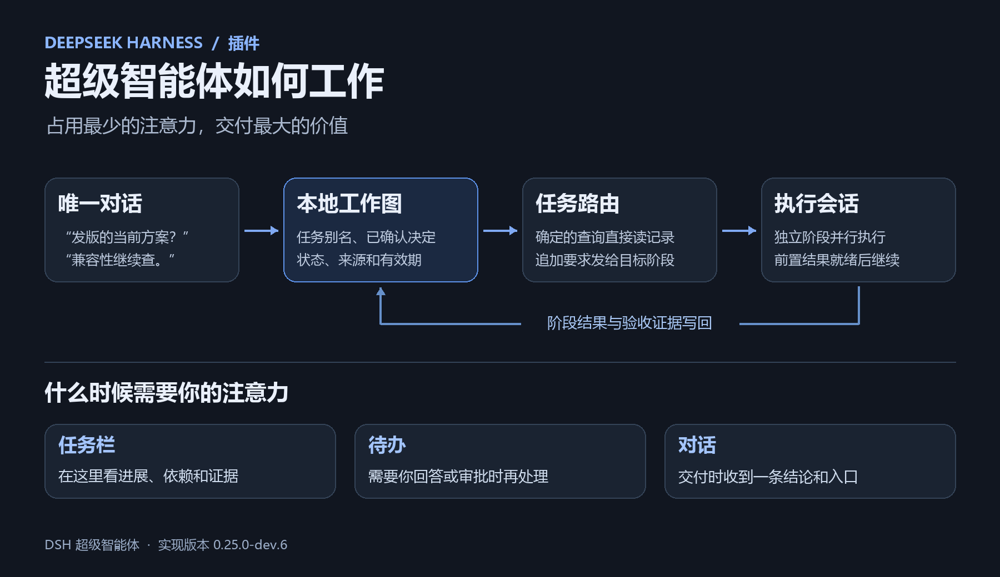

# DSH 超级智能体桌面上手

本页适用于包含「工作上下文」的 Windows DSH 桌面插件。公开发布的 `0.24.0` 早于本文的别名、决定和查询功能。



## 准备示例工作区

准备一个文件夹，放一份 `release-checklist.md`，写明发布范围、灰度比例和回滚步骤。在 DSH 侧边栏打开「超级智能体」，从输入框旁的工作区菜单选择「输入路径」，添加并选中该文件夹。派发任务需要配置可用的模型和控制台端口 `consolePort`。

## 交办发布评审

在同一个输入框发送这项任务。

```text
核对当前工作区 release-checklist.md 的发布范围、灰度比例和回滚步骤。先评审清单，再做兼容性验证，覆盖上一个稳定版本直接升级。
```

任务出现在顶部的「任务」列表。阶段拆分和名称由模型生成，下面的「发布评审」和「兼容性验证」是演示名称。

1. **加别名。** 展开任务卡，点「加别名」，在预填模板的 `|` 后输入「发版」再发送。也可以在输入框说「把发布评审叫做发版」，使用卡片上的实际标题。在别名末尾加 `| 7天` 可设置有效期。
2. **记决定。** 已确认灰度方案后，在任务卡点「记决定」，补齐主题和内容后发送。等价的命令是 `/决定 发版 | 发布方案 | 先灰度 10%，观察 24 小时再全量`。在「待办」回答任务问题也会留下确认记录。
3. **重启后查方案。** 重开 DSH，回到该工作区，发送 `/方案 发版`。有效别名会直接读出关联的决定。用 `/状态 发版` 查进度。
4. **给一个阶段补充要求。** 对仍可接收要求的「兼容性验证」阶段点「补充阶段要求」，发送「覆盖上一个稳定版本的直接升级，失败时给出回滚步骤」。还没开始的阶段会在派发时收到，任务卡的「补充记录」可查接收范围。

## 看决定、待办和证据

- **工作上下文**在任务卡内列出当前别名和决定，标出来源、确认日期和有效期。有草稿或正在补充要求时，记录入口会先提示。
- **待办**汇集需要回答或审批的问题。根据卡片提示选择选项或提交回答。
- **验收证据**在有验收记录的执行详情中展示检查结果。可以在同一处打开已经交付的文件。演示中的问题、产物和验收结果取决于所选模型及实际执行。
